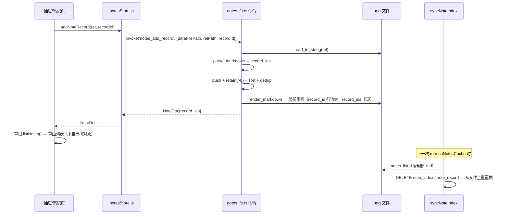
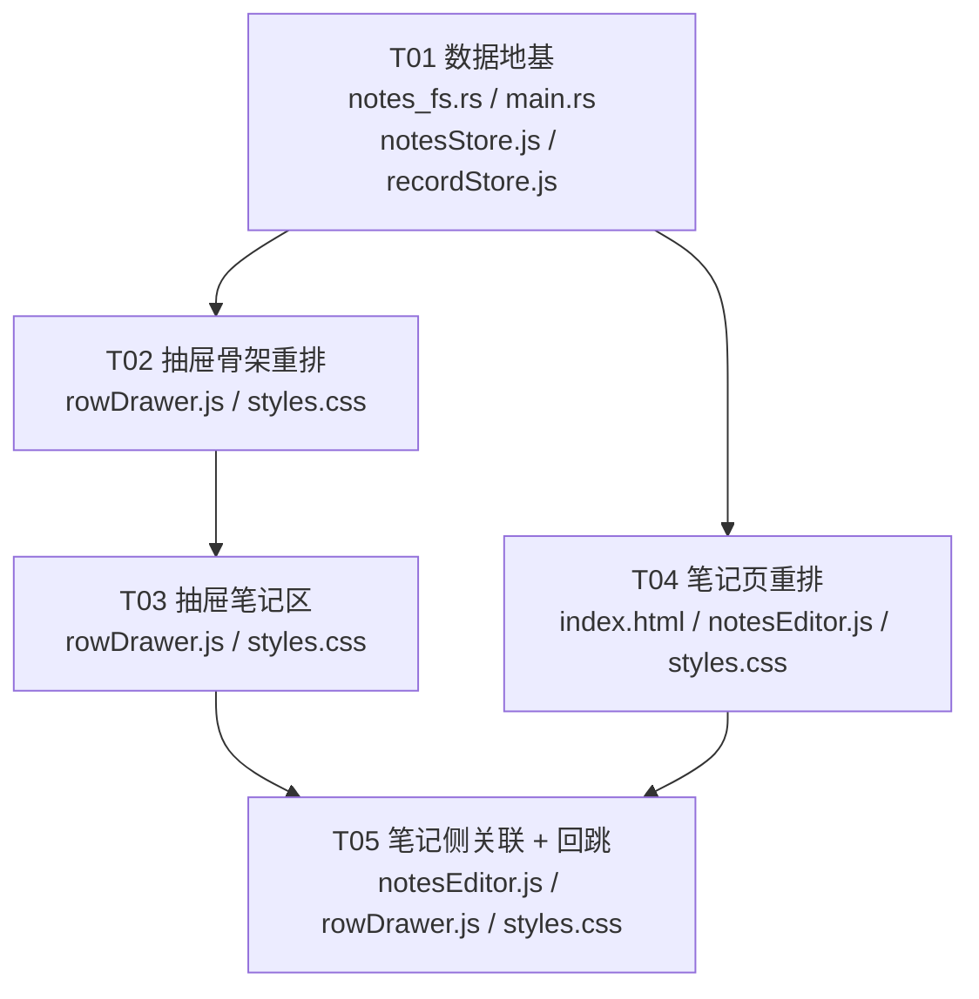

# WorkRecorder v1.2 增量架构设计（笔记 ↔ 记录多对多 / 记录详情抽屉 / 笔记页）

> 输入基线：`docs/prd-v1.2.md`（R01–R16 + QA 11 条）、`docs/system_design.md` §9 与 T06–T10、以及本轮真实读过的源码。
> 本文所有「现状是怎样」的判断都带文件行号，可逐条核对；**没有任何一条来自 PRD 转述**。
> 本文只描述设计与实施，不改任何源码。不含新依赖，不含新框架，不重建视图与触发器。

---

## 一、总体方案

本轮把三件事一次性改完，但不推倒任何一层：**关联的真相从「一个 id」变成「一组 id 且写在文件里」**（`src-tauri/src/notes_fs.rs` 的 `NoteDoc` 加 `record_ids: Vec<i64>`、解析器加一行合并逻辑、新增三个只改 front-matter 的命令）；**在这之上重建记录详情抽屉的信息顺序**（只改 `src/rowDrawer.js` 的内部结构与 `src/styles.css` 末尾追加「设计层 9」，`sheetPanels.openDrawer` 一行不动——它提供的 title/subtitle/width/footer 恰好够用）；**再把笔记页压成「打开就写」**（`src/index.html` 的 `#subview-notes` 换骨架 + `src/notesEditor.js` 跟着换绑定）。数据侧只加一张可随时 `DROP` 的派生表 `note_record` 与 v12 迁移，**不碰 `record` 表、不碰 `logs`/`todos`/`sheet_row` 三个视图与六个触发器**——它们是同名可写视图，靠 `INSTEAD OF` 触发器全列覆写转译（`main.rs:519-524` 的注释就是上一轮的教训），扩列漏一列会静默抹数据，本轮没有任何理由去动它。

为什么这样切：用户抱怨的三件事（信息太散 / 步骤多 / 字小挤）中，只有「信息散」需要改数据口径（笔记挂多记录），另两件纯粹是 DOM 顺序与字号问题。把它们混在一个改动里，一旦抽屉打不开就无法判断是关联逻辑坏了还是样式坏了。所以 T01（数据）与 T02–T05（界面）在文件层面几乎不重叠，只有 `rowDrawer.js` 与 `notesEditor.js` 内部按功能区依次推进。

---

## 二、数据层

### 2.1 front-matter 新格式：**逗号串 `record_ids: 12,13`**（不是 YAML 列表）

**决定**：写入形如
```yaml
---
id: 7
record_ids: 12,13
title: 3 号机组温差复盘
...
---
```
（`id` 之后、`title` 之前；无关联时**整行不写**，不许写 `record_ids:` 空行。）

**理由（决定性的一条是解析器）**：`notes_fs.rs:306-339` 的 front-matter 解析是**手写逐行 `line.find(':')`**，不是 YAML 库。这带来两个硬约束：

| 候选格式 | 现有解析器读得出来吗 | 结论 |
|---|---|---|
| `record_ids: 12,13` | 能。`find(':')` → value = `"12,13"`，加一个 `match` 分支 `split(',')` 即可 | ✅ **采用** |
| `record_ids: [12, 13]`（flow list） | 能。value = `"[12, 13]"`，剥括号即可 | 读时顺带兼容（见下） |
| YAML 块列表 `record_ids:\n  - 12\n  - 13` | **不能**。`record_ids:` 冒号后为空 → `parse::<i64>()` 失败得 `None`；`- 12` 行 `find(':')` 返回 `None` → `continue` 直接跳过 | ❌ 禁止 |

如果选了块列表，会得到一个**应用自己写得出来、自己读不回来**的格式：第一次保存后所有关联在下次读盘时全部消失，而文件内容看起来完全正常——这正是 §9 与 R08 反复警告的那一类「静默丢数据」。所以不选。

另外两条次要理由：
- 逗号串只含数字与逗号，**不触发 `escape_yaml_value`（`notes_fs.rs:190-206`）的引号分支**（它只在值含 `:` `#` `"` `'` 或首尾空格时才加引号）。少一条会被引号搞坏的路。
- 单行，Git diff 干净（R07 的用户故事就是「用 Typora / 资源管理器管文件」，块列表每人缩进不同会产生无意义 diff）。

**读时的宽容度**（多写 4 行代码，换手写文件不炸）：
```rust
/// 解析 "12,13" / "12, 13" / "[12, 13]" / "[12,13]" / " 12 " 全部接受，
/// 非数字片段与 <=0 的值一律丢弃（手写出 `record_ids: 12, 待定` 时退化为只有 12）。
fn parse_id_list(raw: &str) -> Vec<i64> {
    raw.trim()
        .trim_start_matches('[')
        .trim_end_matches(']')
        .split(|c: char| c == ',' || c.is_ascii_whitespace())
        .filter_map(|part| part.trim().trim_matches(|c| c == '"' || c == '\'').parse::<i64>().ok())
        .filter(|id| *id > 0)
        .collect()
}
```

### 2.2 向后兼容：旧 `record_id: 12` 怎么读、怎么迁移、同时存在时谁优先

**`NoteDoc` 字段（`notes_fs.rs:19-52`）新增两个成员，一个语义一个兼容**：
```rust
/// 关联的 record id 集合（新口径）。文件里写成 `record_ids: 12,13`。
/// 空 = 独立笔记。这是**内存里的唯一表示**，任何读路径都以它为准。
#[serde(default)]
pub record_ids: Vec<i64>,

/// 旧口径单值，**只读兼容字段**：解析时并进 record_ids；写入时永不输出。
/// 保留它只为一个用途 —— 让 v1.1 前端（回滚场景）继续能收到 record_id。
#[serde(default)]
pub record_id: Option<i64>,
```

**读（兼容）**：`parse_markdown` 里 `record_id` 不再直接写进 `doc`，而是先攒在局部变量，循环结束后统一裁决。必须两段式——文件里 `record_id` 可能出现在 `record_ids` **之前**，边读边定会误判：

```rust
let mut legacy_single: Option<i64> = None;
let mut saw_multi = false;
for line in front_matter.split('\n') {
    let Some(colon) = line.find(':') else { continue };
    let key = line[..colon].trim();
    let value = unquote_yaml_value(&line[colon + 1..]);
    match key {
        // ... 其余分支不变 ...
        "record_ids" => { doc.record_ids = parse_id_list(&value); saw_multi = true; }
        "record_id"  => { legacy_single = value.parse::<i64>().ok(); }   // 不再直接写 doc
        _ => {}
    }
}
// 只有**完全没有** record_ids 这一行时，旧单值才生效。
if !saw_multi {
    if let Some(id) = legacy_single { if id > 0 { doc.record_ids.push(id); } }
}
doc.record_ids.sort_unstable();
doc.record_ids.dedup();
doc.record_ids.retain(|id| *id > 0);
doc.record_id = doc.record_ids.first().copied();   // 兼容投影，供 v1.1 前端读
```

**两个键同时存在时谁优先：`record_ids` 赢，`record_id` 整行忽略（不求并集），并写一条 `logToFile('warn', ...)`。**

求并集看着更「不丢数据」，但它引入一个更坏的语义：**删不掉的关联**。用户在笔记页点 × 把 #12 摘掉 → 写回 `record_ids: 13`，可文件里那行 `record_id: 12` 还在 → 下次读盘又被并回来 → 12 复活。用户点五次 ×、五次都「成功了」、关联还在，这比丢一条关联更伤信任（§9.3 的信任危机就是这么来的）。而「两个键同时存在」只可能来自**手写**：`render_markdown` 是整份重写 front-matter，新代码一旦保存过这份文件，`record_id` 那一行就不存在了。

**迁移策略：延迟迁移，第一次写盘即完成，不需要一次性脚本。**
- `render_markdown`（`notes_fs.rs:219-262`）把原来的 `if let Some(record_id) = doc.record_id { ... }` 整段**替换**为：
  ```rust
  // 只写有值的记录：独立笔记不产生这一行。
  // 注意这里只输出 record_ids，**永不输出 record_id** —— 旧文件在第一次保存时
  // 自动完成迁移，不需要单独的 migrate 命令（也没法保证用户会去点它）。
  if !doc.record_ids.is_empty() {
      let list = doc.record_ids.iter().map(|i| i.to_string()).collect::<Vec<_>>().join(",");
      out.push_str(&format!("record_ids: {}\n", list));
  }
  ```
- 覆盖到的写入路径：`notes_write` / `notes_update_meta` / 三个关联命令 / `notes_migrate_legacy`（走 `write_note_doc` → `render_markdown`），**全部同一处**，不存在漏网。
- 旧文件在只读路径（`notes_list` / `notes_read`）上靠上面的合并逻辑照常显示关联，所以 **QA #1「旧文件无需手工迁移」成立**。

**`notes_update_meta` 的关联语义（`notes_fs.rs:589-593` 原注释要改写）**：
```rust
// 关联一律走 record_ids，规则与 title 相同：**非空才覆盖**。
// 空 Vec 表示「调用方不想改关联」，不是「清空关联」——清空必须走 notes_set_records。
// 旧字段 record_id 在这里被忽略（它的语义已被 add/remove 覆盖，且区分不了「没传」和「清空」）。
if !doc.record_ids.is_empty() {
    parsed.record_ids = doc.record_ids.clone();
}
```

### 2.3 索引表 `note_record` + v12 迁移

**建表 SQL**（写进 `main.rs` v12 段）：
```sql
CREATE TABLE IF NOT EXISTS note_record (
  rel_path  TEXT    NOT NULL,
  record_id INTEGER NOT NULL,
  PRIMARY KEY (rel_path, record_id)
) WITHOUT ROWID;

CREATE INDEX IF NOT EXISTS idx_note_record_record ON note_record(record_id);
```

**为什么主键是 `(rel_path, record_id)` 复合 + `WITHOUT ROWID`**：
1. 复合主键让「同一篇笔记重复挂同一条记录」在**数据库层**就不可能发生——`INSERT OR IGNORE` 天然幂等，不需要前端去重后再写（前端也去重，双保险）。
2. 全量重建是 `DELETE FROM note_record` + 批量 `INSERT`，没有 AUTOINCREMENT 就不会有 rowid 空洞累积。
3. `WITHOUT ROWID` 让主键索引本身就是表（一篇笔记挂 3 条记录只占 3 条索引项），个人量级（≤ 几千行）不需要额外堆结构。
4. `idx_note_record_record` 是**反向**查询用的（「#37 被哪些笔记引用」），这是记录被删时算影响面的唯一低代价路径。

**v12 迁移完整内容**（`main.rs` 里 v11 段之后，`schema_version < 12` 判断）：
```rust
// v12：笔记 ↔ 记录改为多对多。**只加一张派生表，一个字符都不碰 record / 视图 / 触发器。**
//
// 这张表不是真相：真相在 .md 的 front-matter 里（record_ids）。表随时可以
// DROP TABLE 重建，重建的输入永远是文件（notes_list）。所以要保证的是
// 「重建得回来」，而不是「写进去不丢」。
if schema_version < 12 {
    conn.execute_batch(
        "CREATE TABLE IF NOT EXISTS note_record (
             rel_path  TEXT    NOT NULL,
             record_id INTEGER NOT NULL,
             PRIMARY KEY (rel_path, record_id)
         ) WITHOUT ROWID;
         CREATE INDEX IF NOT EXISTS idx_note_record_record ON note_record(record_id);",
    )
    .map_err(|e| format!("创建 note_record 失败: {}", e))?;

    // 把 v11 的 note_index.record_id 搬成关联行。
    // typeof() 那个条件是必须的：历史上 params.map(String) 把 null 写成了字符串
    // 'null'（notesStore.js:292-295 的注释记着这个坑），存成 TEXT 的幽灵值
    // 会让「已关联但查不到」的条目永远清不掉。
    conn.execute_batch(
        "INSERT OR IGNORE INTO note_record (rel_path, record_id)
           SELECT rel_path, record_id FROM note_index
            WHERE record_id IS NOT NULL
              AND typeof(record_id) = 'integer'
              AND record_id > 0;",
    )
    .map_err(|e| format!("搬迁 note_index.record_id 失败: {}", e))?;

    conn.execute_batch("PRAGMA user_version = 12;")
        .map_err(|e| format!("数据库升级到 v12 失败: {}", e))?;
}
```

**幂等性**：`CREATE TABLE IF NOT EXISTS` + `CREATE INDEX IF NOT EXISTS` + `INSERT OR IGNORE` + `PRAGMA user_version` 的 `if schema_version < 12` 守卫，四条一起保证重跑无副作用。单测按 v11 的写法把版本号退回 11 再跑一次（`main.rs:1403-1425` 已有现成范式），断言：①`user_version`=12；②`note_record` 与两个索引存在；③`sqlite_master` 里 `type IN ('view','trigger')` 的 SQL 与迁移前**逐字相同**；④搬迁行的 `typeof(record_id)` 全是 `'integer'`。

**为什么重建时不会丢关联**（这是本节最要紧的一段，写清因果链）：
1. 重建的**输入**是 `notes_list` 的返回值，而 `notes_list`（`notes_fs.rs:401-467`）是扫盘读 `.md`、`parse_markdown` 出来的 → 输入来自文件。
2. 重建的**输出**只有 `note_index` 与 `note_record` 两张**派生表**，`DELETE`+`INSERT` 只作用于它们。
3. 关联的**写入**路径只有 `notes_add_record` / `notes_remove_record` / `notes_set_records` 三个命令，它们的终点都是 `notes_write` → `render_markdown` → 写文件。
4. **显示**（记录侧笔记区、笔记页 chips）只读 `listNotes()` 的结果，从不读 `note_record`。

这四条合起来意味着：`note_record` 被清空、被清一半、被 DROP，用户看不到任何差异；下一次全量同步从文件把行补齐。**「文件里有、索引里没有」可以存在且无害；「索引里有、文件里没有」会在下次同步被纠正。** 反过来，唯一会真的丢关联的操作是**在内存里构造一个 `record_ids: []` 的 doc 然后调 `notes_write`**——见 §2.5 不变式 1。

**`note_index.record_id` 的去留**：列保留、索引保留（回滚用），语义降级为**兼容投影**：写入 `record_ids[0]`（最小 id），为空时写 SQL 字面量 `NULL`。这样即使回滚到 v1.1 的 `rowDrawer`，每篇笔记仍能看到它的第一条关联，而不是全空。

### 2.4 Rust 命令签名

三个新命令 + 一个保留的旧命令。全部放在 `notes_fs.rs`，全部注册进 `main.rs:1051-1072` 的 `generate_handler!`。

```rust
/// 给笔记追加一条关联。**幂等**：已存在则原样返回，不报错、不重复写。
#[tauri::command]
pub async fn notes_add_record(
    data_file_path: String,
    rel_path: String,
    record_id: i64,
) -> Result<NoteDoc, String>

/// 解除一条关联。**幂等**：本来就没有则原样返回。
/// 只改 front-matter，**永远不删笔记文件**（文件是独立存在的，解除只是少一行元数据）。
#[tauri::command]
pub async fn notes_remove_record(
    data_file_path: String,
    rel_path: String,
    record_id: i64,
) -> Result<NoteDoc, String>

/// 整组替换。空数组 = 显式清空（这是**唯一**能把关联清成 0 的入口）。
#[tauri::command]
pub async fn notes_set_records(
    data_file_path: String,
    rel_path: String,
    record_ids: Vec<i64>,
) -> Result<NoteDoc, String>

/// 【保留，语义收窄】设置或解除**单值**关联。
/// v1.1 的两个调用点（notesStore.setNoteRecord → 抽屉的挂上/解除）继续可用：
/// Some(id) 等价于 notes_set_records([id])，None 等价于 notes_set_records([])。
/// 新代码不要用它 —— 它会把已有的其它关联一起清掉，那正是 R01 要消灭的语义。
#[tauri::command]
pub async fn notes_set_record(
    data_file_path: String,
    rel_path: String,
    record_id: Option<i64>,
) -> Result<NoteDoc, String>
```

**为什么是三个命令而不是一个带 `Option<Vec<i64>>` 的**：与 `notes_fs.rs:599-604` 保留 `notes_set_record` 的理由完全相同，而且更硬——`Option<T>` 在 serde 下**区分不了「调用方没传」和「调用方要清空」**，只有靠 double-option 技巧（`Option<Option<T>>` + `deserialize_with`）才能区分，那条路一旦有人改成 `#[serde(default)]` 就静默退化成「清空」。拆成三个之后每个命令的语义都只有一个：
- `add(id)` → 并集里加一个
- `remove(id)` → 并集里减一个
- `set(ids)` → 整组替换（`[]` 就是清空）

这也正好一一对应 UI 的三个动作（挂一篇 / 解一条 / chip 批量改），工程师不需要在调用点做任何猜测。

**共享实现（三个命令都走它，避免三份 mutate 逻辑分叉）**：
```rust
/// 读文件 → 解析 → 改 record_ids → 写回。唯一改关联的内部入口。
fn mutate_records(
    data_file_path: &str,
    rel_path: &str,
    f: impl FnOnce(&mut Vec<i64>),
) -> Result<NoteDoc, String> {
    if rel_path.trim().is_empty() {
        return Err("笔记路径为空".to_string());
    }
    let root = notes_root(data_file_path);
    let existing = safe_join(&root, rel_path)?;           // 复用 notes_fs.rs:164-188
    let text = fs::read_to_string(&existing)
        .map_err(|e| format!("读取笔记失败 {}: {}", rel_path, e))?;
    let file_name = existing.file_name()
        .map(|n| n.to_string_lossy().to_string()).unwrap_or_default();
    let mut parsed = parse_markdown(&text, &title_from_file_name(&file_name));
    let mut ids = parsed.record_ids.clone();
    f(&mut ids);
    ids.retain(|id| *id > 0);
    ids.sort_unstable();
    ids.dedup();
    parsed.record_ids = ids;
    parsed.rel_path = rel_path.to_string();
    notes_write(data_file_path.to_string(), parsed).await      // 走同一条写盘路径
}
```
命令体各三行：
```rust
pub async fn notes_add_record(data_file_path: String, rel_path: String, record_id: i64)
    -> Result<NoteDoc, String> {
    if record_id <= 0 { return Err(format!("record_id 非法: {}", record_id)); }
    mutate_records(&data_file_path, &rel_path, |ids| ids.push(record_id)).await
}
pub async fn notes_remove_record(...) -> Result<NoteDoc, String> {
    mutate_records(&data_file_path, &rel_path, |ids| ids.retain(|id| *id != record_id)).await
}
pub async fn notes_set_records(data_file_path: String, rel_path: String, record_ids: Vec<i64>)
    -> Result<NoteDoc, String> {
    mutate_records(&data_file_path, &rel_path, |ids| { ids.clear(); ids.extend(record_ids); }).await
}
```

**错误语义（三个命令一致）**：

| 情况 | 返回 | 前端表现 |
|---|---|---|
| `rel_path` 空 / 含 `..` / 越出 notes 根 | `Err("笔记路径不合法: …")`（来自 `safe_join`） | throw → 提示条 + `logToFile('error')`，**不改 UI 列表** |
| 笔记文件不存在（已被 Typora 删掉） | `Err("读取笔记失败 <rel>: No such file …")` | 同上；提示「笔记文件已不在磁盘，刷新列表」 |
| `record_id <= 0` | `Err("record_id 非法: …")` | 不该发生（前端已 normalize），走到这里说明有 bug，记日志 |
| 写盘失败（磁盘满 / 文件被占用） | `Err("写入笔记失败 …")` | 同上，保留原列表不动 |
| **`record_id` 指向的记录不存在** | **`Ok`**（不校验、不报错） | 正常挂上。记录可能已删（R06 要求保留悬空 id 并显示灰色占位），把校验放在这里会让「先删记录后挂笔记」这种操作直接失败 |

**注意**：`record_id` 的类型是 `i64` 不是 `Option<i64>`/`String`，因为 Tauri 2 会按参数名注入、不做 `map(String)`；这是唯一能避免 §2.5 不变式 5 那类 `'null'` 幽灵的地方。

### 2.5 关键不变式（写清哪些做法会静默丢数据）

**不变式 1（最危险）· `notes_write` 是整份覆盖，`notes_update_meta` 是非空才覆盖。**
`notesEditor.saveCurrentNote`（`notesEditor.js:359-370`）手工拼 payload，**当前不含 `record_ids`**。如果不在那里补 `record_ids: state.doc.record_ids`，那么**每一次自动保存（1.2s 一次）都会把所有关联清空**——文件里 front-matter 变成没有 `record_ids` 行，而界面上什么都不报。这是本轮最容易翻车的一条，必须写成代码注释 + 一次性验证：
```js
// saveCurrentNote 的 payload 里必须带 record_ids：
// writeNote → notes_write 是**整份覆盖**（render_markdown 从 doc 重建全部 front-matter），
// 漏传 record_ids 等于每次自动保存都把关联清空，而且零报错。
record_ids: normalizeRecordIds(state.doc.record_ids),
```
反向的坑：`updateNoteMeta`（`notesStore.js:176-200`）走的 `notes_update_meta` 是「非空才覆盖」，所以**改标题/分类时传 `record_ids: []` 是安全的**（表示不动关联）。两条语义不能混：整份覆盖的路径必须带全，增量覆盖的路径必须不带。

**不变式 2 · `params.map(String)` 把 `null` 变成字符串 `'null'`（`data.js:11/24/37/43`）。**
`note_record.record_id` 是 `NOT NULL INTEGER`，所以：
- **禁止** 任何把可空值写进 `note_record` 的代码。`note_record` 只接受「确定的、>0 的 id」，没有任何一处该传 `null`。
- 需要写 `NULL` 的地方（`note_index.record_id` 的兼容投影）必须用 **SQL 字面量**，沿用 `notesStore.js:307-312` 现有的三段式写法，不许把 `null` 放进 `params`。
- 自检 SQL（每次迁移后跑）：
  ```sql
  SELECT COUNT(*) FROM note_index WHERE typeof(record_id) NOT IN ('null','integer');  -- 必须 0
  SELECT COUNT(*) FROM note_record WHERE record_id <= 0;                              -- 必须 0
  ```

**不变式 3 · `Option<i64>` 区分不了「没传」和「清空」。**
所以：`notes_set_record(record_id: Option<i64>)` 看起来能表达「解除」，但**同一个签名放在 `notes_update_meta` 里就分不清**（`notes_fs.rs:589-590` 的注释就是为这个）。规则：
- 改关联**只准**走 `add` / `remove` / `set_records` 三个命令；
- `notes_update_meta` 里**不许**再出现任何写 `record_id` 的代码；
- 新旧调用点排查：`grep -n "notes_set_record\|updateNoteMeta" src/*.js` 必须只剩签名保留处的封装。

**不变式 4 · 数组在 JS 与 Rust 之间是「JSON number 数组」，不是字符串。**
`NoteDoc.record_ids: Vec<i64>` 经 serde 序列化成 `[12, 13]`。前端拿到的是 **number**，所以：
- 比较用 `Number`，`normalizeRecordIds` 统一收口（见下），不许各处 `String(id)` 对比——`String('12') === String(12)` 在 `' 12'` 这类脏值下会假阴性。
- `ctx.recordId` 来自 `toId()`（`recordTree.js:23-27`，返回 number），`ids.includes(ctx.recordId)` 才是对的类型。

**不变式 5 · 前端唯一收口函数（放 `notesStore.js` 并导出，`rowDrawer` / `notesEditor` 都用它）**：
```js
/**
 * 把任意来源的关联值收成一个干净的正整数数组（去重、升序）。
 *
 * 必须收口的原因：'null' / 空串 / 0 / NaN / '12abc' 这几种脏值都能从
 * 旧数据、手写 front-matter、上一版的 map(String) 里漏下来。任何一处
 * 漏过滤，就会出现「笔记上显示挂了 #37，记录 #37 的抽屉里看不到」这种
 * 单侧可见的幽灵关联（R08 最后一条判据专门验收它）。
 */
export function normalizeRecordIds(value) {
  const raw = Array.isArray(value) ? value : value == null || value === '' ? [] : [value];
  const out = [];
  for (const item of raw) {
    const num = Number(item);           // Number('null') = NaN → 被下面挡掉
    if (!Number.isFinite(num)) continue;
    const id = Math.trunc(num);
    if (id <= 0) continue;
    if (!out.includes(id)) out.push(id);
  }
  return out.sort((a, b) => a - b);
}
```

**不变式 6 · 删记录不清理 front-matter。** 记录被删后笔记里的 id 必须留着（R06），所以任何「删记录时顺带清关联」的代码都不许写。清理是一个显式的 P2 入口（PRD Q4），本期不做。

**不变式 7 · `note_record` 是派生表，任何代码都不许把它的内容当真相读回来判断「有没有关联」。** 判断关联只读 `listNotes()` 的 `record_ids`。

**关联写入的完整调用链（时序，供工程师对账）**：



**给前端补的三个封装（`notesStore.js`，与 `setNoteRecord` 并列）**：
```js
export async function addNoteRecord(relPath, recordId)      // → notes_add_record
export async function removeNoteRecord(relPath, recordId)   // → notes_remove_record
export async function setNoteRecords(relPath, recordIds)    // → notes_set_records
```
三个都沿用 `setNoteRecord`（`notesStore.js:214-231`）的错误处理：`Number()` 收口、失败 `throw`（不吞），因为关联失败必须让 UI 停手。

**`syncNoteIndex` 改造（`notesStore.js:284-319`）**，关键是参数顺序不能错：
```js
export async function syncNoteIndex(notes, dbExecute) {
  if (!Array.isArray(notes) || typeof dbExecute !== 'function') return;
  try {
    await dbExecute('DELETE FROM note_index', []);
    await dbExecute('DELETE FROM note_record', []);

    for (const note of notes) {
      const rel = String(note?.rel_path || '');
      if (!rel) continue;
      const ids = normalizeRecordIds(note?.record_ids);
      const linked = ids.length > 0;

      // note_index.record_id 降级为「第一条关联」的兼容投影（回滚到 v1.1 仍能看到一条）。
      // ⚠️ 可空列必须走 SQL 字面量 NULL：dbExecute 会把 params 统一 String()，
      //    传 null 落库是字符串 'null' —— 那样「已关联但查不到」的幽灵值永远清不掉。
      const params = [
        rel,
        note.title || '',
        note.note_type || 'idea',
        note.status || 'usable',
        note.tag || '',
        note.sub_tag || '',
      ];
      if (linked) params.push(ids[0]);
      params.push(note.created_at || '', note.updated_at || '');

      await dbExecute(
        `INSERT OR REPLACE INTO note_index
         (rel_path, title, note_type, status, tag, sub_tag, record_id, created_at, updated_at)
         VALUES (?, ?, ?, ?, ?, ?, ${linked ? '?' : 'NULL'}, ?, ?)`,
        params
      );

      if (linked) {
        // 一篇一条多值 INSERT，把 IPC 次数压到「1 + 篇数」而不是「1 + 关联数」
        const placeholders = ids.map(() => '(?, ?)').join(', ');
        const values = ids.flatMap(id => [rel, id]);
        await dbExecute(
          `INSERT OR IGNORE INTO note_record (rel_path, record_id) VALUES ${placeholders}`,
          values
        );
      }
    }
  } catch (error) {
    logToFile('warn', `笔记索引同步失败（不影响笔记本身）: ${error?.stack || error}`);
  }
}
```

**`stop 位`**：`note_record` 中途只写了一半是可接受的（下一次同步自愈，从文件重建）。上面把「先算后写」做到底（`notes` 已经在数据库之外算好），唯一可能半途而废的是 `dbExecute` 抛错，此时 `note_record` 不完整但**文件与 `note_index` 都完好**——记录侧显示走 `listNotes()`，用户无感。

### 2.6 记录侧查询用什么 & `note_record` 的三个真实职责

**决策：记录抽屉的笔记区继续用 `listNotes()` 一次调用 + JS 过滤**，不改用 `note_record` 直查。理由三条：
1. PRD QA #11 的判据原文是「`listNotes` 单次调用完成，无 N+1」——这句本身就把调用方式定死了；一次扫盘（Rust 内 200 个 `read_to_string`，单次 IPC）比「先查表拿 rel_path，再对每篇 `notes_read`」少 200 次 IPC。
2. 若走 `note_record` 直查，返回的 `rel_path` 在用户用 Typora 移动文件后会**变成过期值**（R07 的场景），要么显示 404 条目，要么再补一次存在性校验——多一次 IO 换不到速度。
3. 抽屉要显示「更新日期 + 一行摘要」（R10），而摘要只在 `NoteDoc.content` 里；`note_index` 没有摘要列，直查仍要回去读文件。

`note_record` 承担三件**真正省事**的事，不要因为它「暂时没被读」就删掉：
- **删记录时算影响面**：`SELECT COUNT(DISTINCT rel_path) FROM note_record WHERE record_id = ?` —— 一条 SQL，不用扫盘。
- **R08 的验收口径**：QA #6「连续两次全量同步，关联总数不变」的断言目标就是 `SELECT COUNT(*) FROM note_record`；每篇集合一致则用 `SELECT record_id FROM note_record WHERE rel_path = ?`。
- **P1/P2 的按记录筛选**（R14/R15）：笔记列表「只看已挂 / 未挂」、搜索结果显示「挂在 #37」都靠它，一次聚合查询解决。
- 附：笔记数 > 800 时可改走「查表拿 rel_path → 新增 `notes_read_many` 批量读」，本期不实现，只在 `syncNoteIndex` 上方留注释。

---

## 三、UI 结构设计（写给工程师照做）

### 3.1 记录详情抽屉 · 自上而下区块顺序表

容器是 `openDrawer` 给的 `.sh-drawer`（`sheetPanels.js:99-144`）：`.sh-drawer-head` 固定、`.sh-drawer-body` 滚动（`overflow:auto`）、`.sh-drawer-foot` 固定。
按 `1360×860` 计算可用高度：`860 − head(76) − footer(55) = 729`，`body` 内边距 `20+24` → **内容区 685px**。

| # | 区块 | 常显 | 默认 | 高度预算 @1360×860 | 备注 |
|---|---|---|---|---|---|
| 0 | `.sh-drawer-head`：kicker + 标题（可点改）+ 关闭 × | 是 | — | 76（固定，设计稿「记录 03 / 24」形态） | kicker 文案仍由调用方的 `subtitle` 决定（`sheetPage.openDetail` 传「表名 · 第 x / y 条」） |
| 1 | `.rd-hint` 操作提示条 | 否 | 隐藏 | 0 / 34 临时 | 已有（`rowDrawer.js:181`），不动 |
| 2 | `.rd-meta-line` 元信息行 | 有内容才显 | 展开 | 22 | 面包屑 + 状态 chip + 日期，**一行**，替代原来独立的 `.rd-crumbs` 块（26px）|
| 3 | 正文 `.rd-body` | 是 | 展开，**不折叠** | 空态 44 / 单段 ≈ 82 / 长文 n×27 | 由原第 6 位提到第 2 位 |
| 4 | 字段 `.rd-fields`（两列网格） | 有可见字段才显 | 展开，**无折叠、不隐藏任何字段** | 6 字段 = 3 行 × 28 = **84** | 原 6 行 ≈ 270 |
| 5 | 笔记 `.rd-block[data-section=notes]` | 是 | 展开 | 空 46 / 3 篇 ≈ 18+3×46 = 156 | 区标题带计数 |
| 6 | 结构 `[data-section=structure]`（子项 + 挂载的表合并） | 两者皆空则整块不出现 | **收起** | 收起 30 / 展开 30+子项+卡片 | 原 子项 4 项 ≈ 140 + 表卡片 ≈ 90 |
| 7 | 被引用于 `[data-section=backlinks]` | **仅非空** | 展开 | 0 / 18+n×30 | 默认 `hidden`（原为常显「暂无引用」）|
| 8 | footer：左「最后编辑 10 分钟前」/ 右「⋯ · 上一条 / 下一条」 | 是 | — | 55（固定） | 删除记录与 4 个兼容动作收进「⋯」 |

**首屏核算（6 字段 + 4 子项 + 1 表 + 3 篇笔记，最坏情况）**：
`76(head) + 22 + 14 + 82 + 15 + 84 + 15 + 156 + 15 + 30 = 509` ≤ 685，**余 176px**；
正文首行落在 `body` 内 y≈36（head 76 + meta 22 + 间距 14），远在折叠线（685）以上 → **R04 判据 1 达成**，且 3 篇笔记也在首屏。原来第 3 个字段就掉到 500px 的位置，正文完全在折叠线下（见 `_debug/shots/drawer-row.png`）。

**为什么正文不设「约 6 行 + 展开全文」**（PRD §4.1 第 3 条要求折叠，这里明确不做）：
PRD 自己在同一节的「编辑与查看如何切换」里写着「查看态就是完整的：正文全文可读（长文只是折叠，不是隐藏）」——折叠就是隐藏，两句互相矛盾。而且用户的抱怨是「找不到重点」，不是「正文太长」；正文已经在第 2 位，6 行截断只会多出一次点击，还把「读完结论」变成两次操作。**复核信号**：如果实际使用中正文经常超过 400 字、把字段区挤到必须滚动，再加 `max-height: 40vh` + 渐隐（记入 §七 复核清单，不在本期）。

### 3.2 DOM 骨架

沿用 `rd-*` 前缀，**不新开前缀**。理由：`rowDrawer.js` 是唯一生产者，`styles.css` 的设计层 8（14389–15183）已经把这套前缀的语义、`!important` 策略、主题取色规则都定好了；换前缀等于把 8.10 那套「顶回全局 button」的结论重抄一遍，还会让「哪些规则属于抽屉」变得不可 grep。

```html
<aside class="sh-drawer" style="width:652px">              <!-- openDrawer 建，不改 -->
  <header class="sh-drawer-head">
    <div class="sh-drawer-titles">
      <div class="sh-drawer-kicker">主设备诊断台账 · 第 4 / 18 条</div>
      <h2 class="sh-drawer-title rd-title">2 号机组前置泵驱动端轴承</h2>
    </div>
    <button type="button" class="sh-icon-btn" data-close aria-label="关闭">…</button>
  </header>

  <div class="sh-drawer-body">
    <div class="rd">
      <div class="rd-hint" data-section="hint" hidden></div>

      <!-- ① 元信息行：一行装完面包屑 + 状态 + 日期 -->
      <div class="rd-meta-line" data-section="meta" hidden>
        <nav class="rd-crumbs" data-list="crumbs" aria-label="上级路径"></nav>
        <span class="rd-status-chip" data-status-chip hidden></span>
        <span class="rd-meta-when" data-meta-when hidden></span>
      </div>

      <!-- ② 正文：无 h3 标题（它就在页面第二行，标题纯占位） -->
      <section class="rd-body-block" data-section="body">
        <div class="rd-body markdown-body" data-body></div>
      </section>

      <!-- ③ 字段：.sh-detail 变两列网格，DOM 结构完全不动 -->
      <div class="rd-block rd-fields" data-section="fields">
        <div class="sh-detail">
          <div class="sh-detail-field">
            <div class="sh-detail-label">状态</div>
            <div class="sh-detail-cell sh-cell" data-key="f_status" data-row="12" tabindex="-1">…</div>
          </div>
          <!-- …每个字段一项，网格自动两列… -->
        </div>
      </div>

      <!-- ④ 笔记 -->
      <section class="rd-block" data-section="notes">
        <h3 class="rd-h">笔记<span class="rd-h-count" data-notes-count>· 0</span></h3>
        <div class="rd-notes" data-notes></div>
        <div class="rd-note-panel" data-notes-panel hidden></div>
        <div class="rd-notes-foot" data-notes-foot hidden>
          <button type="button" class="rd-link-btn" data-note-create>新建笔记</button>
          <button type="button" class="rd-link-btn" data-note-pick-link>挂一篇已有的</button>
        </div>
      </section>

      <!-- ⑤ 结构：子项 + 挂载的表，合成一块，默认收起 -->
      <section class="rd-block" data-section="structure" hidden>
        <div class="rd-struct-head" data-struct-toggle role="button" tabindex="0"
             aria-expanded="false" aria-controls="rd-struct-body">
          <span class="rd-struct-label">结构</span>
          <span class="rd-struct-count" data-struct-count></span>
          <svg class="rd-caret" aria-hidden="true"><use href="#ic-chevron-right"/></svg>
        </div>
        <div class="rd-struct-body" id="rd-struct-body" data-struct-body hidden>
          <div class="rd-sub" data-section="children" hidden>
            <div class="rd-sub-h">子项</div>
            <div class="rd-list" data-list="children"></div>
          </div>
          <div class="rd-sub" data-section="sheets" hidden>
            <div class="rd-sub-h">挂载的表</div>
            <div class="rd-sheets" data-list="sheets"></div>
          </div>
        </div>
      </section>

      <!-- ⑥ 被引用于：仅非空 -->
      <section class="rd-block" data-section="backlinks" hidden>
        <h3 class="rd-h">被引用于</h3>
        <div class="rd-backlinks" data-list="backlinks"></div>
      </section>
    </div>
  </div>

  <footer class="sh-drawer-foot rd-foot">
    <span class="rd-foot-when" data-foot-when></span>
    <span class="rd-foot-gap"></span>
    <button type="button" class="rd-foot-btn" data-more aria-haspopup="menu" aria-expanded="false"
            aria-label="更多操作"><svg class="wr-icon" aria-hidden="true"><use href="#ic-dots"/></svg></button>
    <button type="button" class="rd-foot-btn" data-prev>上一条</button>
    <button type="button" class="rd-foot-btn" data-next>下一条</button>
    <div class="rd-menu" data-more-menu role="menu" hidden>
      <!-- handlers.actions 逐条 → <button class="rd-menu-item" data-action-key="…"> -->
      <!-- 分隔线 .rd-menu-sep -->
      <!-- <button class="rd-menu-item is-danger" data-del>删除记录</button> -->
    </div>
  </footer>
</aside>
```

**`data-*` 契约表**（必须与现有委托方式对齐，否则事件全哑）：

| 属性 | 现有用法 | 本轮变化 |
|---|---|---|
| `data-section="hint\|body\|notes\|children\|sheets\|backlinks\|fields\|meta\|structure"` | `section(ctx, name)`（`rowDrawer.js:1581-1583`）用 `querySelector('[data-section="…"]')` 取区块 | 新增 `meta` / `structure`；`children`/`sheets` 从顶层块降为 `structure` 内部子块（查询逻辑不变） |
| `data-list="children\|sheets\|crumbs\|backlinks"` | `block.querySelector('[data-list="…"]')` 取容器 | 新增 `crumbs`（从 `.rd-crumbs` 自身挪到内部）+ `backlinks` |
| `data-body` / `data-body-edit` | 正文宿主 / 编辑框 | 不变 |
| `data-note-open\|unlink\|create\|pick-link\|pick\|submit\|move\|cancel` | `onBodyClick` 的 8 个分支 | 全部保留，**一个都不改名** |
| `data-note-filter` / `data-note-title` | `onBodyInput` / `onBodyKeydown` | 不变 |
| `data-child-id` / `data-sheet-id` / `data-crumb-id` / `data-action-key` | `onBodyClick` 分支 | 保留；`data-action-key` 的宿主从 `.rd-actions` 里的按钮变成 `.rd-menu` 里的菜单项，**委托仍走 `onBodyClick`？不行** —— 菜单在 footer，不在 `.sh-drawer-body` 里（见 §3.5 事件位置） |
| `data-struct-toggle` / `data-struct-body` | 新增 | 折叠开关 |
| `data-foot-when` / `data-more` / `data-more-menu` / `data-del` / `data-prev` / `data-next` | `bindEvents`（`rowDrawer.js:643-657`）直接在 `drawer` 上 querySelector | 保留 id 名，位置挪到 footer |

### 3.3 字号 / 行距 / 间距尺（纯 px + 令牌名，无「适中」这类词）

在层 9 开头追加一个只含新令牌的 `:root`（不覆盖任何已有令牌）：

```css
:root {
  /* 设计层 9 专用。--rd-* / --nt-* 前缀避免与旧层同名令牌打架。 */
  --rd-gap: 20px;              /* 抽屉区块之间的垂直间距 */
  --rd-gap-tight: 12px;        /* 区块内部小节间距 */
  --rd-fs-body: 15px;          /* 抽屉正文 */
  --rd-lh-body: 1.78;          /* 抽屉正文行距 */
  --rd-fs-label: 12px;         /* 字段 label */
  --rd-row-h: 28px;            /* 字段网格单行高度 */
  --nt-fs-title: 22px;         /* 笔记标题 */
  --nt-fs-body: 15px;          /* 笔记正文（源码与预览同号） */
  --nt-lh-body: 1.9;           /* 笔记正文行距 */
  --nt-measure: 700px;         /* 笔记正文可读宽度上限 */
  --nt-list-w: 210px;          /* 笔记列表固定宽 */
}
```

| 用途 | 字号 | 行距 | 字重 | 颜色令牌 | 现值（对照） |
|---|---|---|---|---|---|
| 抽屉 kicker（记录 03 / 24） | `var(--font-size-xs)` 12px | 1.4 | 500 | `--text-muted` | 10.5px（11556）/ 11px（11873） |
| **抽屉标题** | `var(--font-size-xl)` 20px | 1.32 | 700 | `--text-main` | 16px（11557）/ 18px（11872） |
| 元信息行 / 面包屑 | 12px | 1.4 | 400 | `--text-muted` | 12px（14470） |
| 状态 chip（meta 行内） | 12px | 1 | 500 | `--text-secondary` | 新 |
| 区块标题（`.rd-h`：笔记 / 被引用于） | 12px + `letter-spacing: .02em` | 1.4 | 600 | `--text-muted` | 11px（14435） |
| 字段 label | `var(--rd-fs-label)` 12px | 1.5 | 400 | `--text-muted` | 11.5px（14539）/ 12px（11876） |
| **字段值** | `var(--font-size-md)` 14px | 1.5 | 400 | `--text-main` | 13px（14544）/ 13.5px（11901） |
| **抽屉正文** | `var(--rd-fs-body)` 15px | `var(--rd-lh-body)` 1.78 | 400 | `--text-main` | 13.5px / 1.7（14768） |
| 正文内 h1–h3 | 16px（固定，**不用 em**） | 1.45 | 600 | `--text-main` | 15px（14789） |
| 正文内 h4–h6 | 15px | 1.5 | 600 | `--text-main` | 1.05em = 15.75 |
| 正文段落间距 | — | — | — | — | `.markdown-body p{margin:.85em 0}` = 12.75px @15px，**沿用，不改** |
| 笔记项标题 | `var(--font-size-md)` 14px | 1.45 | 500 | `--text-main` | 13px（14476） |
| 笔记项 meta（日期） | 12px | 1.4 | 400 | `--text-muted` | 11.5px（14733） |
| 笔记项摘要 | `var(--font-size-sm)` 13px | 1.6 | 400 | `--text-secondary` | 新（R10） |
| 空态文字（`.rd-empty`） | 13px | 1.6 | 400 | `--text-muted` | 12px（14444） |
| 结构块折叠头 | 12px | 1.4 | 600 | `--text-muted` | 新 |
| 结构块计数（`4 个子项 · 1 张表`） | 12px | 1.4 | 400 | `--text-muted` | 新 |
| footer 时间 / 按钮 | 12px | 1.4 | 400 / 500 | `--text-muted` / `--text-secondary` | 新 |
| 「⋯」菜单项 | 13px | 1.4 | 400 | `--text-main`；危险项 `--color-danger` | 新 |
| 笔记页「笔记」+「12 篇」 | 18px / 12px | 1.3 | 600 / 400 | `--text-main` / `--text-muted` | 大标题（原 h1 28px） |
| 笔记列表头「全部笔记」 | 12px | 1.4 | 600 | `--text-muted` | 新 |
| **笔记列表项标题** | 14px | 1.45 | 500 | `--text-main` | 13px / 650（9331） |
| 笔记列表项 meta | 12px | 1.4 | 400 | `--text-muted` | 新（替换摘要） |
| **笔记标题** | `var(--nt-fs-title)` 22px | 1.3 | 700 | `--text-main` | 16px（8683） |
| meta chip（复盘 / 产品） | 12px，pill 高 22px | 1 | 500 | `--text-secondary` + `--overlay-hover` 底 | 新 |
| **笔记正文（源码 textarea + 预览）** | `var(--nt-fs-body)` 15px | `var(--nt-lh-body)` 1.9 | 400 | `--text-main` | 14px / 1.6（textareaf 全局，5755） |
| 保存状态小字 | 12px | 1.4 | 400 | `--text-muted`（未保存时 `--color-warning`） | 13px |
| 底部只读（字数 / 更新时间） | 12px | 1.4 | 400 | `--text-muted` | 新 |

**间距尺**：

| 位置 | 值 |
|---|---|
| `.sh-drawer-body` 内边距 | `20px 24px 24px`（原 `16px 20px 20px`，11565） |
| `.rd-block` 上外边距 / 上内边距（分隔线） | `var(--rd-gap)` 20px / `16px`（原 14 / 12） |
| `.rd-block` 内部 gap | 10px（原 8） |
| 元信息行 → 正文 | 12px |
| 正文 → 字段块 | 由 `.rd-block` 统一 20 + 16 |
| 字段网格列间距 / 行间距 | 28px / 2px |
| 字段行高 | `var(--rd-row-h)` 28px（label 62px + gap 8 + 值 flex） |
| 笔记项 padding / 项间距 | `8px 10px` / 2px |
| `1360` 下抽屉宽度 | 652px |
| 笔记页 `.nt-head` 高度 | 48px |
| 笔记列表宽 | `var(--nt-list-w)` 210px |
| 笔记正文列宽上限 | `var(--nt-measure)` 700px（左对齐，右侧留白） |
| 笔记编辑器左右内边距 | 28px / 32px |

**R13 验收对照**：
- 「正文 ≥ 左侧列表标题字号」：抽屉正文 15px > 笔记项标题 14px ✓；笔记正文 15px > 列表项标题 14px ✓。
- 「说明性小字 ≥ 11px 且用 muted」：kicker 12 / 区块标题 12 / label 12 / 空态 13 / meta 12，全部 `--text-muted` 或 `--text-secondary`，无 10px、无 10.5px ✓。
- 「段落行距 ≥ 1.7」：抽屉 1.78、笔记 1.9 ✓。
- 「标题与正文差至少 2 档」：抽屉 20 vs 15（令牌档 12→13→14→16→20，20 与 16 差 2 档于 14/15）✓；笔记页 22 vs 15 ✓。**注意**：这条要求把整条 `--font-size` 阶梯当成档位，因此**禁止**再用 11 / 11.5 / 12.5 / 13.5 这类半档值（原样式表里 6 种字号混用正是「看不清层级」的根因）。

### 3.4 抽屉宽度

**决定**：`DRAWER_WIDTH` 常量换成函数，按视口算，不再固定 560。

```js
/**
 * 抽屉宽度。设计稿约 48%（@1360 → 652px）。
 * 上限 720：再宽正文行长会超 60 个汉字，读起来要摆头。
 * 下限 520：两列字段网格每列 (520 − 48 内边距 − 28 列间距) / 2 = 222px，
 *          刚好放得下 62px label + 160px 值（「下次大修核对润滑脂牌号」11 字 ≈ 154px）。
 */
function drawerWidthFor(viewportWidth) {
  return Math.round(Math.min(720, Math.max(520, viewportWidth * 0.48)));
}
```

| 视口宽 | 抽屉宽 | 效果 |
|---|---|---|
| ≥ 1500 | 720（封顶） | 正文行长 ≤ 60 汉字 |
| 1080 – 1500 | `0.48 × vw`（518 – 720） | 设计稿比例区间 |
| 800 – 1080 | 520（封底） | 占 48%–65%；有 `.sh-scrim` 遮罩，通栏读不误伤 |
| < 800（低于最小窗口，仅防万一） | `min(520, vw - 32)` | 保留 16px 边距，不撑出屏幕 |

**窄窗降级规则**：
- `vw < 1080`：字段网格仍两列（不降单列，否则 6 字段回到 6 行，正文又被挤下去）；
- `vh < 700`：`--rd-gap` 20 → 14、`.sh-drawer-body` 内边距 `20 24 24` → `14 18 18`、正文行距 1.78 → 1.72（仍 ≥ R13 的 1.7）。用 `@media (max-height: 700px)` 声明。
- 抽屉打开后**不监听 resize 重算宽度**：抽屉生命周期以秒计，加一个 resize 监听会多一条需要摘除的监听器（漏摘就是内存泄漏）。用户改窗口大小后重开抽屉即生效。

### 3.5 交互流

**保留原样（有注释说明为什么，不给自己找理由改）**：

| 交互 | 现状证据 | 本轮处理 |
|---|---|---|
| 点标题 → 就地 `<input>`，Enter 保存 / Esc 放弃（Esc 顺带关抽屉，正是「不保存」的意思） | `rowDrawer.js:1290-1391`，`:1380-1386` 有完整解释 | **不动** |
| 点正文 → textarea 自适应高度，光标置末尾 | `rowDrawer.js:1415-1468` | **不动** |
| Ctrl/⌘+Enter 保存并退出；Esc 放弃回到库里的值 | `rowDrawer.js:1447-1467` | **不动** |
| **不在 blur 上保存** | `rowDrawer.js:1396-1403`：「blur 早于 click，会和切换记录打架」 | **不动**，并把这句注释保留 |
| 关闭即保存（`flushDrawerBody` 同步抓草稿 + 三处调用点） | `rowDrawer.js:258-287`、`:219-231` | **不动** |
| 点字段值 → 交给 `sheetPage` 的单元格编辑器 | `rowDrawer.js:749-754` | **不动** |
| Esc 优先级：编辑框 > 笔记面板 > 抽屉 | `rowDrawer.js:1237-1249` 的 window 捕获技巧 | 沿用同一技巧给「⋯」菜单与结构块 |

**需要改的三处，各带理由**：

1. **笔记面板的 Esc 捕获点要跟着区块顺序走**：`bindNotePanelKeys` 挂 `window` 捕获，与「⋯」菜单的 Esc 会互相抢。规则：**同一时刻只允许一个捕获者**——打开菜单前先 `closeNotePanel`，打开面板前先 `closeMenu`，两者都通过一个 `closeTransient(ctx)` 收口。理由：`rowDrawer.js:1241-1245` 已经踩过一次「谁先捕获」的坑，两个都挂 window 捕获时后挂的那个赢，顺序依赖太脆。

2. **「⋯」菜单不许用 `openPopover`**（`sheetPanels.js:61-97`）。那函数第一行就是 `closeAllPanels()`，而抽屉本身就是 `activePanel`（`:141`）——用它做菜单等于**点一下「⋯」抽屉自己关掉**。改成 footer 内的绝对定位块：`.sh-drawer-foot{position:relative}` + `.rd-menu{position:absolute; right:16px; bottom:calc(100% + 6px)}`。点外部关闭用 `.sh-drawer-body` 上的 document `mousedown` 判断（`onBodyClick` 已有委托，加一个 `!menu.contains(target)` 就够）。

3. **结构块折叠头用 `<div role="button" tabindex="0">`，不用 `<button>`**。理由：它长得不像按钮（无底、无边框、无内边距），用 `<button>` 就要顶 `min-height/padding/border/border-radius/background/color/font-size/line-height` 八条 `!important`（全局规则见 5608–5617）；用 div 则零对抗。**代价：Enter/Space 不会自动触发**，必须补 3 行 keydown：
   ```js
   head.addEventListener('keydown', e => {
     if (e.key !== 'Enter' && e.key !== ' ') return;
     e.preventDefault();
     toggleStructure(ctx);
   });
   ```
   其余所有「行 / 卡片 / chip / 菜单项」继续用 `<button type="button">`（与设计层 8 的 `.rd-row-item` / `.rd-sheet-card` / `.rd-link-btn` 保持一致，委托 `closest('[data-*]')` 两种都能命中，但混用两套实现会让下一个改样式的人踩两次）。

4. **状态在哪显示（只显示一次）**：表里有「状态类字段」（`visibleFields` 中存在 `key === 'status'`）→ 状态就是**字段网格里的一格**（对齐设计稿 `6-记录详情@2x.png`）；没有字段的记录（随手记 / 待办 / 子项）→ `record.status` 映射成 chip 放进元信息行（对齐 PRD §4.1「无字段记录」段）。这样**任何一条记录的状态只出现一次**——把状态既做成标题旁 chip 又留在字段网格里，就是我们刚从字段区删掉的那种重复。

5. **「值与大标题逐字相同」的字段删掉**（R04 / QA #8）：在 `fieldsHtml` 之前过滤一次：
   ```js
   // 标题字段的值与大标题逐字相同时不渲染那一格：
   // 截图 _debug/shots/drawer-row.png 里「设备名称 = 2 号机组前置泵驱动端轴承」
   // 与大标题完全一样，白占一整行。
   // 只删「逐字相同」，不删「标题字段本身」—— 值不同时它是有信息的。
   const titleText = initialTitle.trim();
   const gridFields = visibleFields.filter(
     f => !(titleText && String(row?.values?.[f.key] ?? '').trim() === titleText)
   );
   ```
   **注意**：过滤只作用于「显示」，`ctx.fields` 仍保留全量（`onCellClick` 按 `data-key` 找字段，`startTitleEdit` 也要能找到 `titleField` 的格子——如果标题格被删了就自然走 `openInlineTitleInput`，这正是想要的行为）。

### 3.6 空态（逐块）

**抽屉**：

| 情况 | 表现 | 高度 |
|---|---|---|
| 无资产/无字段记录 | `[data-section=fields]` **整块 `hidden`**；`renderMetaLine` 把 类型→无、状态→chip、标签→meta 行、发生时间→meta 行写出，**空值一律不占行**（沿用 `rowDrawer.js:625` 的 `.filter(([,v]) => String(v ?? '').trim())` 思路，扩展到 meta 行） | 0 |
| 无正文 | `.rd-body.is-empty` + 「写点什么…」（可点，`rowDrawer.js:432-435` 原样保留） | 44 |
| 无笔记 | 区标题「笔记 · 0」，下面一行虚线「＋挂一篇笔记」。**不写「还没有关联笔记」**（纯陈述不提供动作） | 46 |
| 无子项且无挂载表 | `[data-section=structure]` 整块 `hidden`，不显示「0 个子项」 | 0 |
| 只有子项 / 只有表 | 结构块出现，计数只报存在的那一项（`4 个子项` / `1 张表`） | 30（收起）|
| 无引用 | `[data-section=backlinks]` 默认 `hidden`，非空才解开 | 0 |
| 记录已被删除（`getRecord` 返回 null） | 现状：`applyRecord` 早退，正文可编辑但字段空。新增：kicker 加「· 记录已删除」，字段块 `hidden`，笔记块 `hidden`（没有 id 可挂） | — |
| 笔记文件已不在磁盘（R07 末条） | 笔记项渲染为 `.rd-note-item.is-missing`，标题「已删除笔记」，无点击、无解除按钮 | 46 |

**笔记页**：

| 情况 | 表现 |
|---|---|
| 右侧无选中笔记 | `.note-editor-empty`：主按钮「新建笔记」+ 一行 13px muted「笔记是 .md 文件，可以挂到多条记录上」。**不写「选择或新建一篇」**（两块空态说同一件事是现状的毛病，`_debug/shots/notes.png` 可证） |
| 左侧无笔记 | 只有一行 13px muted「还没有笔记」，**无按钮、无指路**（新入口已在列表头） |
| 有关联记录为 0 | 不显示空列表；meta 行末尾只留一个「＋挂到记录…」 |
| 有关联记录但已被删 | chip 变灰 `.is-dead`：`已删除记录（原 #37）`，`aria-disabled="true"`，无 click 监听（连点 5 次无任何跳转，R06） |
| 预览态 | 正文铺满整个宽度（`data-pane="preview"` 时 `.note-split` 单列、`.nt-measure` 上限仍生效） |

---

## 四、样式实施策略

### 4.1 位置与边界

`src/styles.css` 共 15183 行，纯追加、多层叠压。本轮**只在文件末尾新增「设计层 9」**（`/* ===== 设计层 9 · v1.2 … ===== */` 起），**前 15183 行一个字符都不改**。层 9 内部按小节编号 `9.1 … 9.8`，每节首行写用途，末行写「本节为什么这样写」的一句话——沿用层 8 的注释风格（14389–14397 是范本）。

**层 9 与前面各层的层叠关系**：同选择器 + 同 `!important` 状态下，**后出现者胜**。所以凡是前面带 `!important` 声明过的属性，层 9 必须也带（否则必输）；前面没带 `!important` 的，层 9 直接写即可（后者胜）。

### 4.2 已知五连坑与逐条对策

> 主理人给的「三连坑」经实测是五条。第 4、5 条是本轮新发现的，都比第 3 条更容易翻车（第 4 条会直接让 R13 的行距验收失败，第 5 条会让新元素的 `hidden` 失效——`styles.css:9921-9928` 的注释还记着上次被这个 bug 咬过）。

**坑 1 · 全局 `button, .btn` 全 `!important` 接管（`styles.css:5608-5617`）**
```css
button, .btn {
  min-height: var(--control-height-md) !important;   /* 38px */
  padding: 0 var(--space-4) !important;
  border-radius: var(--radius-sm) !important;
  border: 1px solid var(--color-border) !important;
  background: var(--color-surface) !important;
  color: var(--color-text) !important;
  box-shadow: none !important;
  font-size: var(--font-size-md) !important;         /* 14px */
  line-height: 1 !important;
}
```
实测后果：任何做成 `<button>` 的行 / 卡片 / 面包屑行高被撑到 38px、hover 无反馈（设计层 8 的 §8.10 就是为此存在）。
**本轮新增的元素里哪些是 `<button>`**：`.rd-status-chip`（**不是** button，用 `<span>`）、`.rd-foot-btn`、`.rd-menu-item`、`.nt-seg-btn`、`.nt-icon-btn`、`.nt-link-chip`、`.nt-link-add`、`.nt-meta-toggle`、`.nt-back`。**全部需要 `!important` 顶回**。
对策：一条**分组 reset** 只顶结构性杀手（不写尺寸，尺寸留在各自的类里，避免两处 `!important` 打架）：
```css
.rd-foot-btn, .rd-menu-item,
.nt-seg-btn, .nt-icon-btn, .nt-link-chip, .nt-link-add, .nt-meta-toggle, .nt-back {
  min-height: 0 !important;
  padding: 0 !important;          /* 各分支自己再给 */
  box-shadow: none !important;
  font-family: inherit !important;
  line-height: 1.4 !important;
}
```
然后每个分支写完整（含 `padding` / `border` / `background` / `color` / `font-size`，均带 `!important`）。**`.rd-struct-head` 不在名单里**——它是 `<div role="button">`（§3.5 决策 3）。

**坑 2 · `input[type="text"]` / `textarea` / `select` 全局 `!important`（`styles.css:5729-5758`）**
```css
input[type="text"], …, textarea { border/radius/background/color/box-shadow/font-size: 14px !important }
input[type="text"], …, select,…, { min-height: var(--control-height-lg) !important }   /* 44px */
textarea, .textarea { min-height: 88px !important; line-height: 1.6 !important }        /* ← 本轮最致命 */
```
本轮受害者：`#note-title-input`（要 22px、高 34px）、`#note-source-input`（要 15px / **1.9** 行距 / 撑满高度）、`#notes-filter-input`（要 30px 高）、`.rd-note-input`（层 8 已处理，不动）。
**坑 2b（`textarea` 的 `line-height: 1.6 !important`）直接威胁 R13 的「行距 ≥ 1.7」**——不改就是验收失败。对策：
```css
#note-source-input {
  font-size: var(--nt-fs-body) !important;   /* 15px */
  line-height: var(--nt-lh-body) !important; /* 1.9 —— 必须 !important，全局 textarea 声明过 1.6 */
  min-height: 0 !important;                  /* 必须 !important，全局声明过 88px，会让 flex:1 撑破容器 */
  height: 100% !important;
  border: 0 !important;
  border-radius: 0 !important;
  background: transparent !important;
  padding: 0 !important;
}
```

**坑 3 · 旧「详情抽屉：字号、行距」块（`styles.css:11871-11908`）**
```css
.sh-detail-field { padding: 6px 0 !important; }
.sh-detail-label { width: 96px !important; padding-top: 12px !important; font-size: 12px !important; }
.sh-detail-cell  { min-height: 40px !important; padding: 8px 10px !important; border: 1px solid var(--border-light) !important; }
```
这条把 `6 个字段吃掉 300px、正文被挤到折叠线以下`（层 8 的注释 14540 行原话）。层 9 必须逐条 `!important` 顶回，且**权重更高**（`.rd-fields .sh-detail-cell` = 0,2,0 > `.sh-detail-cell` = 0,1,0）。目标是 28px 一行、两列、静止无边框。

**坑 4 · `hidden` 属性被 `!important` 的 `display` 规则压掉（`styles.css:9924-9930` 记录过的真实 bug）**
本轮新增 6 个用 `hidden` 控制显隐的元素（`.rd-meta-line` / `.rd-status-chip` / `.rd-meta-when` / `.rd-struct-body` / `.rd-menu` / `.nt-meta-edit` / `.nt-link-chip[hidden]`）。只要其中有任何一条规则给了 `display:flex !important` 又没排除 `[hidden]`，元素就关不掉。
对策：层 9 统一写一段
```css
.rd-meta-line[hidden], .rd-status-chip[hidden], .rd-meta-when[hidden],
.rd-struct-body[hidden], .rd-menu[hidden], .rd-sub[hidden],
.nt-meta-edit[hidden], .nt-link-chip[hidden], .nt-link-row[hidden] {
  display: none !important;
}
```
并把它放在层 9 **最后**（保证胜过同层任何 `display` 声明）。

**坑 5 · `.note-split` / `.note-list-item` / `.note-editor-*` 的既有 `!important`**
`styles.css:9363`（`.note-split{gap:0!important;background:transparent!important}`）、`:9623`（`.note-split{gap/border/radius/background/overflow 全 !important}`）、`:9321`（`.note-list-item{padding:10px 11px!important}`）、`:9331`（`.note-list-title{font-size:13px!important}`）、`:9354`、`:9631`（`.note-split-label` 一堆 `!important`）。
对策：① `.note-split-label` 的两个节点**直接从 `index.html` 删掉**（R05 要求「两个分区小标签不再出现」），DOM 没了就不用打样式仗；② 其余用 `#subview-notes[data-pane="…"] …`（id + 属性 + 类，权重 1,2,0）压过 (0,2,0) 类选择器，涉及 `display` / `padding` / `font-size` 的照旧带 `!important`。

### 4.3 新增选择器清单

| 选择器 | 用途 | 需要 `!important`？依据 |
|---|---|---|
| `:root`（追加 `--rd-*` / `--nt-*`） | 新令牌 | 否。新建令牌，无同名冲突 |
| `.sh-drawer-head`（padding/gap） | 头部 18/20/14 → 16/24/12 | **是**。11546 带 `!important` |
| `.sh-drawer-kicker` | 12px / 500 / muted | **是**。11556（10.5px）、11873（11px）都带 |
| `.sh-drawer-title` | 20px / 700 / 1.32 | **是**。11557（16px）、11872（18px）都带 |
| `.sh-drawer-body` | `padding: 20px 24px 24px` | **是**。11565 带 |
| `.rd-block`（重定义 margin-top / padding-top / gap） | 20 / 16 / 10 | 否。层 8 的 `.rd-block` 无 `!important`，层 9 在后 |
| `.rd-h` | 12px / 600 / .02em | 否。层 8 无 `!important` |
| `.rd-meta-line`（+`[hidden]`） | 新元信息行，`display:flex; flex-wrap:nowrap; gap:6px; height:22px; overflow:hidden` | 否（新类）。**但 `[hidden]` 那条必须 `!important`**（坑 4） |
| `.rd-crumbs`（重定义：从独立块降为行内片段） | `display:flex; gap:2px; min-width:0`；去掉层 8 的 `margin:-2px 0 6px` | 否。层 8 无 `!important` |
| `.rd-crumb` | 12px / padding 3px 6px | **是**。14849 带 |
| `.rd-status-chip` | pill：高 20px / padding 0 8px / `border-radius:var(--radius-pill)` / 12px / 500 | 否（`<span>`，不是 button） |
| `.rd-meta-when` | 12px muted，`flex:none` | 否 |
| `.rd-body-block` | 新外层（正文从 `.rd-block` 里拆出来，去掉上分隔线） | 否 |
| `.rd-body` | 15px / 1.78（重定义层 8 的 13.5/1.7） | 否。层 8 无 `!important`；但 `.markdown-body` **容器上无 font-size 规则**（8835-8900 已核），不冲突 |
| `.rd-body h1,h2,h3` | 16px / 600（覆盖层 8 的 15px） | 否 |
| `.rd-body h4,h5,h6` | 15px（`.markdown-body h4{font-size:1.05em}` 会算成 15.75，这里钉死） | 否（权重 0,1,1 > 0,1,1？相同 → 层 9 在后，胜） |
| `.rd-fields .sh-detail` | `display:grid; grid-template-columns:repeat(2,minmax(0,1fr)); column-gap:28px; row-gap:2px` | **是**。11573 `.sh-detail{display:flex!important}` |
| `.rd-fields .sh-detail-field` | `display:flex; align-items:center; gap:8px; padding:2px 0; min-width:0` | **是**。11579（`display:flex!important;gap:12px!important`）+ 11871（`padding!important`） |
| `.rd-fields .sh-detail-label` | `width:62px; flex:none; padding-top:0; font-size:12px; line-height:1.5` | **是**。11874（`width/padding-top/font-size` 全带） |
| `.rd-fields .sh-detail-cell` | `min-height:26px; height:auto; padding:2px 6px; border:1px solid transparent; font-size:14px; line-height:1.5` | **是**。11881-11888 全带 |
| `.rd-fields .sh-detail-cell:hover` | 透明边框 → `var(--border-light)` + `rgba(127,127,127,.1)` 底 | **是**。11893 带 |
| `.rd-fields .ft-text` / `.ft-date` / `.ft-pill` / `.ft-status` | 数值/日期/选项在 14px 行里对齐（13.5→14、13→14） | **是**。11901-11904 带 |
| `.rd-fields .sh-detail-cell .ft-att-thumb` | 96×60 （不变） | **是**（11906 已带，重声明同值可省，写出来防以后改） |
| `.rd-notes`（重定义 gap 4） | 项间距 | 否 |
| `.rd-note-item` | 行容器（已是 flex） | 否 |
| `.rd-note-open`（`.rd-row-item` 的子类） | 14px / 500 标题 + 12px meta + 13px 摘要三行 | **是**。`button` 全局（坑 1）+ 14861 的 `.rd-row-item` 组 |
| `.rd-note-unlink`（改文案为「×」） | 20×20 `/`；opacity 显隐规则沿用 15023-15060 | **是**（已有） |
| `.rd-note-excerpt` | 13px / 1.6 / `--text-secondary` / 单行 `text-overflow:ellipsis` | 否 |
| `.rd-struct-head` | `display:flex; align-items:center; gap:6px; padding:6px 0; cursor:pointer` + `:focus-visible` 描边 | 否（`<div>`，无全局对抗） |
| `.rd-struct-count` | 12px muted | 否 |
| `.rd-caret` | 12×12，`transition: transform .15s`；`[aria-expanded="true"] &` 转 90° | 否 |
| `.rd-struct-body` | `padding: 4px 0 0 12px`（视觉缩进，表示「在结构里」） + `[hidden]` 强制隐藏 | `[hidden]` 那条**必须**（坑 4） |
| `.rd-sub-h` | 12px / 600 / muted 小节标题（子项 / 挂载的表） | 否 |
| `.rd-foot` | `position:relative`（承载绝对定位菜单）+ 布局 | 否（`.sh-drawer-foot` 的 `display:flex!important` 已在 11567，这里只加 `position`） |
| `.rd-foot-when` | 12px muted，`flex:none` | 否 |
| `.rd-foot-gap` | `flex:1 1 auto`（左时间 / 右按钮，沿用 405 行已有类名） | 否 |
| `.rd-foot-btn` | 高 26px / padding 0 10px / 12px / 500 / 透明底 | **是**（坑 1） |
| `.rd-menu` | `position:absolute; right:12px; bottom:calc(100% + 6px); min-width:160px; padding:4px; border:1px solid var(--border-light); border-radius:10px; background:var(--bg-card); box-shadow:var(--shadow-lg); z-index:2` + `[hidden]` | 否（新类） |
| `.rd-menu-item` | 高 30px / padding 0 10px / 13px / 左对齐 / hover 叠灰 | **是**（坑 1） |
| `.rd-menu-item.is-danger` | `color: var(--color-danger)`；hover 红底 8% | **是**（坑 1） |
| `.rd-menu-sep` | `height:1px; margin:4px 6px; background:var(--border-light)` | 否 |
| `#subview-notes` | `display:flex; flex-direction:column; gap:0; padding:0` | **是**。`#workspace-view .main-content > .subview` 在 13948 带 `padding:0!important`，此处只补 flex |
| `.nt-head` | 48px 单行：`display:flex; align-items:center; gap:10px; height:48px; padding:0 24px` | 否 |
| `.nt-head h1` / `.nt-head-count` | 18px/600 + 12px/muted | 否（新类；原 `.subview-page-head h1` 不再命中，因为节点被替换） |
| `.nt-icon-btn` | 28×28 图标按钮 | **是**（坑 1） |
| `.nt-seg` / `.nt-seg-btn` | 3 段切换（源码/预览/双栏）：高 26px、`aria-pressed` 选中态用 `--overlay-hover` | **是**（坑 1） |
| `.nt-list-head` | 36px，左「全部笔记」右两个图标 | 部分**是**（`.notes-list-head{padding!important}` 在 9312） |
| `#notes-filter-input` | 30px 高 / 13px / 占满 `.nt-list-head` 第二行（点搜索图标才出现） | **是**（坑 2：44px + 14px） |
| `.notes-workbench`（`#subview-notes` 前缀重定义） | `grid-template-columns: var(--nt-list-w) minmax(0,1fr); gap:16px; flex:1; min-height:0` | 否。原 8491 无 `!important`；`#subview-notes .notes-workbench` 权重更高 |
| `.note-list-item` | padding 8px 10px / 两行 / `border-radius:8px` / 选中 `--overlay-hover` 底 | **是**。9321/9323 带 |
| `.note-list-title` | 14px / 500 | **是**。9331 带 |
| `.note-list-meta` | 12px muted（**替换掉 `.note-list-excerpt`**） | 否（新类） |
| `#note-editor-pane`（内层） | `display:flex; flex-direction:column; padding:0` | **是**（`display:flex!important` 在 8666 → 同值；`hidden` 那条见 9927） |
| `.nt-doc-head` | 36px：`[← 记录标题]` + `[源码/预览/双栏]` + `[⋯]` + 保存状态 | 否 |
| `.nt-back` | 12px / 500 / muted + ← 图标 | **是**（坑 1） |
| `#note-title-input` | 22px / 700 / 1.3 / 无边框 / 高 34px / `padding:0` | **是**（坑 2：44px + 14px） |
| `.nt-meta` / `.nt-meta-toggle` | 折叠的元数据行：单行 24px；`▾` 图标 | **是**（`.nt-meta-toggle` 是 button） |
| `.nt-meta-edit` | 展开的 3 个 select 一行；`[hidden]` | select 的 `min-height:44px` **是**（坑 2）；`[hidden]` **是**（坑 4） |
| `.nt-link-row` | 关联 chips 行：`display:flex; flex-wrap:nowrap; gap:6px; overflow-x:auto; height:26px; scrollbar-width:none` | 否（新类） |
| `.nt-link-chip` | pill：高 22px、12px、`padding:0 8px`、右内边距留 × 的位置 | **是**（坑 1） |
| `.nt-link-chip.is-dead` | 虚线边框、muted、`cursor:default`、无 hover | **是**（坑 1） |
| `.nt-link-add` | 「＋挂到记录…」虚线按钮 | **是**（坑 1） |
| `#note-source-input` | 15px / 1.9 / 无边框 / `height:100%` / `min-height:0` | **是**（坑 2b，四属性全带） |
| `.nt-measure`（正文列容器） | `max-width: var(--nt-measure); width:100%; padding:0 32px 0 28px` | 否 |
| `#note-preview` | 15px / 1.9 | 否（新 id 规则；`.markdown-body` 无容器字号） |
| `.nt-doc-foot` | 24px：字数 / 更新时间，12px muted，`border-top` | 否 |
| `[data-pane]` 三态网格 | 见 §4.4 | 混合（见下表） |
| 一段集中的 `[hidden]` 兜底 | 见坑 4 | **是** |

### 4.4 笔记页三态布局（`data-pane`）

```css
/* 单栏 · 源码（默认） */
#subview-notes[data-pane="source"] .note-split { grid-template-columns: minmax(0,1fr) !important; }
#subview-notes[data-pane="source"] .note-split-preview { display: none !important; }
/* 单栏 · 预览 */
#subview-notes[data-pane="preview"] .note-split { grid-template-columns: minmax(0,1fr) !important; }
#subview-notes[data-pane="preview"] .note-split-source { display: none !important; }
/* 双栏（仅 ≥1200px 渲染切换按钮） */
#subview-notes[data-pane="split"] .note-split { grid-template-columns: minmax(0,1fr) minmax(0,1fr) !important; }
#subview-notes[data-pane="split"] .note-split-source { border-right: 1px solid var(--border-light) !important; }
```
`grid-template-columns` 的 `!important` 是必须的：`#subview-notes.is-single-pane .note-split`（0,2,1，无 `!important`）与层 9 的 `#subview-notes[data-pane=…]`（1,2,0）——后者本身权重更高，但**若代码里残留 `is-single-pane` 类**（旧 JS 没删干净）两者会同时命中，靠 `!important` 拿到确定结果。同时**要求 JS 侧彻底不再 `classList.toggle('is-single-pane')`**（`notesEditor.js:612-616` 那段删掉），把旧路径关死。

### 4.5 明确「绕过」的旧规则与代价

| 旧规则 | 处理 | 代价 / 依据 |
|---|---|---|
| 全局 `button { … !important }`（5608） | **不用 `<div role=button>` 大规模绕过**，只在 `.rd-struct-head` 一处绕 | 绕过的代价是 Enter/Space 要手写 3 行 keydown；大规模绕会失去焦点环、`disabled`、表单语义，且与层 8 已有写法割裂。**只绕最不像按钮的那一个** |
| `input[type=text]{min-height:44px}`（5750） | 顶回，不绕 | 绕开只能改成 `<div contenteditable>`，会把 IME / 光标 / 撤销栈全接过来自己维护，代价远大于一条 `!important` |
| 11871 详情抽屉块 | 顶回（权重更高 + `!important`） | 该块仍服务 `.sh-detail-*` 在别处的用法（字段面板 `sheetPanels.js:581` 用的是 `.sh-fieldpanel`，不受影响），**不能删**（append-only），所以只能顶 |
| `.note-split-label`（9631） | **删 DOM 节点**（`index.html`） | 这是最省事的一条：R05 要求「两个分区小标签不再出现」，节点删了规则自然失效，零 `!important` |
| `.note-editor-toolbar` / `.note-editor-actions` / `#note-save-btn` | **删 DOM 节点** | R05 要求「保存按钮不再出现」+「标题下方常驻控件 ≤ 1 行」；`grep note-save-btn src/` 必须为 0（QA #10） |
| `.note-split` 的 `is-single-pane` 分支 | **删 JS 里的类切换**，改用 `data-pane` | 两套状态并存必然出现「切到预览又切了单栏」的错位 |
| `.notes-page-head` / `.subview-kicker` | 换成新 `.nt-head`，旧类不再出现 | 旧规则留着无害（无节点命中） |

---

## 五、文件清单与改动性质

| 文件路径 | 新增/修改 | 改动要点 | 预估行数 | 风险 |
|---|---|---|---|---|
| `src-tauri/src/notes_fs.rs` | 修改 | ①`NoteDoc` 加 `record_ids: Vec<i64>`，`record_id` 降为只读兼容；②`parse_markdown` 两段式裁决 + `parse_id_list`；③`render_markdown` 只写 `record_ids`；④`notes_update_meta` 关联改「非空才覆盖」；⑤`mutate_records` + 三个新命令；⑥`notes_set_record` 收窄为单值别名；⑦`#[cfg(test)]` 加 4 个用例（见下） | +170 / −12 | **高** |
| `src-tauri/src/main.rs` | 修改 | ①v12 迁移段（建表 + 索引 + 搬迁 + `user_version`）；②`generate_handler!` 注册 3 个新命令；③`v12_adds_note_record_without_touching_views` 单测（照 `v11_adds_indexes_without_touching_views` 的形状） | +70 | 中 |
| `src/notesStore.js` | 修改 | ①`normalizeRecordIds` 导出；②`toNoteDoc` 带 `record_ids`；③`addNoteRecord` / `removeNoteRecord` / `setNoteRecords`；④`setNoteRecord` 标 deprecated；⑤`syncNoteIndex` 写 `note_record` + `note_index.record_id` 降级为投影 | +100 / −25 | **高** |
| `src/recordStore.js` | 修改 | 新增 `searchRecords(keyword, {limit, excludeIds})`：`SELECT id,title,kind FROM record WHERE title LIKE ? OR CAST(id AS TEXT) = ? ORDER BY updated_at DESC LIMIT ?`（供 R03「搜索记录标题 / id」）。**只用 `LIKE` 做标题模糊，id 用等值**（避免 `'%12%'` 命中 123） | +28 | 低 |
| `src/rowDrawer.js` | 修改 | ①`bodyHtml` 按 §3.2 重排；②`drawerWidthFor`；③`fieldsHtml` 过滤标题重复字段；④`renderMetaRows` → `renderMetaLine`（含状态 chip）；⑤`loadChildren` / `loadChildSheets` 改为喂结构块计数 + 折叠；⑥`runBacklinks`（原先是静态占位）按 `findBacklinks` 思路懒加载；⑦`footerHtml` 改「⋯」菜单；⑧新增 `bindFooterMenu` / `toggleStructure` / `closeTransient`；⑨`loadNotes` 改多值过滤、`noteRowHtml` 加摘要 + 更新日期；⑩`unlinkNote` 改 `removeNoteRecord`；⑪`linkNote` / `createNoteFromDrawer` 改 `addNoteRecord`；⑫`pickRowHtml` 的「已关联其他记录」判定改「已挂 N 条」 | +430 / −190 | **高** |
| `src/notesEditor.js` | 修改 | ①`cacheElements` 增删（删 `saveBtn`/`splitToggle`，加 `backBtn`/`paneToggle`/`moreBtn`/`linkRow`/`metaToggle`/`docFoot`）；②`renderNotesPane` 改两行 + 记录数 meta；③`renderDocHead`（标题 / chips / 保存状态）；④`renderLinkRow`（chips + × + ＋入口 + 灰占位）；⑤`state.origin` + `goBackToRecord`；⑥`saveCurrentNote` payload 带 `record_ids`（不变式 1）；⑦删「保存」按钮与 `is-single-pane` 切换，改 `data-pane` + `settings.note_pane`；⑧新增 `pickRecordForNote`（调 `searchRecords`）；⑨空态节点与文案 | +300 / −130 | **中高** |
| `src/index.html` | 修改 | 仅 `#subview-notes`（408–469）整段替换为 §3.2 的笔记页骨架；删 `.subview-kicker` / 说明句 / 三个 `note-split-label` / `#note-save-btn` / 第二行工具栏；`#note-new-btn` 移入 `.nt-list-head`（id 不变，`els.newBtn` 继续可用） | 62 → 88 | 中 |
| `src/styles.css` | 追加 | **只在末尾追加「设计层 9」**（9.1 令牌 / 9.2 抽屉壳与元信息行 / 9.3 字段两列网格 / 9.4 正文 / 9.5 笔记区与结构块 / 9.6 footer 与菜单 / 9.7 笔记页 / 9.8 `[hidden]` 兜底）。**前 15183 行一个字符不改** | +880 | 中 |
| `docs/design-v1.2.md` | 新增 | 本文档 | — | — |
| **不改** | | `src/sheetPanels.js`（`openDrawer` 的 title/subtitle/width/footer 已够用）、`src/fieldTypes.js`、`src/data.js`、`src/recordTree.js`、`record` 表、三个视图、六个触发器、`themes.json` | 0 | — |

**Rust 单测清单（`notes_fs.rs` 的 `mod tests`）**：
1. `front_matter_round_trip` 扩展：`record_ids: vec![12,13]` 写 → 读 → 相等；且输出文本里 `!contains("record_id:")`（**注意**：`"record_ids:"` 包含 `"record_id"` 子串，断言必须带冒号）。
2. `legacy_record_id_merges_into_record_ids`：给 `"---\nrecord_id: 12\ntitle: T\n---\n"` → `record_ids == [12]`。
3. `record_ids_wins_over_record_id`：两键同时存在（且 `record_id` 在 `record_ids` **之后**）→ 只取 `record_ids` 的值。
4. `parse_id_list_tolerates_junk`：`"12, 13"` / `"[12,13]"` / `"12,待定,-3,0"` → 分别 `[12,13]` / `[12,13]` / `[12]`。
5. `add_remove_set_are_idempotent`（走临时目录 + 真文件）：add 两次 → 一条；remove 不存在的 → 不变；set([]) → 0 条且文件里没有 `record_ids` 行。

---

## 六、任务列表（按实现顺序，可并行处标注）

> 说明：本轮的改动天然集中在 `rowDrawer.js` / `notesEditor.js` / `styles.css` 三个文件上，任务按**功能区**切分而不是按文件数切分。T02 只触碰 2 个文件，这是真实情况——硬凑第三个文件只会制造无谓改动（比如为了「有 3 个文件」去动 `sheetPanels.js`，反而破坏「一行不改」的收益）。

### T01 · 数据地基：多值关联 + v12 索引表
- **目标**：关联从单值变多值、真相在文件、索引可重建，且旧文件零手工迁移。
- **涉及文件**：`src-tauri/src/notes_fs.rs`、`src-tauri/src/main.rs`、`src/notesStore.js`、`src/recordStore.js`
- **依赖**：无
- **完成判据**：R01 全 5 条 · R07 第 3 条（移回不重复）· R08 全 4 条 · QA #1 #5 #6
  - `cargo test` 全绿（含 5 个新增用例）
  - `PRAGMA user_version` = 12；`SELECT COUNT(*) FROM note_record` > 0（用真实库副本跑 v11→v12）
  - 迁移前后 `sqlite_master` 里 `type IN ('view','trigger')` 的 SQL **逐字相同**（diff 为空）
  - 手写一个只含 `record_id: 12` 的 `.md` → 笔记页与 #12 抽屉都能看到；编辑一次后文件里出现 `record_ids: 12`
  - 连续两次 `syncNoteIndex`（20 篇 × 1–3 条）→ `SELECT COUNT(*) FROM note_record` 两次相同
  - `SELECT COUNT(*) FROM note_index WHERE typeof(record_id) NOT IN ('null','integer')` = 0

### T02 · 抽屉骨架与视觉重排（先结论后结构）
- **目标**：打开抽屉第一屏看到标题 → 元信息 → 正文 → 两列字段，一屏装得下 6 字段 + 3 篇笔记。
- **涉及文件**：`src/rowDrawer.js`、`src/styles.css`（层 9 的 9.1–9.4 与 9.6 的 footer 段）
- **依赖**：T01
- **完成判据**：R04 全 6 条 · R13 抽屉部分 · QA #7 #8 #9
  - 1360×860 打开 6 字段行 → **不滚动**即可见正文首行（截图存档，与 `_debug/shots/drawer-row.png` 对比）
  - `.sh-detail` 计算样式 `display:grid`、`grid-template-columns:repeat(2,…)`；6 字段占 3 行、字段区总高 ≤ 96px
  - 值与大标题逐字相同的字段**不渲染**（用截图里「设备名称」验证）
  - 「结构」块默认 `aria-expanded="false"`，标题显示 `4 个子项 · 1 张表`，点一次展开 5 项都在
  - 无引用记录不出现「被引用于」块（`[data-section=backlinks]` 有 `hidden`）
  - footer：左「最后编辑 …」右「⋯ / 上一条 / 下一条」；4 个兼容动作在「⋯」里、能力一个不少；「删除记录」也进「⋯」
  - 点「⋯」抽屉**不关闭**（回归：误用 `openPopover` 会导致此症状）
  - 800×600 下抽屉宽 520、两列字段不塌、正文仍可见首行

### T03 · 抽屉笔记区（多篇 / 计数 / 解除 / 摘要）
- **目标**：一条记录能看到它挂的全部笔记，能挂新的、能解一条，且不打开也知道是哪篇。
- **涉及文件**：`src/rowDrawer.js`、`src/styles.css`（层 9 的 9.5）
- **依赖**：T01、T02
- **完成判据**：R02 全 5 条 · R06 记录侧 · R10 · R16 · QA #2（记录侧部分）#3（记录侧部分）
  - 挂 3 篇 → 标题计数 3、列表 3 项；连续两次「挂一篇已有的」→ 两篇都在（`addNoteRecord` 幂等 + 候选列表已排除已挂项）
  - 解除 1 篇 → 剩 2 项，被解的那篇仍在磁盘、仍在笔记页可见，其余 `record_ids` 原样保留
  - 每项含「标题 + 更新日期 + 一行摘要（`extractExcerpt(content, 60)`，已剥离 Markdown 符号）」
  - 空态：「笔记 · 0」+ 虚线「＋挂一篇笔记」，无「还没有关联笔记」字样
  - 笔记文件被删 → 该项显示「已删除笔记」，不可点

### T04 · 笔记页重排（写作优先）— 可与 T03 并行
- **目标**：打开笔记就能写；标题下方常驻控件只有一行；页面无「保存」按钮。
- **涉及文件**：`src/index.html`（`#subview-notes`）、`src/notesEditor.js`、`src/styles.css`（层 9 的 9.7）
- **依赖**：T01
- **完成判据**：R05 全 6 条 · R11 · R12 · R13 笔记页部分 · QA #10
  - 打开任意笔记 → 正文可编辑区高度 ≥ 视口 60%（1360×860 下 ≥ 516px，用 `getBoundingClientRect()` 量）
  - 标题下方常驻控件 `offsetHeight` ≤ 26（即 1 行）；不含正文与底部只读信息
  - `grep -rn "note-save-btn" src/` = 0；`grep -rn "is-single-pane" src/*.js` = 0
  - 输入后 1.5s 不操作 → 磁盘文件内容已更新；保存状态小字是唯一反馈
  - `data-pane` 三态可切；`双栏` 段在 < 1200px 时不渲染；选择存 `settings.note_pane` 且重启后保持
  - 列表项 ≤ 2 行（标题 + `10-15 · 2 条记录`），无 70 字摘要
  - 右空态有「新建笔记」主按钮，点它就地新建、焦点在标题、不弹窗；左空态只有「还没有笔记」

### T05 · 笔记侧关联与回跳闭环
- **目标**：笔记里能看到并管理「我挂在哪几条记录上」，且从抽屉进来能一键回去。
- **涉及文件**：`src/notesEditor.js`、`src/rowDrawer.js`、`src/styles.css`（层 9 的 9.8 尾部）
- **依赖**：T03、T04
- **完成判据**：R03 全 5 条 · R06 笔记侧 · R07 第 1/2 条 · R09 · QA #2 #3 #4 #5
  - 挂 3 条记录 → 3 个 chip，文字是记录标题（无标题退化为 `#id`）
  - 点 × → 只少那一个；文件 front-matter 同步少一个 id；其余记录的笔记区各少 1 项
  - 点 chip 主体 → 打开该记录抽屉，**仍在笔记页**；关闭后停在原笔记、滚动位置不变（不重新读盘）
  - 「＋挂到记录…」→ 搜标题 / id（`recordStore.searchRecords`）→ 选中即挂上，chip 立即出现
  - 删除 #37 → chip 显示 `已删除记录（原 #37）`、灰、连点 5 次无跳转；文件里 37 仍在
  - 从抽屉进笔记后顶栏出现「← 记录标题」，点它或按 Esc 回到该记录抽屉；**抽屉开着时 Esc 不触发返回**（`isDrawerOpen()` 守卫）

**任务依赖图**



**并行建议**：T01 完成后，T02 与 T04 立刻可分两人并行（改的文件完全不重叠）。T03 必须等 T02（同一个 `bodyHtml`）；T05 必须等 T03 与 T04（两侧 chip 要对账）。若只有一人，按 01 → 02 → 03 → 04 → 05 串行，T04 的样式段与 T03 的样式段在 `styles.css` 同一追加区，串行可避免冲突。

---

## 七、风险与回滚

### 风险 1 · 数据迁移失败（v12）
**为什么危险**：v12 只有 DDL + 一条 `INSERT … SELECT`，但**在用户唯一的数据文件上执行**。若 `note_record` 建表成功而搬迁语句失败，`schema_version` 不会推进到 12，下次启动重跑；这本身是安全的。真正危险的是有人「顺手」把 v12 写成 `DROP TABLE note_index` 重建 —— `note_index` 里还有 `record_id`（回滚靠它）。
**验证**：
```bash
# 用真实库副本（不要用原文件）
cp my_data.db /tmp/t.db
# 迁移前快照
sqlite3 /tmp/t.db "SELECT name, sql FROM sqlite_master WHERE type IN ('view','trigger') ORDER BY name" > /tmp/before.txt
# 跑迁移（启动一次应用，或跑单测）
sqlite3 /tmp/t.db "PRAGMA user_version; SELECT COUNT(*) FROM note_record;"
sqlite3 /tmp/t.db "SELECT name, sql FROM sqlite_master WHERE type IN ('view','trigger') ORDER BY name" > /tmp/after.txt
diff /tmp/before.txt /tmp/after.txt        # 必须为空
sqlite3 /tmp/t.db "SELECT COUNT(*) FROM note_record WHERE typeof(record_id) != 'integer' OR record_id <= 0"  # 必须 0
```
**回滚**：`DROP TABLE note_record; DROP INDEX idx_note_record_record; PRAGMA user_version = 11;` —— 三步、秒级、不丢任何真相（真相在文件里）。

### 风险 2 · 索引重建抹掉关联
**为什么危险**：`syncNoteIndex` 是 `DELETE` + 全量 `INSERT`（`notesStore.js:289`）。两条独立隐患：①有人把 `DELETE FROM note_index` 之后忘了也从文件重建 `note_record`（或反过来，`DELETE note_record` 但 `INSERT` 仍写单值）；②有人把 `note_index.record_id` 当真相读（`rowDrawer` 的笔记过滤曾经就是 `note.record_id === ctx.recordId`，`rowDrawer.js:836`）——多值之后那句只剩「第一条」能匹配，表现是「挂了 3 篇只显示 1 篇」。
**验证**：
```sql
-- 同步前后各跑一次，两个数必须相等
SELECT COUNT(*) FROM note_record;
SELECT COUNT(*) FROM note_record WHERE record_id <= 0;
```
```bash
grep -rn "record_id ===" src/            # 必须 0 处（全部换成 normalizeRecordIds(...).includes）
grep -rn "record_id" src/rowDrawer.js    # 只允许出现在 normalizeRecordIds/兼容注释里
```
**回滚**：无操作 —— 下一次全量同步从文件自愈。若库已损坏，`DELETE FROM note_record` 后重启即可。

### 风险 3 · 视图与触发器被误改（本轮绝不该碰 `record` 表）
**为什么危险**：`logs` / `todos` / `sheet_row` 是同名可写视图，靠三个 `INSTEAD OF UPDATE/INSERT` 触发器做全列 `NEW.*` 覆写（`main.rs:519-524` 的注释：「漏写一列 → 那列被 `COALESCE(NEW.x,'')` 静默抹成空，不报错」）。本轮设计**完全不需要**动它们，但只要有人在 v12 里「顺手给视图补一列 `record_ids`」，就会重建视图与触发器 → 漏一列 → `body` 或 `parent_id` 被抹空，下次打开才发现数据没了。
**硬约束（写进 PR：v12 的 `execute_batch` 里不许出现 `CREATE VIEW` / `CREATE TRIGGER` / `DROP VIEW` / `ALTER TABLE record`）**。
**验证**：
```bash
# 1) 触发器与视图必须与 git 基线逐字一致
git stash list && sqlite3 /tmp/t.db "SELECT name FROM sqlite_master WHERE type='trigger'" | wc -l   # 必须 6
diff /tmp/before.txt /tmp/after.txt        # 必须为空（同风险 1）
# 2) 行为验证：走视图写一次，视图里没有的列必须存活
sqlite3 /tmp/t.db "SELECT body, parent_id FROM record WHERE id = <某个 sheet_row>"
```
**回滚**：v12 的 `execute_batch` 只有两段，`git revert` 一个提交即可；视图一直在，从没删过。

### 风险 4 · `!important` 覆盖战
**为什么危险**：`styles.css` 15183 行里 `!important` 密度极高（全局 `button`、`input`、`.note-split`、11871 详情块）。本轮的 5 条坑（§4.2）里任意一条漏处理，症状都是**静默的**：字号没变、行高没变、`hidden` 没生效。尤其坑 4（`[hidden]` 被 `display:!important` 压掉）会造成「元信息行明明该隐藏却显示空行」，肉眼很难归因。
**验证（逐条，可脚本化）**：
```js
// 在 DevTools 控制台跑，全部应返回 true
const css = el => getComputedStyle(el);
css(document.querySelector('.sh-drawer-title')).fontSize === '20px';
css(document.querySelector('.rd-body')).fontSize === '15px';
css(document.querySelector('.rd-body')).lineHeight === '26.7px';   // 15 × 1.78
document.querySelector('.rd-fields .sh-detail').display === 'grid';
document.querySelector('.rd-fields .sh-detail-cell').minHeight === '26px';
css(document.getElementById('note-source-input')).lineHeight === '28.5px'; // 15 × 1.9
document.querySelector('[data-section="backlinks"]').offsetHeight === 0;    // hidden 真的生效
// 全局 button 是否还在接管：任取一个 .rd-foot-btn
css(document.querySelector('.rd-foot-btn')).height === '26px';
```
**回滚**：层 9 是纯追加，`git revert` 一个提交即可整体摘除；层 1–8 从未被修改，所以回滚后界面回到 v1.1 的样子（数据侧不受影响）。

### 风险 5 · ESM 循环引用（抽屉偶发打不开）
**为什么危险**：`rowDrawer.js` 单向依赖 `sheetPanels.js`（`rowDrawer.js:21` 静态 import），文件头 10–14 行有禁令：**`sheetPanels.js` 绝不许 import `rowDrawer.js`**，否则 `openDrawer` 会在 TDZ 里被求值，表现为「抽屉偶发打不开，刷新一下又好了」。
本轮新增两条依赖边，方向必须严格保持：
- `notesEditor.js` → `rowDrawer.js`（T05 要用 `openRowDrawer` / `isDrawerOpen`）：**必须用 `await import('./rowDrawer.js')`（动态）**，与 `rowDrawer.js:911-916` 反向引 `notesEditor` 的做法对称。静态 import 会让 `notesEditor → rowDrawer → sheetPanels` 在笔记页初始化时就整条求值，任一处将来回头引就是环。
- `rowDrawer.js` → `notesStore.js`（已有，静态，安全：`notesStore` 只依赖 `logger.js`）。
**验证**：
```bash
# 1) 禁止的边
grep -rn "from './rowDrawer" src/sheetPanels.js     # 必须 0
grep -rn "^import .*rowDrawer" src/notesEditor.js   # 必须 0（只允许 await import）
# 2) 依赖图快照（人工看一遍方向）
grep -rn "^import" src/rowDrawer.js src/notesEditor.js src/sheetPanels.js
# 3) 行为验证：反复开关抽屉 20 次 + 反复在笔记页与表格页之间跳 20 次，无一次失败
```
**回滚**：把 T05 里的动态 import 换成局部函数内 `const m = await import(...)`（本来就是这么写的）；不影响数据。

### 风险 6 · 「关闭即保存」+「自动保存」两条保存语义并存导致丢字
**为什么危险**：抽屉正文是「关闭即保存 + Ctrl+Enter」（`rowDrawer.js:273-287`），笔记页是「1.2s 防抖自动保存」（`notesEditor.js:22`）。本轮把抽屉的笔记项改成「打开 → 跳笔记页」，路径上多了两次跨模块跳转（`openLinkedNote` → `__wrRouteTo` → `openNote`），任何一处 `await` 顺序错了，抽屉那边未落库的正文就可能丢。
**现状已有防护**：`openLinkedNote` 第 900 行先 `await flushDrawerBody()` 再 `closeRowDrawer()`；`__wrRouteTo` 在离开笔记页时调 `__wrFlushNotes`（`main.js:405-408`）。**本轮不许动这两处顺序**。
**验证**：抽屉正文输入最后一个字 → 立刻点笔记项 → 进入笔记页后回抽屉（Esc 逐层退）→ 正文完整。

### 风险 7 · `settings` 双写不一致（笔记页三态偏好）
**为什么危险**：`note_pane` 存在 `settings` 表，主题也存在同一张表（`settings.js:198`）。若只在 `appData.settings` 里改而不 `INSERT OR REPLACE`，重启后回到默认；若只写库不更新 `appData`，本次会话后续读取（`loadData` 之外的地方）拿不到。**两条都必须写**，与主题的双写模式完全一致（`settings.js:196-198`）。
**验证**：切到「双栏」→ 重启（真重启，不是刷新）→ 仍是双栏；`SELECT value FROM settings WHERE key='note_pane'` = `split`。
**回滚**：`DELETE FROM settings WHERE key='note_pane'`，界面回落默认单栏。

### 整体回滚策略

| 层次 | 动作 | 成本 | 丢失什么 |
|---|---|---|---|
| 样式（层 9） | `git revert` 该提交 | 秒级 | 无 |
| 抽屉 / 笔记页结构 | revert T02–T05 的提交（4 个） | 分钟级 | 无（数据未动） |
| 数据库 | `DROP TABLE note_record; PRAGMA user_version=11;` | 秒级 | 无（真相在文件） |
| 关联数据本身 | 不需要回滚：`record_ids` 是**追加**的 front-matter 键，v1.1 代码读它时直接忽略（`parse_markdown` 的 `_ => {}` 分支） | — | 无 |
| Rust 命令 | 三个新命令保留注册即可（旧前端不调用），`notes_set_record` 没有删除 | — | 无 |

**唯一不可回滚的点**：`record_ids` 一旦写进 `.md`，**v1.1 的抽屉再也看不到这些关联**（它只读 `record_id`，而新代码不再写那一行）。所以 T01 的判据里必须包含「回滚演练」：把 `note_index.record_id` 的兼容投影**也写对**（`record_ids[0]`），保证回滚后至少第一条关联还在。这是本设计为回滚付的唯一代价，已在 §2.3 落实。

---

## 八、共享知识（跨文件约定，工程师必须遵守）

### 8.1 命名

- 抽屉内所有新 class 一律 `rd-` 前缀；笔记页新元素一律 `nt-` 前缀（`notes-` / `note-` 已被旧层占用 15183 行，混用会让人无法判断某条规则属于哪一层）。
- **不改名任何已有的 `data-*` 属性**（`data-section` / `data-list` / `data-note-*` / `data-child-id` / `data-sheet-id` / `data-action-key` / `data-del` / `data-prev` / `data-next` / `data-body` / `data-body-edit`）。事件委托全靠 `closest('[data-*]')`，改名等于静默让功能失效。
- 新增 `data-*`：`data-struct-toggle` / `data-struct-body` / `data-struct-count` / `data-foot-when` / `data-more` / `data-more-menu` / `data-note-back` / `data-note-link-add` / `data-note-link-remove` / `data-pane`。
- JS 变量/函数用 existing 风格：`ctx.xxx`（抽屉上下文）、`els.xxx`（笔记页 DOM 缓存）、私有函数不加下划线。

**图标只能用 `src/index.html` 里已声明的 symbol，不许新画 SVG**（新 symbol 要改 `index.html` 的 sprite 段，属于额外风险面）。已核实的可用 id：
`ic-home` `ic-notebook` `ic-clock` `ic-cards` `ic-search` `ic-sliders` `ic-sun` `ic-timer` `ic-database` `ic-tag` `ic-info` `ic-inbox` `ic-table` `ic-check` `ic-caret` `ic-filter` `ic-sort` `ic-swap` `ic-pencil` `ic-copy` `ic-insert-left` `ic-insert-right` `ic-eye-off` `ic-trash` `ic-close` `ic-dots` `ic-image` `ic-chevron-right`（+ 7 个 `ic-type-*`）。

映射约定：
- 「⋯」更多 → `#ic-dots`（**不是** 文本 `⋯`，文本在不同主题下基线会飘）
- 结构块折叠箭头 → `#ic-chevron-right`，展开态用 `.rd-struct-head[aria-expanded="true"] .rd-caret { transform: rotate(90deg) }`
- 「← 记录标题」返回 → `#ic-chevron-right` + `transform: rotate(180deg)`，**文字用记录标题本身**
- 「＋」类入口（＋新建 / ＋挂一篇笔记 / ＋挂到记录…）→ **用全角 `＋` 字符**，sprite 里没有纯加号，别用 `ic-insert-left` 冒充
- 搜索 → `#ic-search`；删除 → `#ic-trash`；在外部打开 → `#ic-swap`（沿用列头菜单的既有语义）

### 8.2 事件委托约定

- **抽屉正文区**：所有点击走 `.sh-drawer-body` 上的单个 `click` 委托（`rowDrawer.js:646`），分支按「最内层先判」排序：附件缩略图 → 动作按钮 → 面包屑 → 子项 → 表卡片 → 笔记（6 个分支）→ 单元格。新分支**必须插在「单元格」之前**，否则 `.sh-cell` 会先吃掉事件。
- **抽屉 footer**：单独在 `drawer.querySelector('.sh-drawer-foot')` 上挂一个委托（不要塞进 body 的委托里，两者不是同一个父节点）。
- **笔记页**：每个区域一个委托（列表区、chips 行、doc-head、meta 区），**不要**逐项 `addEventListener`（列表每次重绘会泄漏监听器）。
- **临时捕获者收口**：抽屉内同时只允许一个 `window` 捕获 Esc 的监听器（笔记面板 / 「⋯」菜单 / 结构块）。统一走 `closeTransient(ctx)`，新开前先关旧的（`teardownNotePanelKeys` 已有范式，`rowDrawer.js:1251-1255`）。
- **禁止**在抽屉内用 `sheetPanels.openPopover`（它会 `closeAllPanels()` 把抽屉自己关掉）。

### 8.3 时间与日期

- 落库/落盘时间戳统一 `YYYY-MM-DD HH:mm:ss`（本地时区，无时区后缀）——沿用 `notesEditor.nowString()`（`notesEditor.js:88-92`）与 `recordStore.nowStamp()`（`recordStore.js:35-37`）。
- 文件名日期前缀取 `created_at[..10]`（Rust 侧 `notes_fs.rs:498-503`，用 `get(..10)` 不用切片，防多字节 panic）。
- **列表里只显示 `MM-DD`**（`updated_at.slice(5,10)`），**抽屉笔记项也只显示 `YYYY-MM-DD`**（`noteMetaText`，`rowDrawer.js:887-890`）——精确到分秒在窄栏里是噪音。
- footer 的「最后编辑 10 分钟前」是**相对时间**，只在抽屉打开时算一次，不设定时器刷新（抽屉生命周期以秒计）。

### 8.4 错误处理

- **笔记关联类操作失败必须 `throw`**，不许吞（吞掉的后果是「界面显示已挂着，文件里没有」）。`notesStore` 的 `addNoteRecord` / `removeNoteRecord` / `setNoteRecords` 与现有 `writeNote` / `updateNoteMeta` 一致：`catch → console.error → throw`。
- **索引类操作失败必须吞**（只打日志），因为 `note_record` / `note_index` 是派生表：`syncNoteIndex` 内部 `catch` + `logToFile('warn', …)`（`notesStore.js:314-318`）。
- UI 层：失败要**回滚界面**（不要先改列表再写库），并给用户一句可读的话（`showHint` / `setPanelTip` / 全局 toast）。抽屉关闭后失败，提示必须走**全局 toast**（不能挂在抽屉 DOM 里）。
- `dbExecute` / `dbQuery` 会把异常吞成 `0` / `[]`（`data.js:11/24`），**新代码涉及写关联一律用 `dbExecuteStrict` / `dbQueryStrict`**（`data.js:40-51`）。

### 8.5 日志

- 只用 `logToFile(level, message)`（`src/logger.js`），GUI 应用没有控制台。
- 必打的三类：①关联写失败（`error`，带 `rel` 与 `record` id）；②索引同步失败（`warn`，措辞必须含「不影响笔记本身」）；③数据矛盾（`warn`，例如「两个键同时存在，以 record_ids 为准」）。
- 日志里**不要写正文内容**（只写 id / rel_path / 长度）。

### 8.6 `localStorage` 的禁区

- **不许用 localStorage 存业务状态**。与表/记录/笔记相关的偏好一律进 `settings` 表（跟表走、能进备份、与主题同源）。已有先例：`sheet_collapsed:<sheetId>`（system_design T06）、`theme`。
- 本轮唯一新增的偏好：`settings.note_pane` ∈ `source|preview|split`。写入必须**双写**：`appData.settings.note_pane = v` + `dbExecute("INSERT OR REPLACE INTO settings (key, value) VALUES (?, ?)", ['note_pane', v])`。
- 允许用 localStorage 的只有 UI 层面的、「丢了也无所谓」的东西：`workRecorder:lastSubview`（已有，`main.js:421`）。
- 抽屉的「结构块展开状态」**不持久化**（每次打开都收起）——理由见 §3.1；如果将来要记，走 `settings`，key 形如 `drawer_structure_open`。

### 8.7 三条「不许」

1. **不许**把笔记正文渲染进抽屉（`rowDrawer.js:800-812` 的既有口径：抽屉里的「正文」只属于 `record.body`，两段正文并排会让人分不清在改哪份）。
2. **不许**在 `sheetPanels.js` 里 import `rowDrawer.js`（TDZ 风险，见风险 5）。
3. **不许**在 `notes_update_meta` 路径上写 `record_id` / `record_ids` 的「清空」语义（它只有「非空才覆盖」）。

### 8.8 一次性自查命令（提交前跑）

```bash
cd /d/MyDesktopApp/work_recorder
grep -rn "note-save-btn" src/                          # 0
grep -rn "is-single-pane" src/*.js                     # 0
grep -rn "record_id ===" src/                          # 0
grep -rn "from './rowDrawer" src/sheetPanels.js        # 0
grep -rn "^import .*notesEditor" src/rowDrawer.js      # 0（只允许 await import）
grep -c "record_ids" src-tauri/src/notes_fs.rs         # > 0
grep -n "CREATE VIEW\|CREATE TRIGGER\|ALTER TABLE record" src-tauri/src/main.rs | awk -F: '$1>520 && $1<620'   # 空
cargo test --manifest-path src-tauri/Cargo.toml        # 全绿
```
