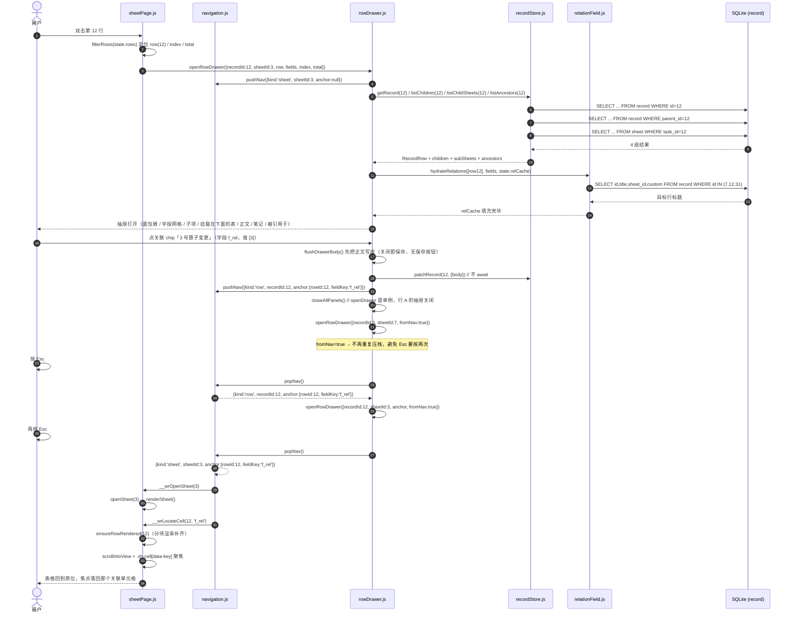
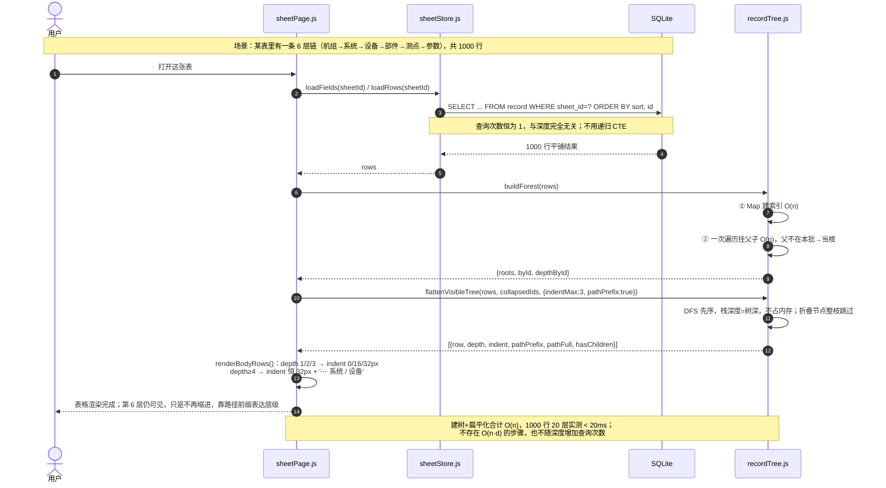
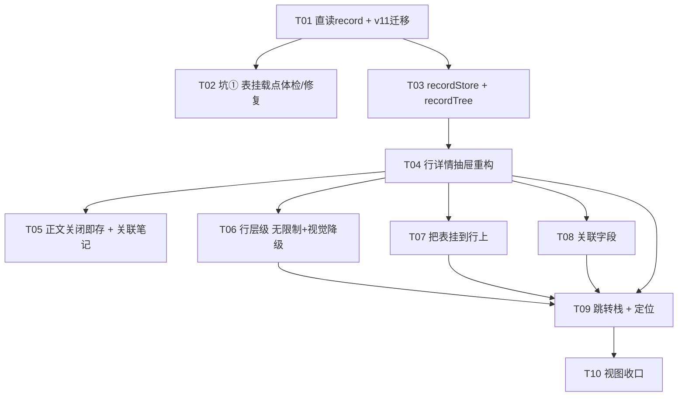

# WorkRecorder「以表格为核心」信息架构重构 · 系统设计

> 架构：高见远 · 版本 v2.0 · 依据 `D:\MyDesktopApp\work_recorder\` 实际代码核实（非文档推测）
> 前置：v10 `record` 单表地基已上线，本次**不推翻**，只在其上做「能力开口 + 交互收口」

---

## 一、方案总述

### 1.1 分层：这次改造只有四层，没有第五层

| 层 | 职责 | 本次改动性质 |
|---|---|---|
| **存储层**（`record` 表 + 3 个只读兼容视图） | 唯一真相。所有内容都是 record | **纯增量**：只加 2 个索引 + 1 列；视图定义**一个字符都不动** |
| **数据访问层**（`sheetStore.js` / 新 `recordStore.js`） | 把 SQL 收拢成函数，供 UI 调 | **改造**：`sheetStore` 从「查视图」改为「直查 record」；新建 `recordStore` 承接非表格场景 |
| **字段渲染层**（`fieldTypes.js` / `sheetTable.js`） | 同步纯函数，输入 (field, value) → HTML 字符串 | **扩展**：注册第 8 种字段类型 `relation`；`buildRow` 加缩进与展开箭头 |
| **交互层**（`rowDrawer.js` / `navigation.js` / `sheetPage.js`） | 抽屉、跳转栈、定位 | **新建 2 个 + 改造 1 个**（这是本次 80% 的工作量） |

关键判断：**这次不是「加 5 个功能」，而是「把 5 个入口收成 1 个」**。具体说，原来「今天 / 记录 / 笔记 / 待办 / 表格」是五套并列的页面，各自读自己那份数据；改造后表格是唯一入口，其余四个页面变成「对同一批 record 的四种筛选视图」。所以工作量的大头在**删代码和改调用方向**，不在写新组件。

### 1.2 纯前端 vs 要动 Rust

**只动前端（占 ~90%）**：行详情抽屉、行层级、把表挂到行上、关联字段、跳转栈、定位、今天三分区、记录按表分组、设置三分区。理由：`db_query` / `db_execute` 是无限制的 SQL 直通，`record` 表的 `parent_id`、`body`、`custom`、`sheet_id` 全部已存在，前端用普通 SQL 就能读写，不需要为新概念加 IPC 命令。

**必须动 Rust（3 处，都极小）**：
1. **v11 迁移**：`record(parent_id)` 索引、`record(sheet_id) WHERE NOT NULL` 部分索引、`note_index.record_id` 加列 + 部分索引。全部是 `IF NOT EXISTS` / `add_column_if_missing`，可重复执行。
2. **`notes_fs.rs`**：`NoteDoc` 加 `record_id: Option<i64>`，`render_markdown` 写一行 front-matter，`parse_markdown` 加一个 `match` 分支。不加列、不改文件布局。
3. **新增一个命令 `db_repair_sheet_parent(dry_run)`**：处理`sheet.task_id` 的历史重映射（坑①）。**刻意不放进 `init_and_migrate_db_at`**，见 §2.6。

### 1.3 三条不能碰的红线（本次设计的全部约束来源）

1. **三个视图（`logs` / `todos` / `sheet_row`）冻结**。任何「让视图多一列」的想法都直接否掉 —— 视图重建会连带重建 `INSTEAD OF UPDATE` 触发器，而三个触发器都是全列 `NEW.*` 覆写（`main.rs:430-511`），漏一列该列就被静默抹成默认值。
2. **写入计数不碰 `changes()`**。`db_execute` 已用 `total_changes()` 前后差值（`main.rs:663-665`），新代码一律通过 `data.js` 的 `dbExecute` / `dbExecuteStrict`，不自己算行数。
3. **新代码不 `FROM sheet_row` / `FROM todos` / `FROM logs`**。视图只服务「不打算再改的旧代码」。新代码一律 `FROM record`。这条线一旦松掉，坑② 会以各种变体反复出现。

### 1.4 「表格是唯一结构来源」在代码上落成了什么

一句话概括：**`record.kind` 从「身份」降级为「出生地」，`record.sheet_id` 升格为「归属」**。

- 一条随手记（`kind='log'`）被拖进表格 → `UPDATE record SET sheet_id=7 WHERE id=123`，`kind` 保持 `'log'` 不变。
- 表格行列表 = `WHERE sheet_id = ?`，**不再看 kind**。这就是坑② 的根因，也是它的解法。
- `kind` 唯一还被信任的地方是**删除语义**：删表时 `kind='sheet_row'` 的行随表销毁（它只在这张表里有意义），`kind≠'sheet_row'` 的行 `sheet_id` 置 NULL 退回记录页（它有独立的出生语境）。这是「保留出生地」换来的唯一实际好处，要在代码注释里写死。

> **两条关系别混（全文统一，实现时最容易搞混的地方）**：
> - **record → sheet**：`record.sheet_id`，语义是「这条记录**归属**哪张表」。一条记录最多归属 1 张表，`null` = 不在任何表里。用词：**归属 / 属于**。
> - **sheet → record**：`sheet.task_id`，语义是「这张表**挂载**在哪一行上」。一张表最多挂 1 处，`null` = 未挂载的独立表。用词：**挂载点 / 挂载于**。
>
> 两者是**不同的关系、不同的列、不同的话术**。表不会被「归属」，行也不会「挂载」。

---

## 二、数据模型变更清单

逐条：改什么 / 为什么 / DDL·DML / 能否回滚。

### 2.1 `sheet_field.type` 容纳 `'relation'` —— 无需 DDL，判据已核实

**核实**：`main.rs:223` 建表语句是 `type TEXT NOT NULL DEFAULT 'text'`，**没有 CHECK 约束**。写入 `'relation'` 不会失败。

**但真正的风险不在存储，在 `options` 的既有清洗逻辑**。`sheetStore.mergeFieldOptions()`（`sheetStore.js:74-88`）会强制补 `if (!Array.isArray(next.options)) next.options = []`，并主动删除 `wrap` / `dateOnly` / 空 `format`。新键 `targetSheetId` / `multiple` 不在删除名单里，会被原样保留 —— **安全**。但有两个必须遵守的写法：

```js
// ✅ 正确：配置走顶层键，不塞进 options 数组
mergeFieldOptions(field, { targetSheetId: 12, multiple: false })
// → {"source":"custom","options":[],"targetSheetId":12,"multiple":false}

// ❌ 错误：塞进 options 数组会被 resolveOptions 当成「单选选项」渲染成 chip
mergeFieldOptions(field, { options: [{ targetSheetId: 12 }] })
```

完整 options 形状：
```json
{ "source": "custom", "options": [], "targetSheetId": 12, "multiple": false }
```

配套改动：`sheetStore.FIELD_DEFAULT_WIDTH` 加 `relation: 200`（`fieldTypes` 的列宽映射在 `sheetStore.js:46`，不在 `fieldTypes.js`，容易找错地方）。

**回滚**：把该字段 `type` 改回 `text`。行数据里存的是 `[3]` 数组，`renderTextCell` 走 `String(value)` → 显示 `"3"`（不会抛错，语义降级）。列宽/配置留着无害。**不需要恢复数据**。

**顺带核实 `describeField()`（`sheetStore.js:485`）是同步函数**，被库视图卡片用来拼「字段名 · 类型」。`relation` 想显示「关联 · 问题跟踪」需要异步查表名 —— 不做。卡片只显示「关联」，详情抽屉里才显示目标表名。这是刻意的取舍，避免把同步渲染函数改成异步（会传染到整个 `renderLibrary`）。

### 2.2 `record.parent_id` 无深度限制 —— 加索引，建树 O(n)，视觉层分层降级

**核实**：`main.rs:298` 已有 `parent_id INTEGER`（无外键、无 CHECK）。v10 迁移的引用重映射（`main.rs:355-357`）只覆盖 `WHERE kind='todo'`，因为**旧 `logs` 表根本没有 `parent_id` 列**（`main.rs:74`），所以不存在漏映射的 log 行。

**语义变更**：`parent_id` 从「待办父子」升为「任意 record 父子」。**不需要 DDL，只需要索引**：

```sql
CREATE INDEX IF NOT EXISTS idx_record_parent ON record(parent_id);
```
为什么 63 条数据也要建：`listChildren` / `listAncestors`（面包屑）/ `wouldCreateCycle`（逐级上溯）三条路径都按 `parent_id` 查，其中面包屑和环检测是**每次打开抽屉都跑**的。索引成本为 0，收益是「打开抽屉不用全表扫 3 次」。

**环检测不能直接复用 `taskRelations.js`**，核实结论：
- `getTodos()`（`taskRelations.js:17`）读的是 `appData.todos` —— 内存快照，`loadData()` 只在启动时跑一次（`data.js:61`），新建的待办**不在里面**。
- `isDescendantOf` / `isAncestorOf` 只在 `appData.todos` 这个集合里游走，**看不到 `kind='log'` 或 `kind='sheet_row'` 的父级**。而本次恰恰允许「行 → 子行 → 移入的 log」跨 kind 的父子链。

→ 结论：**另起纯函数**，放进新文件 `recordTree.js`，把「取父」作为参数注入（可单测、不碰 DB）：

```js
/**
 * @param {number|string} childId  即将成为子项的 record id
 * @param {number|string} parentId 目标父 id
 * @param {(id:*) => Promise<{id:number, parent_id:number|null}|null>} parentOf
 * @returns {Promise<boolean>} true = 会形成环，禁止写入
 */
export async function wouldCreateCycle(childId, parentId, parentOf)
```
实现即「从 parentId 逐级向上，遇到 childId 就返回 true；遇到已访问过的 id 说明旧数据已有环，返回 false 停止上溯」。`taskRelations.js` **一行不改**（旧待办的功能继续用旧逻辑，两套并存直到待办页收口）。

#### 2.2.1 为什么层级「无深度限制」也不会带来性能问题

用户担心的是「无限制 → 递归深 → 慢」。这个担心不成立，但**必须用具体做法回应，而不是口头保证**。关键判断：**层级不需要任何按深度展开的查询。**

**做法（一次查库，内存建森林）**：
```js
// 只有这一条 SQL，与深度无关
const rows = await dbQuery(
  'SELECT id, parent_id, sheet_id, title, status, sort FROM record WHERE sheet_id = ? ORDER BY sort, id',
  [sheetId]
);
// 内存三步，全部 O(n)
const byId = new Map(rows.map(r => [r.id, { ...r, children: [] }]));   // ① 建索引
const roots = [];
for (const node of byId.values()) {                                    // ② 一遍遍历挂父子
  const parent = node.parent_id != null ? byId.get(Number(node.parent_id)) : null;
  if (parent) parent.children.push(node);                              //    父不在本表 → 当根（跨表脏数据兜底）
  else roots.push(node);
}
// ③ 渲染时 DFS 一遍，带 depth 往下传（栈深度 = 深度，不占内存）
```
复杂度：让 `n` = 本表行数、`d` = 最大深度。建树 `O(n)`（一次哈希 + 一次遍历），**与深度无关**；渲染 `O(n)`；面包屑祖先链 `O(d)` 次 Map 查找（20 层也是微秒级）。

**为什么不用递归 CTE（`WITH RECURSIVE`）**：
1. **它没有更快。** 递归 CTE 的复杂度也是 `O(n)`，但它把成本从 JS 的 Map 查找换成 SQLite 的物化临时表 + 每层一次索引 probe。本表行数是几十到几千，两种做法都在毫秒级 —— 差别不足以抵消缺点。
2. **它拿不到「一次全量」的红利。** 我们渲染整张表本来就要把所有行读进内存（`loadRows` 已如此），CTE 等于把已经在内存里的数据再算一遍。
3. **它把树结构分散到 SQL 里，改不动。** 「折叠某枝」「按筛选后的集合重建树」这两个操作在 JS 里是 `Set` 过滤，用 CTE 就得重写 SQL 并重新 round-trip 一次 IPC（每次滚动都可能触发）。
4. **`db_query` 每调用一次开一个新连接**（`main.rs:598`），CTE 方案会把「一次查询」变成「N 次查询」，在 `busy_timeout=3000` 下反而更容易撞锁。

**规模验证**：63 条记录 / 2 张表 → 建树 < 1ms。即使到 1000 条记录、20 层深，建树仍是 `O(1000)` 的单次哈希遍历（约 0.1-0.3ms），因为**没有任何一步是 `O(n·d)` 或 `O(n²)`**。这个方案不随深度退化，是本设计的核心结论。

**唯一真正的约束不是性能，是视觉宽度** —— 见 2.2.2。

#### 2.2.2 真正的约束：视觉宽度，因此「数据无限制 + 视觉分层降级」

**算一笔账**：第一列表头宽 `FIELD_DEFAULT_WIDTH.text = 220`（实际布局 260-280px，见 `sheetTable.js:MIN_COL_WIDTH` 的计算）。每级缩进 16px：

| 深度 | 缩进占宽 | 剩余文字宽 | 观感 |
|---|---|---|---|
| 1 | 0（根不缩进） | 260 | 正常 |
| 2 | 16 | 244 | 正常 |
| 3 | 32 | 228 | 正常 |
| 4 | 48 | 212 | 偏窄 |
| 5 | 64 | 196 | 字段名开始被截成「2 号…」 |
| 6 | 80 | 180 | 读不出区别 |

**结论：缩进最多吃到 3 层（32px），第 4 层起停止增加缩进。**

新方案三层分工：

| 层 | 规则 |
|---|---|
| **数据层** | `parent_id` **无深度限制**。想建多深建多深，写入侧只做环检测（`wouldCreateCycle`），不做深度校验 |
| **视觉层** | 前 3 层正常缩进（每级 16px）；**第 4 层起 `indent` 恒为 32px 不再增加**，改为在标题前插一段灰色路径前缀（取**祖先链末两段**，不含自身——自身标题紧跟在后面，重复一遍没意义）。例如 `2号机组 / 给水系统 / 前置泵 / 轴承` 这条链上，第 4 层的「轴承」显示为 `⋯ 给水系统 / 前置泵`，`⋯` 表示省略了更上层 |
| **交互层** | 默认**只展开第 1 层**子项（深层默认折叠，避免首屏被撑长）；折叠状态**按表持久化**（复用现有 `settings` 表存 JSON 的做法，key = `sheet_collapsed:<sheetId>`，值是 id 数组） |

路径前缀为什么取末两段而不是全路径：第一列只有 260px，`2号机组/给水系统/前置泵/轴承/驱动端/温度` 全写会占满整行反而更糟；末两段足以让用户回答「这条是从哪来的」，完整链在行详情抽屉的面包屑里。鼠标悬停 `title` 属性给全路径。

**回滚**：`DROP INDEX idx_record_parent`，数据不动；视觉规则是纯 CSS + 渲染参数，改回常缩进即可。


### 2.3 `note_index.record_id` —— 加列 + 部分索引，旧数据天然兼容

**现状核实**：`note_index`（`main.rs:142-152`）是 `rel_path UNIQUE` 的元数据缓存，`syncNoteIndex()`（`notesStore.js:231-260`）每次全量 `DELETE` 后重建。真正的元数据在 `.md` 的 front-matter 里，**SQLite 侧只是缓存**。

**DDL**（v11 迁移内）：
```sql
ALTER TABLE note_index ADD COLUMN record_id INTEGER;   -- 走 add_column_if_missing，可重复执行
CREATE INDEX IF NOT EXISTS idx_note_index_record
    ON note_index(record_id) WHERE record_id IS NOT NULL;
```
用**部分索引**而不是普通索引：绝大多数笔记 `record_id` 为 NULL，部分索引体积恒小。

**旧数据兼容**：旧笔记没有 front-matter `record_id` → 解析出 `None` → `note_index.record_id = NULL` → 不属于任何行的笔记，行为完全不变（仍在笔记页）。**不需要数据迁移**。反过来，`syncNoteIndex` 里那一句 `INSERT OR REPLACE` 要加上 `record_id` 列，否则全量重建会把已有的关联抹成 NULL —— 这是本项唯一会「静默丢数据」的点，见 §7 风险 4。

**为什么不用 `record.custom` 存笔记路径列表**：正文是长文，必须留在 `.md` 文件里（用户要能用 Typora 打开、能用 Git 备份）。`custom` 里只放 `{notes:["rel/path.md"]}` 作为索引也可以，但会和 `sheet_field` 的字段 key 撞名（`custom` 是字段值容器，插业务键进去会污染 `rowTitle` 与 `hydrateRelations` 的取值逻辑）。**结论：单向存 front-matter + `note_index` 缓存，`custom` 保持纯净。**

**回滚**：`DROP INDEX`；列留着（SQLite 不能安全 DROP COLUMN，留着无副作用，读取方都会 `?? null`）。

### 2.4 `sheet.task_id` 不改列名 —— 语义是「挂载点（anchor）」，只改注释 + 加别名

> **术语定调（全文统一）**：`sheet.task_id` 不是「表的父亲」，而是**这张表被挂在哪一行上的指针**。
> 一张表本身是独立表；只有当某行把它「挂」过来，两者才临时有了上下文关系。不挂的时候，它们就是互不相干的同级表。
> 所以全文用 **挂载点 / 挂载于 / anchor**，不用「归属 / 属于 / 子表从属」。删掉挂载点 = 表回到「未挂载」的独立状态，**表本身不动**。

**核实影响面**：`task_id` 出现在 `main.rs:213`（建表）、`sheetStore.js:214/252/265-274/306`、`sheetPage.js:399/1350+`（面包屑与分组）、`sheetPage.js:groupSheets()`。共 4 个文件 12 处。

**为什么不改列名**：
1. **改了没有收益。** 它本来就是「指向一条 record」的外键，只是当年 record 还不存在、只能指向 todos。列名 `task_id` 描述的是「这条 record 是个任务」这个**已失效的假设**，但列的**类型与用法**（`INTEGER`，指向 `record.id`）完全正确。改列名纯粹是命名洁癖。
2. **改了有真实成本。** 新库走 `CREATE TABLE IF NOT EXISTS sheet (... task_id ...)`（v8 分支），老库走 `ALTER TABLE RENAME COLUMN` —— 两条路径必须产出同一个 schema。SQLite 的 `RENAME COLUMN` 在 3.25+ 可用，且 `sheet.task_id` 没有被任何视图/触发器引用（已核实，`main.rs` 里没有任何触发器碰 `sheet`），所以技术上可行 —— 但两条建表路径分叉意味着「全新安装」和「升级安装」的数据库 schema 会在未来某次改动里悄悄不一致，这个雷不值得为改名埋。
3. **真正的需求是「让代码读起来对」，不是「让列名对」。** 用别名解决，成本 1 行：

```js
/** sheet.task_id 的真实语义 = 挂载点 record id（anchor）。null = 未挂载的独立表。 */
function anchorRecordIdOf(sheetRow) {
  return sheetRow.task_id == null ? null : Number(sheetRow.task_id);
}
```
`listSheets()` 返回值补一个**只读别名** `anchor_record_id`（**不叫 `parent_record_id`** —— 「parent」会误导成「父表」），**新代码一律读别名，旧代码继续读 `task_id`**。将来真要改名，只改 `listSheets` 一处 + 一条迁移。

**文案统一（必须在实现时落实，不能只写在文档里）**：

| 位置 | ❌ 不要写 | ✅ 写成 |
|---|---|---|
| 表格库分组头 | 「挂在：」「归属：」「子表」 | `挂载于：主设备诊断台账 / 2 号机组` |
| 行详情分区标题 | 「子表」 | `挂载在下面` |
| 建表按钮 | 「新建子表」 | `在此行挂一张表` |
| 删行确认框 | 「子表将被移除 / 删除」 | `这张表会保留，只是不再挂在这一行下面` |
| 删表确认框 | 「会同时删除归属记录」 | `表里的记录会一起删除` |
| 面包屑 | 「父表 / 父行」 | `挂载点` |

**必须在注释里纠正的旧描述**：`sheetStore.js:4` 写着「表可以归属某个任务（`sheet.task_id` → `todos.id`）」，`sheetPage.js` 的 `groupSheets()` 把未命中者显示成「已删除的任务」—— 都是错的，它现在指向 `record.id`。这种「注释/文案骗人」是本次事故的高发区（坑① 的成因就是它）。

### 2.5 `sheet` 上补充的索引

```sql
CREATE INDEX IF NOT EXISTS idx_sheet_task_id ON sheet(task_id);
```
`groupSheets()` 每次进库视图都要按 `task_id` 分组，`listChildSheets` 按 `task_id = ?` 找挂载在某一行的表。成本为 0。

### 2.6 坑① 处理方案：**独立命令，不入迁移**

**错误表现不是报错，而是「表挂到了错误的机组上」**。核实后的真实判定条件比「指向不存在」更细，三种情况必须分开：

| 情况 | 判定 | 处理 |
|---|---|---|
| A. `task_id` 指向不存在的 record | `NOT EXISTS(SELECT 1 FROM record WHERE id=sheet.task_id)` | **必然错**，用 `legacy_id` 反查修复 |
| B. 指向存在，但 `record.legacy_id IS NOT NULL AND legacy_id != task_id` | 撞车：`task_id` 命中了**另一条** record 的自增 id | **可疑**，只报告，交用户逐条确认 |
| C. 指向存在，且 (`legacy_id = task_id` 或 `legacy_id IS NULL`) | 意义一致，或 v10 后新建 | **正确**，不动 |

**为什么必须放独立命令，不放 `init_and_migrate_db_at`**：
1. 迁移每次启动都跑。情况 B 一旦判断错，就是**每次启动都把用户的表挂错一次**，且不报错。
2. 情况 B 没有可靠判定 —— 它依赖「用户当初建这张表时到底想挂哪条」，这个信息**只存在于用户脑子里**。程序能做的只有把三条候选（当前指向 / legacy 反查结果 / 无）列出来让用户点。
3. 迁移里做修复 = 迁移不可回滚。而这条修复本质上是一次**人工决策**，不该伪装成自动迁移。

**签名**（Rust，`main.rs`）：
```rust
#[tauri::command]
async fn db_repair_sheet_parent(dry_run: bool) -> Result<String, String>
// 返回 JSON 字符串：
// { "checked": 2, "ok": 1, "fixable": 1, "suspicious": [
//     { "sheetId": 4, "name": "2号机组排查", "taskId": 7,
//       "current": "一条待办：巡检记录", "legacyHit": 12,
//       "legacyTitle": "2 号机组排查" } ] }
```

**修复 SQL（仅 `dry_run=false` 且只处理情况 A）**：
```sql
UPDATE sheet SET task_id = (
    SELECT r.id FROM record r
     WHERE r.kind = 'todo' AND r.legacy_id = sheet.task_id
)
WHERE task_id IS NOT NULL
  AND NOT EXISTS (SELECT 1 FROM record x WHERE x.id = sheet.task_id)
  AND EXISTS (SELECT 1 FROM record r WHERE r.kind = 'todo' AND r.legacy_id = sheet.task_id);
```
末尾的 `EXISTS` 保证：反查不到就不写，绝不把 `task_id` 变成 NULL（变 NULL 等于「表变成未挂载的独立表」，是另一种静默错误）。

**UI 入口**：设置 → 数据 → 「检查表挂载点」。点一次 = dry run 出报告；有 `fixable` 才显示「修复」按钮；有 `suspicious` 就逐条列出并给三个选项（保持现状 / 改成 legacyHit / 解除挂载）。

**上线前验证（必做，一条 SQL）**：
```sql
SELECT COUNT(*) FROM sheet s
 WHERE s.task_id IS NOT NULL
   AND NOT EXISTS (SELECT 1 FROM record r WHERE r.id = s.task_id);
-- 必须为 0
```

### 2.7 坑② 影响面清单（已逐文件核实）

**好消息**：`sheetPage.js`（103 KB，最大的文件）里**零处** `kind='sheet_row'` 依赖。grep 出的 `clipboard.kind` / `item.kind` 全是 UI 剪贴板概念，与数据库无关。所以坑② 的爆炸半径收敛在 **2 个文件**。

| 文件:行 | 现状 SQL | 改为 | 不改的后果 |
|---|---|---|---|
| `sheetStore.js:393` `loadRows` | `FROM sheet_row WHERE sheet_id=?` | `FROM record WHERE sheet_id=?` | **主病灶**：移入表的 log 在表格里看不见（它 kind 是 log） |
| `sheetStore.js:216` `listSheets.row_count` | `(SELECT COUNT(*) FROM sheet_row r WHERE r.sheet_id=s.id)` | `FROM record r` | 卡片显示「0 条记录」，点进去有行 |
| `sheetStore.js:217` `listSheets.last_at` | 同上 | `FROM record r2` | 卡片「最后更新」时间永远停在移入之前 |
| `sheetStore.js:320` `deleteSheet` | `DELETE FROM sheet_row WHERE sheet_id=?` | 见下方两段式 | **产生孤儿**：被移入的 log 保留 `sheet_id` 指向已删的表，记录页显示它、表格里查不到它，且再也删不掉 |
| `sheetStore.js:404/409/413` `insertRow` | `INSERT INTO sheet_row ...` / `MAX(sort) FROM sheet_row` | `INSERT INTO record (kind, sheet_id, custom, sort, created_at, updated_at)` | 走视图会被触发器强制 `kind='sheet_row'`，等于「新记录也没有出生地」 |
| `sheetStore.js:424/431` `insertRowAt` | 同上 | 同上 | 同 |
| `sheetStore.js:442/445` `setRowHeight` | `UPDATE sheet_row` | `UPDATE record` | 能用（视图等价），但违反红线 3，且将来视图冻结时会被误改 |
| `sheetStore.js:454` `saveRowValues` | `UPDATE sheet_row SET data=?` | `UPDATE record SET custom=?` | 同 |
| `sheetStore.js:462` `deleteRow` | `DELETE FROM sheet_row` | `DELETE FROM record` | 同 |
| `search.js:175` `searchSheetRows` | `WHERE r.kind='sheet_row'` | `WHERE r.sheet_id IS NOT NULL` | Ctrl+K 搜不到移入表的记录 |
| `commandPalette.js:175-178` | `if (type==='sheet') { routeTo('nav-table'); return; }` | 打开对应表 + 定位到行 | **既存缺陷**（产品经理说的「只跳首页」）：搜索结果里有 `sheetId` 和 `id`，但代码把它扔了 |

**`deleteSheet` 的两段式（这是「kind 保留出生地」的落地处，必须写清）**：
```js
// 1) 出生的行跟着表走：它只在这张表的语境里存在
await db().dbExecute("DELETE FROM record WHERE sheet_id = ? AND kind = 'sheet_row'", [sheetId]);
// 2) 被移入的（kind = 'log' | 'todo'）回到「记录」页，不销毁 —— 它有独立的出生语境
//    注意 sheet_id 必须写成 SQL 字面量 NULL：db_execute 会把参数 String()，传 null 会存成 'null'
await db().dbExecute("UPDATE record SET sheet_id = NULL WHERE sheet_id = ?", [sheetId]);
```
顺序不能反（先 DELETE 再 UPDATE，第二条只命中残留的非 sheet_row 行）。

**`loadRows` 的新 SQL（保留 `data` 别名，零下游改动）**：
```sql
SELECT id, sheet_id, custom AS data, CAST(sort AS INTEGER) AS sort,
       height, created_at, updated_at,
       kind, title, body, parent_id, status
  FROM record
 WHERE sheet_id = ?
 ORDER BY sort, id
```
保留 `custom AS data` 的理由：`parseRowData(row)` 读 `row.data`（`sheetStore.js:113`），`sheetPage` 全程只用 `row.values`。别名一加，103 KB 的 `sheetPage.js` 一行不用改。多取的 `kind/title/body/parent_id/status` 是给行层级、正文、状态用的 —— 顺手取回，避免抽屉再查一次。

`CAST(sort AS INTEGER)` 必须保留：`record.sort` 是 `REAL`（`main.rs:303`），视图里做了取整，直读会拿到 `3.0`。虽然 `ORDER BY` 结果相同，但任何 `row.sort === 3` 的严格比较会变 false（见 §7 风险 3）。

### 2.8 一张表能否同时挂到多行 —— 结论：**单挂载点**

用户的模型（「独立表 + 一根指过来的指针」）天然指向「可以挂多处」，但**必须明确选一个，不能含糊**，因为两者是不可平滑切换的数据结构。取舍如下：

| | 单挂载点（本设计） | 多挂载点 |
|---|---|---|
| 存储 | `sheet.task_id` 一个 INTEGER | 新增 `sheet_anchor(sheet_id, record_id, sort)` 中间表；`task_id` 废弃或保留为「主挂载点」 |
| 一张表能挂几处 | 1 处 | N 处 |
| 删行清理 | 1 条 `UPDATE sheet SET task_id = NULL` | 删中间表行 + 判断「是否剩 0 个挂载点」再决定要不要标记未挂载；**三处逻辑**（删行 / 删表 / 改挂载点） |
| 库视图分组查询 | 直接按 `task_id` 分组，一次查询 | 必须 `join sheet_anchor`；一张表出现在多个分组里，「全部表格」要么去重要么展开，两种都不自然 |
| 面包屑 | `listAncestors(task_id)` 唯一一条链 | 有多条链，进表时得先问「你从哪个入口来的」 |
| 数据一致性 | 天然一致（只有一处） | **同一份数据出现在两个上下文里**：在机组 A 下改一格，机组 B 下也变 |

**推荐：单挂载点。** 三条理由，按重要性排：

1. **「同一份数据挂两处」在 UI 上必然被误解成 bug。** 用户在「2 号机组」里删掉一行，去「3 号机组」发现那行也没了 —— 他会认为是数据损坏，而不是「哦这是同一张表的两个视图」。这个误解的修复成本是无穷的（每次都要解释），而单挂载点的限制是**一次性的**（用户建第二张表时就知道）。
2. **多挂载点会破坏「面包屑只有一条链」这个前提**，而面包屑是 P0-5「跳转栈 + 定位」的地基。栈的每一层都要能唯一回答「我从哪来」，多入口 + Esc 返回 = 得记住「你是从哪个挂载点进来的」，栈元素要从 3 个字段涨到 5 个，且 `locateCell` 要区分回到哪条链。
3. **「两个机组都要看」的真实需求，本质是「筛选」不是「挂载」。** 用户想看同一批数据的两种切面，正确做法是**关联字段**（§5）：在「3 号机组」那行加一列 relation 指向「2 号机组」的表行，或者直接建一个跨表视图。用挂载来复用数据，是把「视图问题」错当「结构问题」。

**因此本设计额外提供一条替代路径**（写进文档，避免用户撞墙后无处可去）：
- 想「同一张表被两处引用」→ 用 **relation 字段**指向目标表里的行，而不是把表挂两处；
- 想「两组数据对比」→ 建**两个视图/筛选**，不建两张表（现有 `filterRows` 已支持多条件筛选，`sheetPage.js:197`）。

**如果将来真要转多挂载点，迁移成本有多大**（这是产品经理问的关键问题，如实回答）：

| 步骤 | 工作量 | 说明 |
|---|---|---|
| 建 `sheet_anchor(sheet_id, record_id, sort)` + 唯一约束 `(sheet_id, record_id)` | 半小时 | v11+N 迁移里一条 `CREATE TABLE` |
| 数据回填 `INSERT INTO sheet_anchor SELECT id, task_id, 0 FROM sheet WHERE task_id IS NOT NULL` | 10 分钟 | 纯 SQL，一条语句，现有数据全部变成「只有 1 个挂载点」，**语义完全兼容** |
| 读侧改造 | **1-2 天** | `listSheets` 加 join + 「每张表返回 anchor 数组」；`groupSheets` 改成「按 anchor 展开」（一张表出现在 N 个分组）；面包屑改成「多链，进表时带 anchor 参数」 |
| 写侧改造 | **0.5 天** | `deleteRecord` 的清理换成「删 anchor 行 + 剩 0 个则视为未挂载」；`createSheet` 写完 sheet 再插一条 anchor |
| UI 文案与交互 | **1 天** | 「挂载于」从单值变列表（需要「＋挂到另一处」入口、每处可单独解除） |
| **合计** | **约 3 天** | 数据层零风险（回填是纯增量），**全部成本在读写侧与 UI** |

结论：**单挂载点是可逆的**，回填那条 SQL 让「1 处 → N 处」不丢任何信息，代价是 3 天的读侧/UI 改造。反过来（N → 1）才是有损的（要人工决定保留哪个挂载点）。所以先做单挂载，等真出现「必须共享」的场景再升级 —— 那时才知道「共享」到底想要什么行为。

---

## 三、文件清单与改动性质

| 文件（相对路径） | 性质 | 改什么 | 大致行数 |
|---|---|---|---|
| `src-tauri/src/main.rs` | 改造 | v11 迁移（3 个索引 + `note_index.record_id`）；新增 `db_repair_sheet_parent`；纠正 `sheet.task_id` 与 `record.kind` 的注释 | +90 / −5 |
| `src-tauri/src/notes_fs.rs` | 改造 | `NoteDoc` 加 `record_id`；`render_markdown` 写 `record_id:`；`parse_markdown` 加 match 分支；`notes_update_meta` 保留该字段 | +18 / −2 |
| `src/recordStore.js` | **新建** | record 统一读写：get/patch/create/delete/move/children/ancestors/backlinks 编排 | ~340 |
| `src/recordTree.js` | **新建** | 纯函数：`wouldCreateCycle` / `buildAncestorChain` / `buildForest` / `flattenVisibleTree`（缩进 + 路径前缀降级） | ~150 |
| `src/relationField.js` | **新建** | `resolveRelation` / `hydrateRelations` / `findBacklinks` / `openRelationPicker` | ~260 |
| `src/navigation.js` | **新建** | 跳转栈 push/pop/peek + `onNavChange` + Esc 全局绑定 + 定位派发 | ~130 |
| `src/rowDrawer.js` | **新建** | 行详情抽屉（吸收 `openRowDrawer` + `record-reader`）：面包屑/字段网格/子项/挂载在下面的表/正文/笔记/被引用于 | ~660 |
| `src/sheetStore.js` | 改造 | `loadRows`/`listSheets`/`insertRow`/`insertRowAt`/`deleteRow`/`saveRowValues`/`setRowHeight`/`deleteSheet` 直读 record；`createSheet` 支持 `anchorRecordId`；`FIELD_DEFAULT_WIDTH.relation`；注释纠正 | +70 / −45 |
| `src/sheetPanels.js` | 改造 | 删 `openRowDrawer`（迁到 `rowDrawer.js`）；`openRowMenu` 加「添加子项 / 在此行挂一张表 / 移入表格」三项；`openColumnMenu` 的字段类型面板自动带出「关联」 | +55 / −60 |
| `src/sheetTable.js` | 改造 | `buildRow` 支持 `indent` + 展开箭头 + 子项计数；`buildCell` 透传 `relCache` | +50 / −10 |
| `src/sheetPage.js` | 改造 | `openSheet` 后 `hydrateRelations` + `buildForest`；`state.relCache` / `state.collapsed`（按表持久化到 settings）；`locateCell` 并挂 `window.__wrLocateCell`；库视图按「挂载于：…」分组；页头面包屑改为 `listAncestors` | +320 / −80 |
| `src/fieldTypes.js` | 改造 | 注册 `relation`（5 个触点，见 §4.1） | +20 / −2 |
| `src/search.js` | 改造 | `kind='sheet_row'` → `sheet_id IS NOT NULL`；结果对象补 `rowId` | +10 / −8 |
| `src/commandPalette.js` | 改造 | 表格结果 → `__wrOpenSheet(sheetId)` + `__wrLocateCell(id)`；非表格结果 → `openRowDrawer` | +35 / −12 |
| `src/quickCapture.js` | 改造 | 删 `openRecordReader` 独立实现（−80 行）；`window.__wrOpenRecordReader` 改为转调 `rowDrawer` 兼容壳；保留 `openQuickConvertModal` 供抽屉调用 | −85 / +30 |
| `src/main.js` | 改造 | 删 `setupRecordReader`（overlay 已移除）；初始化 `navigation`；`beforeunload` 时 flush 抽屉正文 | +35 / −30 |
| `src/notesStore.js` | 改造 | `syncNoteIndex` 写 `record_id`（**必须改，否则全量重建抹关联**）；新增 `listNotesByRecord(recordId)` | +25 / −5 |
| `src/notesEditor.js` | 改造 | `openNote(relPath, { recordId })` 支持从抽屉挂载/新建 | +28 / −6 |
| `src/todayTimeline.js` | 改造 | 三分区（待办 / 今天动过的记录 / 未整理 inbox）；删「今日待办添加框」与「完整录入」入口 | +150 / −190 |
| `src/timeline.js` | 改造 | 分组键 `tag` → `sheet_id`；行内「查看」改为开 `rowDrawer` | +95 / −125 |
| `src/settings.js` | 改造 | 三分区（外观 / 数据 / 实验室）；数据区加「检查表挂载点」与「清理悬空引用」两个按钮；提供 `getSetting/setSetting` 给表格折叠状态持久化（`sheet_collapsed:<sheetId>`） | +150 / −65 |
| `src/index.html` | 改造 | 删 `#record-reader-overlay` 整块（13 行）；加 `#ic-type-relation` symbol；`nav-table` 挪到导航第一位 | +8 / −22 |
| `src/styles.css` | 改造 | 追加「设计层 8」（抽屉分区 / 缩进 / relation chip / 面包屑 / 展开箭头），**纯追加** | +540 |

**不建议改的文件**：`taskRelations.js`（旧待办功能继续用旧逻辑，等待办页收口时整文件删）、`tablePage.js`（**已核实是死代码**，无任何 import；它用的 `field_def` 表也因此无实际读方）、`freecell.js`、`data.js`（`appData` 兼容壳继续服务未收口的旧模块）。

---

## 四、关键接口签名

所有新模块遵守同一约定：**只依赖注入的 adapter（`dbQuery` / `dbExecute`），不直接碰 `window.__TAURI__`**（与 `sheetStore.js:13-26` 一致，好处是调试壳可以换假数据）。

### 4.1 `relation` 如何注册进 `fieldTypes.js` 的类型表

**5 个触点，缺一不可**。前 3 个在文件顶部常量区，后 2 个在函数体内 —— 最容易漏第 5 个（`openCellEditor`），漏了的表现是「关联列能显示、点它没反应、且不报错」。

```js
// 触点 1：FIELD_TYPE_ORDER（fieldTypes.js:17）—— 列头「改类型」面板的排列顺序
export const FIELD_TYPE_ORDER = ['text','number','select','multi_select','date','checkbox','attachment','relation'];

// 触点 2：FIELD_TYPE_LABELS（:19）
relation: '关联',

// 触点 3：TYPE_ICON_IDS（:29）—— 需要 index.html 里加一个 <symbol id="ic-type-relation">
relation: 'ic-type-relation',

// 触点 4：renderCell 的 switch（:267）
case 'relation': return renderRelationCell(field, value, ctx);

// 触点 5：openCellEditor 的 switch（:637）
case 'relation': openRelationPicker(cellEl, field, value, actions); break;
```

图标：`index.html` 的 sprite 里**没有** link / chain 类图标（已核实 33 个 symbol 的完整清单）。两个选择：
- **推荐**：加一个 4 行的 `<symbol id="ic-type-relation" viewBox="0 0 16 16"><path d="M6 10a3 3 0 0 0 4 0l2-2a3 3 0 0 0-4-4l-1 1"/>…</symbol>`。
- 备选：复用 `#ic-swap`。缺点是「换」和「关联」在语义上容易混，不推荐。

### 4.2 `recordStore.js`

```js
/** @typedef {'log'|'todo'|'sheet_row'} RecordKind */

/**
 * @typedef {Object} RecordRow
 * @property {number} id
 * @property {RecordKind} kind            出生地，永不因「移入表格」而改变
 * @property {string} title
 * @property {string} body                正文 Markdown（行详情里那个「关闭即保存」的输入框）
 * @property {string} status              'inbox'|'pending'|'doing'|'done'
 * @property {number|null} parent_id      父 record id；**无深度限制**
 * @property {number|null} sheet_id       归属表；null = 不属于任何表
 * @property {number|null} legacy_id      仅 v10 迁移写入；新行为 null
 * @property {Object<string, any>} custom 表格字段值容器（不含业务键）
 * @property {string} happened_date
 * @property {string} updated_at
 */

/** @param {{dbQuery:Function, dbExecute:Function}} adapter */
export function setRecordAdapter(adapter);

/**
 * 取单条 record。custom 已 JSON.parse。
 * @param {number|string} id
 * @returns {Promise<RecordRow|null>}
 */
export async function getRecord(id);

/**
 * 取直接子项（一层，不含孙）。
 * @param {number|string} parentId
 * @returns {Promise<RecordRow[]>}  按 sort, id
 */
export async function listChildren(parentId);

/**
 * 取祖先链，**自根到父**（面包屑直接用）。自身不含在内。
 * **不设深度上限**：一直上溯到 parent_id 为 null。
 * guardSteps 只是防脏数据里的环（死循环保护），不是深度限制。
 * @param {number|string} recordId
 * @param {{guardSteps?: number}} [opts]  默认 64（远超任何合理深度，只在成环时命中）
 * @returns {Promise<Array<{id:number, title:string, kind:RecordKind, sheet_id:number|null}>>}
 */
export async function listAncestors(recordId, opts);

/**
 * 挂载在某一行上的表。
 * @param {number|string} recordId  挂载点 record id
 * @returns {Promise<Array<{id:number,name:string,row_count:number,field_count:number,anchor_record_id:number}>>}
 */
export async function listChildSheets(recordId);

/**
 * 白名单列更新。**nullable 列传 null 时会写成 SQL 字面量 NULL**，
 * 不走参数（db_execute 会把参数 String()，null 会落成字符串 'null'）。
 * @param {number|string} id
 * @param {Partial<Pick<RecordRow,'title'|'body'|'status'|'parent_id'|'sheet_id'|'happened_date'|'deadline'>>} patch
 * @returns {Promise<void>}
 */
export async function patchRecord(id, patch);

/**
 * 新建。kind 由调用方决定；写 record 表，不经视图。
 * @param {{kind:RecordKind, title?:string, body?:string, sheetId?:number|null,
 *          parentId?:number|null, status?:string, custom?:object}} fields
 * @returns {Promise<number>} 新 id（用 sort+name 精确定位，不用 MAX(id)）
 */
export async function createRecord(fields);

/**
 * 设父。内部先跑环检测，成环则抛错（不静默返回）。
 * @param {number|string} childId
 * @param {number|string|null} parentId  null = 提到顶层
 * @returns {Promise<{ok:boolean, reason?:'cycle'|'self'}>}
 */
export async function setParent(childId, parentId);

/**
 * 删除。三件事，顺序固定：
 *   1) 子项 parent_id 提到祖父（父子是「拆步骤」，不是「依附」，不级联删）
 *   2) 扫描所有 targetSheetId = 本条所属表的 relation 字段，把 [id] 从数组摘掉（同表引用）
 *   3) DELETE
 * 跨表引用**不在这里清理**，靠渲染容错 + 设置页手动清理（见 §5.3）
 * @param {number|string} id
 * @returns {Promise<{reparented:number, clearedRefs:number, childCount:number}>}
 */
export async function deleteRecord(id);

/**
 * 移入表格。**kind 不变**，只写 sheet_id —— 这就是「保留出生地」。
 * @param {number|string} recordId
 * @param {number|string} sheetId
 * @returns {Promise<void>}
 */
export async function moveRecordToSheet(recordId, sheetId);

/**
 * 移出表格（sheet_id 置 NULL，kind 不变，回到「记录」页）。
 * @param {number|string} recordId
 */
export async function removeRecordFromSheet(recordId);
```

**`sheetStore.js` 侧变更的签名**（挂载点术语，`taskId` 保留为兼容别名）：

```js
/**
 * @typedef {Object} SheetSummary
 * @property {number} id
 * @property {string} name
 * @property {number|null} task_id            原始列（旧代码继续读）
 * @property {number|null} anchor_record_id   只读别名 === task_id，**新代码一律读这个**
 * @property {number} row_count               来自 record WHERE sheet_id=?（不是视图）
 * @property {number} field_count
 * @property {string|null} last_at
 */

/**
 * @returns {Promise<SheetSummary[]>}  按 sort, id
 */
export async function listSheets();

/**
 * 挂一张表到某一行（或不挂）。
 * @param {{name:string, anchorRecordId?:number|null, taskId?:number|null, templateKey?:string}} opts
 *        anchorRecordId 优先；taskId 是旧调用方的别名，二者取其一
 * @returns {Promise<number>} 新 sheetId
 */
export async function createSheet({ name, anchorRecordId = null, taskId = null, templateKey = 'blank' });

/**
 * 解除挂载 / 改挂到他行。传 null 走 SQL 字面量 NULL。
 * @param {number|string} sheetId
 * @param {number|string|null} anchorRecordId
 */
export async function setSheetAnchor(sheetId, anchorRecordId);

/**
 * 删表。两段式，顺序不能反：
 *   1) DELETE FROM record WHERE sheet_id=? AND kind='sheet_row'   （出生的行随表销毁）
 *   2) UPDATE record SET sheet_id=NULL WHERE sheet_id=?           （移入的行退回记录页）
 * 与挂载点无关 —— 表被删了，它挂在哪一行都不再重要。
 */
export async function deleteSheet(sheetId);
```

### 4.3 `recordTree.js`（纯函数，无 DB）

```js
/**
 * 环检测。从 parentId 逐级向上，遇到 childId 即返回 true。
 * 遇到已访问过的 id（旧数据里已有环）返回 false 并停止上溯，避免死循环。
 * @param {number|string} childId
 * @param {number|string} parentId
 * @param {(id:*) => Promise<{id:number, parent_id:number|null}|null>} parentOf
 * @returns {Promise<boolean>} true = 会成环
 */
export async function wouldCreateCycle(childId, parentId, parentOf);

/**
 * 一次遍历把平铺行折成森林。O(n)，**与深度无关**。
 * parent_id 指向本批之外的行（跨表脏数据 / 父已被筛掉）时，该节点当根处理，不丢行。
 * @param {Array<{id:number, parent_id:number|null, sort?:number}>} rows  已按 sort,id 排序
 * @returns {{roots: TreeNode[], byId: Map<number, TreeNode>, depthById: Map<number, number>}}
 *   TreeNode = { row, children: TreeNode[], depth: number }
 */
export function buildForest(rows);

/**
 * 把森林折算成「可见行序列」（DFS 先序）。纯展示层，不改数据。
 * 被折叠节点的**整枝**剔除。
 *
 * 缩进策略（视觉降级，不是数据限制）：
 *   depth 1..indentMax  → indent = (depth-1) * 16px，逐级增加
 *   depth > indentMax   → indent 恒为 (indentMax-1) * 16px，**不再增加**
 *                         并在 pathPrefix 里给「⋯ 祖父 / 父」末两段路径
 *
 * @param {Array} rows                        平铺行（同 buildForest 入参）
 * @param {Set<number>} collapsedIds          折叠的节点 id 集合
 * @param {{indentMax?: number, pathPrefix?: boolean, indentStep?: number}} [opts]
 *        indentMax 默认 3，indentStep 默认 16，pathPrefix 默认 true
 * @returns {Array<{
 *   row: object,
 *   depth: number,             // 真实深度，从 1 起，**不封顶**
 *   indent: number,            // 实际缩进 px，超过 indentMax 后恒定
 *   pathPrefix: string,        // depth<=indentMax 时为 ''；否则 '⋯ 给水系统 / 前置泵'
 *   pathFull: string,          // 全路径，给 title 属性用：'2号机组 / 给水系统 / 前置泵 / 轴承'
 *   hasChildren: boolean,
 *   childCount: number,        // 直接子项数（不含孙）
 *   isCollapsed: boolean
 * }>}
 */
export function flattenVisibleTree(rows, collapsedIds, opts);
```

**为什么不再有 `maxDepth`**：深度是数据属性，压平会**丢信息且不可逆**（用户建了 6 层，渲染成 3 层，第 4-6 层就永远看不见）。改成「缩进封顶 + 路径前缀」，深度完整保留、只是换一种表达 —— 这是**展示层降级**，不是**数据层截断**。

**`indentMax=3` 的依据**（见 §2.2.2 的算账）：第 4 层起缩进再增加，字段名就会被截成「2 号…」。所以缩进封顶在 3 层，深层的身份靠 `pathPrefix` 表达。

**折叠状态按表持久化**：`settings` 表已有 `key/value` 结构（`main.rs:78`），沿用现有做法 —— `key = 'sheet_collapsed:' + sheetId`，`value = JSON.stringify([id,...])`。不新建表，不加列。


### 4.4 `relationField.js`

```js
/**
 * 同步！纯函数！**绝对不能 await 查库**。
 * buildRow / buildCell 是同步字符串拼装，链路上任何 await 都会让整张表渲染退化成
 * 异步补丁，代价是每次滚动都要重排。标题一律来自预取的 cache。
 *
 * @param {object} field            sheet_field 行，options 里有 targetSheetId / multiple
 * @param {number[]|undefined} value  恒为数组（单选也是 [id]），空值可为 undefined
 * @param {object} ctx
 * @param {Map<number, RelationTarget>} [ctx.relCache]
 * @param {string} [ctx.placeholder]
 * @returns {string} HTML
 */
export function renderRelationCell(field, value, ctx);

/**
 * @typedef {Object} RelationTarget
 * @property {number} id
 * @property {string} title        对应表里第一个 text 字段的值；取不到用「#id」
 * @property {string} sheetName
 * @property {boolean} missing     目标已被删除（或不在 cache 里且确认查不到）
 */

/**
 * 值 → 可用对象。cache 命中即返回；未命中返回 { id, title:`#${id}`, missing:false }。
 * @param {number[]|undefined} value
 * @param {Map<number, RelationTarget>} cache
 * @returns {RelationTarget[]}
 */
export function resolveRelation(value, cache);

/**
 * 批量预取：把 rows 里所有 relation 字段引用到的目标**一次 IN 查询**取回。
 * 不要 N+1，也不要在 render 里查。
 * @param {Array<{values: Object}>} rows
 * @param {object[]} fields
 * @param {Map<number, RelationTarget>} cache  就地填充
 * @returns {Promise<void>}
 */
export async function hydrateRelations(rows, fields, cache);

/**
 * 反查「被引用于」。单向存 + 运行时反查，**不建反向索引表**。
 * 实现不用 json_extract（不依赖 SQLite JSON1 是否编译进来）：
 *   1) SELECT 出所有 type='relation' 的字段（全库不会超过几十个）
 *   2) 在 JS 里按 options 解析出 targetSheetId，筛出指向本表的
 *   3) 逐字段取候选行的 custom，解析数组后精确 === 比对
 * 63 行数据量下第 3 步是毫秒级；不精确的 LIKE '%12%' 会命中 123，禁止使用。
 * @param {number} recordId
 * @param {number|null} sheetId  本行所属表；null 时直接返回 []
 * @returns {Promise<Array<{recordId:number, sheetId:number, sheetName:string,
 *                          fieldKey:string, fieldLabel:string}>>}
 */
export async function findBacklinks(recordId, sheetId);

/**
 * 就地编辑器：搜索式选目标。选定后 actions.commit([id])。
 * 面板挂 body、定位在 cellEl 下方（与 openSelectPanel 同款定位逻辑）。
 * @param {HTMLElement} cellEl
 * @param {object} field
 * @param {number[]|undefined} value
 * @param {{commit:(next:number[])=>Promise<void>, onSettled?:Function, relCache?:Map}} actions
 */
export function openRelationPicker(cellEl, field, value, actions);
```

### 4.5 `navigation.js`

```js
/**
 * @typedef {Object} NavEntry
 * @property {'sheet'|'row'|'note'|'view'} kind
 * @property {number} [sheetId]
 * @property {number} [recordId]
 * @property {string} [relPath]
 * @property {{rowId:number, fieldKey:string}|null} [anchor] 返回时要定位回哪一格
 */

/** 压栈（打开新一层之前调用）。 */
export function pushNav(entry);
/** 弹栈并执行返回动作。Esc 直接绑这个。没有上一层返回 null。 */
export function popNav();
export function peekNav();
export function getNavDepth();
/** @param {(stack: NavEntry[]) => void} fn */
export function onNavChange(fn);
/** 路由切到非「表格/记录」页时清栈（例如点侧栏进设置）。 */
export function resetNav();
```
栈是**应用内的钻取链**，不是 `history` —— 因为「Esc 回上一层并定位回原单元格」这个语义浏览器历史表达不了，硬套会把路由、滚动位置、抽屉开合三件事搅在一起。

### 4.6 `rowDrawer.js`

```js
/**
 * 行详情抽屉。**唯一入口**，`sheetPanels.openRowDrawer` 与 `quickCapture.openRecordReader`
 * 都被它取代。
 *
 * 向后兼容：老的调用只传 {row, fields, index, total} 也能跑（sheetPage.openDetail 无需改）；
 * 新能力靠 recordId 补齐。
 *
 * @param {object} opts
 * @param {number} [opts.recordId]        唯一真相入口；缺省时从 row.id 取
 * @param {number} [opts.sheetId]         决定字段网格用哪套 sheet_field
 * @param {object} [opts.row]             已装载的行（含 values），传了就省一次查询
 * @param {object[]} [opts.fields]
 * @param {number} [opts.index]
 * @param {number} [opts.total]
 * @param {string} [opts.subtitle]
 * @param {{rowId:number, fieldKey:string}|null} [opts.anchor] 关闭/返回时要定位的格
 * @param {boolean} [opts.fromNav]        true = 由 popNav 触发，不再压栈
 * @param {{onDelete?:Function, onPrev?:Function, onNext?:Function,
 *          onCellClick?:Function}} [opts.handlers]
 * @returns {HTMLElement}
 */
export function openRowDrawer(opts);

/**
 * 关闭前把正文刷进库。由 rowDrawer 自己调，也导出给 main.js 的 beforeunload。
 * fire-and-forget：invoke 已发出，主进程 async 命令会排队跑完。
 */
export function flushDrawerBody();

/** 抽屉当前是否打开（navigation 判断要不要接管 Esc）。 */
export function isDrawerOpen();
```

**必须写进注释的一条禁令**：`rowDrawer.js` 单向依赖 `sheetPanels.js`（用它的 `openDrawer` / `closeAllPanels` / `openImagePreview`）。**`sheetPanels.js` 禁止 import `rowDrawer.js`** —— 否则 ESM 循环引用，`openDrawer` 会在 TDZ 里被求值，表现为「抽屉偶发打不开，刷新后又好了」，是最难查的那类 bug。

### 4.7 表格侧新增的对外接口（`sheetPage.js` 挂到 window）

```js
// 供 navigation / commandPalette / 抽屉调用，避免它们各自 import sheetPage（会造成循环）
window.__wrOpenSheet = (sheetId) => Promise<void>;
window.__wrLocateCell = (rowId, fieldKey) => Promise<boolean>;  // true = 找到并聚焦
window.__wrOpenRow = (recordId, opts) => Promise<void>;
window.__wrSheetState = () => state;  // 只读快照，供定位需要
```

`locateCell` 复用现成的 `ensureRowRendered(rowId)`（`sheetPage.js:950`）—— 它已经处理了「分块渲染还没到位」的情况，**不要重写**，否则会出现「定位到第 300 行时表格还没渲染到那里，聚焦失败但无报错」。

---

## 五、关联字段（Relation）完整规格

产品经理要求「必须写清基数、方向、删除行为」，这里逐项定死。

### 5.1 基数

| `multiple` | UI | 存储 |
|---|---|---|
| `false`（默认） | 单选，一格一条 | `[7]` |
| `true` | 多选，一格多条 | `[7, 12, 31]` |

**单选也存数组**。理由：渲染、反查、清理三处代码只需要一套 `Array.isArray` 分支；如果单选存标量，那三处各要写两遍，且 `value === 7` / `value === '7'` 的类型分歧会立刻出现。

### 5.2 方向：单向存 + 运行时反查

- **值只存在于引用方那一格**：`引用方record.custom[fieldKey] = [目标id, ...]`。被引用方**不存任何东西**。
- **「被引用于」靠反查**（`findBacklinks`），不建反向索引表。理由：反查的输入是「本行 id + 所属表 id」，输出通常 0-3 条。建表意味着**每次改关联值都要同步维护两处**，而同步失败是静默的（关联断了但 UI 看不出来）。63 行的数据量下，反查的计算成本远低于一致性成本。

### 5.3 删除被引用行时的三种行为与推荐

| 方案 | 做法 | 优点 | 缺点 |
|---|---|---|---|
| **A. 写时清理** | 删 B 时扫描所有指向 B 所在表的 relation 字段，把 B 从数组里摘掉 | 数据永远干净 | 要扫全库；删一行可能引发几十次 UPDATE；中途失败会留下半清理状态且无法回滚 |
| **B. 读时容错** | 不清理，`resolveRelation` 查不到目标就渲染灰色 `#123 已删除` chip | 删除零成本 | 数据会烂；用户看不出「这条引用已经废了」直到点开 |
| **C. 删除约束** | 有引用就不许删，弹「被 3 处引用」 | 数据永不出错 | 单人场景太吵；用户会为了删掉它先去手动解 3 处引用 |

**推荐 = A（仅同表）+ B（跨表）+ 手动清理入口**：

1. **同表引用走 A**。`deleteRecord` 第 2 步：只扫 `sheet_field WHERE sheet_id = 本行.sheet_id AND type='relation' AND targetSheetId = 本行.sheet_id`（自引用表）。范围确定、行数少、成本可控。
2. **跨表引用走 B**。跨表清理需要扫全库所有 relation 字段的所有行，且一旦失败没有好的恢复路径 —— 不值得为「一条悬空引用」付这个风险。
3. **容错渲染 + 手动清理**：`missing: true` 的 chip 样式为灰色虚线边框、文字 `#123 已删除`、点击无动作、右键菜单只有「清除此引用」。设置 → 数据 → 「清理悬空引用」跑一次全库扫描，输出「发现 4 处悬空引用，已清理 4 处」。

**为什么不做级联删**：明确的反对理由 —— 「问题跟踪」里的某个问题关联到「算子变更」的某次改动，删掉那次改动**不应该**删掉问题本身。关联表达的是「有因果关系」，不是「依附关系」。

同理 `parent_id` 也不级联删：父行删了，子行提到祖父继续存在（用户建的是「拆步骤」，删掉第 2 步不等于第 3 步作废）。

**表也不用跟着行删** —— 但理由和上面不同，要单独说清：那张表**本来就是一张独立表**，只是这一行曾经挂过它。删掉这一行，只是解除了这个挂载点；表里的几百条数据跟这一行没有任何从属关系。所以删行的动作是 `UPDATE sheet SET task_id = NULL`（解除挂载），**不是** `DELETE FROM sheet`。

确认框文案必须跟这个语义对齐：`这张表会保留，只是不再挂在这一行下面`。写成「子表将被移除」会让用户以为数据要丢，然后放弃清理 —— 结果是一堆挂在不存在的行上的脏挂载点。

### 5.4 坑：为什么 `renderRelationCell` 必须同步

`sheetTable.buildRow` → `buildCell` → `renderCell` 全链路是同步字符串拼装，被 `renderBodyRows` 用 `list.slice().map(...).join('')` 一次性喂给 `insertAdjacentHTML`（`sheetPage.js:490`）。中间插一个 `await` 会让整条链路变异步，而 `renderBodyRows` 被滚动事件高频调用（`bindScroll`，`sheetPage.js:498`）—— 异步化等于每次滚动都产生 N 个未完成的 Promise，且渲染顺序会乱。

→ 所以：**关系标题必须在 `openSheet` 时一次性预取**（`hydrateRelations`），塞进 `state.relCache`，`renderRelationCell` 只做 Map 查表。缓存里没有的就渲染 `#id`（可读、不报错、下次打开抽屉会补全）。

---

## 六、调用时序图

### 6.1 打开行详情 → 点关联 chip → 打开对方 → Esc 逐层返回



### 6.2 在一行上挂一张表 → 写入 task_id → 表格库分组刷新

```mermaid
sequenceDiagram
    autonumber
    actor U as 用户
    participant DR as rowDrawer.js
    participant SS as sheetStore.js
    participant DB as SQLite
    participant SP as sheetPage.js
    participant NAV as navigation.js

    U->>DR: 行详情（record 12「2 号机组」）点「在此行挂一张表」
    DR->>DR: 弹出模板选择（复用 SHEET_TEMPLATES，4 个模板）
    U->>DR: 选「空白表格」+ 名字「温差月报数据」
    DR->>SS: createSheet({name:'温差月报数据', anchorRecordId:12, templateKey:'blank'})
    SS->>DB: SELECT COALESCE(MAX(sort),-1) AS max_sort FROM sheet
    DB-->>SS: 5
    SS->>DB: INSERT INTO sheet (name, task_id, created_at, updated_at, sort) VALUES (?,12,?,?,6)
    SS->>DB: INSERT INTO sheet_field × 2（模板列：名称 / 备注）
    SS->>DB: SELECT id FROM sheet WHERE sort=6 AND name='温差月报数据'
    Note over SS,DB: 不用 MAX(id)：插入失败时会拿到上一张表的 id，后面字段会写进别人表里
    DB-->>SS: sheetId = 9
    SS-->>DR: 9
    DR->>DR: 「挂载在下面」区插入一行「温差月报数据 · 0 条」

    U->>DR: 点这张表
    DR->>NAV: pushNav({kind:'row', recordId:12, anchor:null})
    DR->>SP: __wrOpenSheet(9)
    SP->>SS: loadFields(9) / loadRows(9)
    SS->>DB: SELECT ... FROM sheet_field WHERE sheet_id=9
    SS->>DB: SELECT id, custom AS data, kind, parent_id FROM record WHERE sheet_id=9
    DB-->>SS: 空集
    SP->>SP: renderSheet()，页头面包屑 = listAncestors(12) + 「温差月报数据」

    U->>U: Esc → 回行 12；再 Esc → 回表格首页
    SP->>SS: listSheets()  // 卡片要显示「挂载于：2 号机组」
    SS->>DB: SELECT s.*, (SELECT COUNT(*) FROM record r WHERE r.sheet_id=s.id) AS row_count,
            (SELECT r2.updated_at FROM record r2 WHERE r2.sheet_id=s.id ORDER BY r2.updated_at DESC LIMIT 1) AS last_at
    DB-->>SS: 含 anchor_record_id 别名的表清单
    SP->>SP: groupSheets() → 分组「挂载于：主设备诊断台账 / 2 号机组」
    SP-->>U: 库视图按「挂载于：…」分组显示；未挂载的表单列一组「独立表」
```

### 6.3 打开表格 → 建森林 → 深层视觉降级（为什么深度不影响性能）



---

## 七、任务分解（按实现顺序，粒度 = 半天到一天）

### T01 · 数据层直读 record + v11 迁移 — P0

- **做什么**：① `main.rs` 加 v11 迁移（`idx_record_parent`、`idx_record_sheet_only`、`idx_sheet_task_id`、`note_index.record_id` + 部分索引）；② `notes_fs.rs` 的 `NoteDoc` 加 `record_id` 及 front-matter 读写；③ `sheetStore.js` 全部 SQL 从视图改直读 record（§2.7 清单 9 处）；④ `search.js:175` 改 `sheet_id IS NOT NULL`；⑤ 修正 `sheet.task_id` / `record.kind` 的错误注释。
- **涉及文件**：`src-tauri/src/main.rs`、`src-tauri/src/notes_fs.rs`、`src/sheetStore.js`、`src/search.js`、`src/notesStore.js`
- **完成判据**：
  1. 新建表 → 加一行 → 后台 `SELECT kind, sheet_id, custom FROM record WHERE sheet_id=?` 有记录且 `kind='sheet_row'`
  2. 手工 `UPDATE record SET sheet_id=3 WHERE id=<某条 log 的 id>` → 该记录**出现在**表格里（改造前不会出现）
  3. `PRAGMA user_version` = 11；`PRAGMA table_info(note_index)` 有 `record_id`
  4. 重启两次后数据无变化（迁移幂等）
  5. 旧待办/流水页面功能全正常（视图没动，回归一遍添加/编辑/删除/清理已完成）
- **依赖**：无

### T02 · 坑①：表挂载点体检与修复命令 — P0

- **做什么**：`main.rs` 新增 `db_repair_sheet_parent(dry_run)`，按 §2.6 的三分类（A 修 / B 报 / C 不动）输出报告；`settings.js` 在「数据」分区加按钮与结果面板。
- **涉及文件**：`src-tauri/src/main.rs`、`src/settings.js`、`src/styles.css`
- **完成判据**：
  1. 正常数据 dry run 报告 `checked=2, fixable=0, suspicious=[]`
  2. 手工把某表 `task_id` 改成 999 → 报告 `fixable=1`；点修复后 `SELECT COUNT(*) FROM sheet s WHERE s.task_id IS NOT NULL AND NOT EXISTS (SELECT 1 FROM record r WHERE r.id=s.task_id)` = 0
  3. 手工把某表 `task_id` 改成「另一条 todo 的 record.id」→ 报告把它列入 `suspicious` 且**不自动修**
  4. `dry_run=true` 时数据库文件 mtime 不变（真没写）
- **依赖**：T01

### T03 · `recordStore` + `recordTree` 统一读写层 — P0

- **做什么**：两个新模块按其签名实现；`deleteRecord` 的三步（子项提级 / 同表引用清理 / 删除）；`setParent` 的环检测。
- **涉及文件**：`src/recordStore.js`（新）、`src/recordTree.js`（新）
- **完成判据**：
  1. `wouldCreateCycle(3, 5)`（参数顺序是 child, parent）：构造 `4.parent=3`、`5.parent=4` 的链 —— 把 **3 挂到 5 下**返回 true（3 进了自己的子树）；把 **5 挂到 3 下**返回 false（5 只是变成 4 的兄弟，合法）。把 5 的父设为 null 返回 false
  2. `setParent(3, 3)` 拒绝（self）
  3. 删父行后子项 `parent_id` = 祖父 id，子孙不丢
  4. 同表 relation 引用被清理：`custom[fkey]` 里不再含被删 id，且不误伤其他 id
  5. `patchRecord(id, {parent_id: null})` 后 `SELECT typeof(parent_id)` = `null`（不是 `text`)
- **依赖**：T01

### T04 · 行详情抽屉重构（P0-1 主体） — P0

- **做什么**：新建 `rowDrawer.js`（以 `openRowDrawer` 为基座，吸收 `record-reader` 的「转笔记/转待办」动作）；删 `sheetPanels.openRowDrawer`；`quickCapture.openRecordReader` 改为转调兼容壳；删 `index.html` 的 `#record-reader-overlay`；`main.js` 删 `setupRecordReader`；新增「设计层 8」样式骨架。
- **涉及文件**：`src/rowDrawer.js`（新）、`src/sheetPanels.js`、`src/quickCapture.js`、`src/main.js`、`src/index.html`、`src/styles.css`
- **完成判据**：
  1. 表格双击行 → 右侧抽屉：面包屑 + 字段网格 + 上一条/下一条
  2. 「今天」页点一条记录 → 打开**同一个**抽屉（经 `__wrOpenRecordReader` 兼容壳），且「转笔记」动作可用
  3. `grep -c "record-reader-overlay" src/index.html` = 0
  4. `grep -rn "import.*rowDrawer" src/sheetPanels.js` 无结果（无循环依赖）
  5. 抽屉里点字段能就地编辑，编辑后表格同步刷新
- **依赖**：T03

### T05 · 正文 Markdown 关闭即保存 + 关联笔记 — P0

- **做什么**：抽屉的 `rd-body` 区（编辑/预览切换，`marked` + `DOMPurify` 现成）；400ms 防抖写 `record.body`；`flushDrawerBody` 导出；「写笔记」→ 建 `.md` 且 front-matter 带 `record_id`；「关联已有笔记」→ 更新 `note_index.record_id`；`beforeunload` 兜一次 flush。
- **涉及文件**：`src/rowDrawer.js`、`src/recordStore.js`、`src/notesStore.js`、`src/notesEditor.js`、`src/main.js`、`src/styles.css`
- **完成判据**：
  1. 抽屉里输入一段 → **立刻**按 Esc → `SELECT body FROM record WHERE id=?` 有全文
  2. 输入后 1 秒内不操作 → 已落库（不等关闭）
  3. 新建笔记 → 文件 front-matter 含 `record_id: 12`，`SELECT record_id FROM note_index WHERE rel_path=?` = 12
  4. 该笔记在笔记页仍能正常打开编辑；重命名/移动后 `record_id` 不丢
  5. 断网/关库写失败时有 toast 提示，不静默吞
- **依赖**：T04

### T06 · 行层级：数据无限制 + 视觉分层降级（P0-2） — P0

- **做什么**：
  1. `recordTree.buildForest(rows)`：一次遍历建森林（`O(n)`，无递归 SQL）；
  2. `recordTree.flattenVisibleTree(rows, collapsedIds, {indentMax:3, pathPrefix:true})`：缩进封顶 3 层，第 4 层起改用 `⋯ 祖父 / 父` 路径前缀；
  3. `buildRow` 消费 `indent / pathPrefix / pathFull / hasChildren / isCollapsed`；
  4. `state.collapsed` **按表持久化**到 `settings` 表（key `sheet_collapsed:<sheetId>`，值 id 数组的 JSON）——**不用 localStorage**：它跟表走、能进备份、且与主题等设置同源；
  5. 默认只展开第 1 层（深层节点默认折叠）；
  6. 行右键菜单「添加子项 / 提升一级」；删有子项的父行弹确认（`子项会提到上一级，不会一起删除`）。
- **涉及文件**：`src/sheetTable.js`、`src/sheetPage.js`、`src/sheetPanels.js`、`src/recordTree.js`、`src/rowDrawer.js`、`src/settings.js`（读写 collapsed 配置）、`src/styles.css`
- **完成判据**：
  1. 行菜单「添加子项」→ 主表出现缩进一层的子行；箭头可折叠/展开；重进表格折叠状态还在（从 `settings` 表读回）
  2. 折叠父行后**整枝**隐藏（含曾孙，不只是直接子项）
  3. 删有 3 个子项的父行 → 弹确认 → 确认后 3 个子项 `parent_id` = 祖父（或 NULL）
  4. **构造一条 6 层链**（机组 → 系统 → 设备 → 部件 → 测点 → 参数），验证：
     - ① 第 1/2/3 层 `indent` 分别 0/16/32px，第 **4/5/6 层 `indent` 恒为 32px**（不再增加），且 `pathPrefix` 正确 —— 链为 机组→系统→设备→部件→测点→参数 时：第 4 层（部件）显示 `⋯ 系统 / 设备`、第 5 层（测点）`⋯ 设备 / 部件`、第 6 层（参数）`⋯ 部件 / 测点`（取**祖先末两段**，不含自身）
     - ② 折叠第 2 层（「系统」）→ 第 3-6 层全部隐藏，第 1 层与其它枝不受影响
     - ③ 该表滚动到最深层行（第 6 层）时 `.sh-table-scroll` 的 `scrollWidth <= clientWidth`（**无横向溢出**）
  5. 筛选/排序打开时层级仍正确（父被筛掉的行当根，不丢行）
  6. **性能判据**：1000 条 / 20 层的构造数据下，`buildForest` + `flattenVisibleTree` 合计 < 20ms（`performance.now()` 打点），且**查询次数恒为 1**
- **依赖**：T03、T04

### T07 · 把表挂到行上（P0-3） — P0

- **做什么**：`createSheet` 支持 `anchorRecordId`（`taskId` 保留为别名）；抽屉「在此行挂一张表」；`listChildSheets`；`setSheetAnchor`；库视图 `groupSheets` 改为按挂载点分组（标签「挂载于：…」、未挂载单列「独立表」）；页头面包屑改 `listAncestors`；`listTasks` 改为 `listSheetParents`（直读 record，不再只认 todo）。
- **涉及文件**：`src/sheetStore.js`、`src/sheetPage.js`、`src/rowDrawer.js`、`src/styles.css`
- **完成判据**：
  1. 行详情「在此行挂一张表」→ `SELECT task_id FROM sheet WHERE id=?` = 该行 record.id
  2. 库视图出现「挂载于：主设备诊断台账 / 2 号机组」分组；**挂载点是 `sheet_row` 时也正常**（不是「已删除的任务」）；未挂载的表在「独立表」组
  3. 页头面包屑逐级可点，点挂载点能开抽屉
  4. **删行后表还在**：`task_id` 置 NULL，`SELECT COUNT(*) FROM record WHERE sheet_id=?` 不变（表里的行一条不少）；确认框文案是「这张表会保留，只是不再挂在这一行下面」
  5. 删表：`kind='sheet_row'` 的行消失，移入的 log 回到记录页（`sheet_id IS NULL` 且记录还在）
  6. 一张表**不能**同时挂两行：第二次挂载时 `setSheetAnchor` 覆盖旧值（并在 UI 上提示「已从 XX 移到此处」）
- **依赖**：T03、T04

### T08 · 关联字段（P0-4） — P0

- **做什么**：`relationField.js`；`fieldTypes.js` 5 个触点注册；`index.html` 加图标 symbol；字段面板（`openFieldPanel`）在 type=relation 时显示「目标表 / 单选-多选」；单元格 chip；`openRelationPicker`；`findBacklinks` + 抽屉「被引用于」区；`hydrateRelations` 接入 `openSheet`。
- **涉及文件**：`src/relationField.js`（新）、`src/fieldTypes.js`、`src/sheetPage.js`、`src/sheetTable.js`、`src/sheetPanels.js`、`src/rowDrawer.js`、`src/index.html`、`src/styles.css`
- **完成判据**：
  1. 建「关联」列指向问题跟踪 → 单元格选中一条 → `custom[fkey]` = `[3]`（数组，单选也是数组）
  2. chip 显示对方标题；点 chip 抽屉换到对方行，Esc 回原行并定位到该格
  3. 抽屉「被引用于」正确列出引用方（构造 id=12 与 123 两条互引，**不能多出**）
  4. 删被引用行：同表引用自动清理；跨表引用显示灰色 `#3 已删除`，点击无动作
  5. 100 行表格首屏渲染无 await（`renderRelationCell` 是同步纯函数，code review 卡这条）
  6. 列头改类型为「关联」再改回「文本」不报错、数据不丢
- **依赖**：T03、T04

### T09 · 跳转栈 + 定位（P0-5） — P0

- **做什么**：`navigation.js`；`rowDrawer` 接入 push/pop；`sheetPage` 导出 `locateRow`（供 `main.js` 挂 `__wrLocateRow` / `__wrOpenSheet`）；`commandPalette` 表格结果改为开表 + 定位行（修既存缺陷）；Esc 优先级（先弹栈，栈空才关抽屉）。
- **涉及文件**：`src/navigation.js`（新）、`src/sheetPage.js`、`src/rowDrawer.js`、`src/commandPalette.js`、`src/main.js`、`src/sheetPanels.js`
- **栈里只有抽屉，没有页面**（与初版设计的偏离，理由见下）：
  表格页是抽屉底下那个**从来没被替换掉**的常驻页面，把「表」也压进栈会让最浅的一层抽屉变成第二层，
  Esc 要多按一次才关得掉。跨表跳转（点抽屉里的「挂载的表」卡片）走的是换表 ——
  `openSheet` 里 `resetNav()` 整栈作废：人已经换了一张表，Esc 不该把他带回上一张表的某条记录。
  换页（设置 / 笔记 / 白板）同理，`main.show()` 里也 reset。
  表格页的 Esc 本来就有既定含义（取消编辑 / 清选区，Excel 语义），再叠一层「返回上一张表」会互相打架。
- **完成判据**：
  1. 表格 → 行 A（抽屉）→ 关联行 B（抽屉）：Esc 退回 A 的抽屉（A 没被 `closeAllPanels` 顺手摘出栈），再 Esc 关抽屉回到表格；`nav.depth()` 全程与视觉层数一致
  2. Ctrl+K 搜到某表格行 → 打开**对应那张表**（不是表格首页）并滚动定位到该行、选中首格
  3. 栈为空时 Esc 只关抽屉，不跳页
  4. 换表 / 换页后栈已清空（不会 Esc 回到一个已经不存在的行）
  5. 定位到第 300 行（分块未渲染）能成功（`grid.focus` 的补块循环）
  6. 关掉栈顶 = 整栈作废；关闭后从表格直开一条，Esc 一次就关（不会回到上一条）
- **验证**：`tests/navigation.test.mjs`（45 条）+ `_debug/nav-stack-probe.html`（21 条，真 DOM 里按 Esc 走全链路）
- **依赖**：T04、T06、T07、T08

### T10 · 视图收口（今天 / 记录 / 设置 / 首页） — P1

- **做什么**：表格设为默认首页（`nav-table` 挪第一位，`setupRouting` 默认落 `nav-table`）；今天页三分区；记录页分组键 `tag` → `sheet_id`，行内「查看」开抽屉；设置页三分区；删掉「今日待办添加框」与「完整录入」两个入口。
- **涉及文件**：`src/todayTimeline.js`、`src/timeline.js`、`src/settings.js`、`src/main.js`、`src/index.html`、`src/styles.css`
- **完成判据**：
  1. 启动落在表格库视图；`localStorage` 里上次页面是「设置」时仍回设置（记住上次是既有行为，不破坏）
  2. 今天页只有三块，无「今日待办添加框」「完整录入」按钮（`grep` 不到 `legacy-tools-toggle`）
  3. 记录页分组头是表名（含「不在任何表」），不是标签名
  4. 设置页三个分区可独立切换，且「外观」里主题切换仍生效
  5. 验收：从表格建一条记录 → 今天页「今天动过的记录」里能看到 → 记录页在对应表分组里能看到
- **依赖**：T04、T09

> **实施记录（2026-11-24，按 v4 现状收口，判据 3/4/5 作废）**
>
> 这一卡是按「今天 / 记录 / 设置 三个并列页面」写的，v4 的表库结构与它已经不是一回事：
>
> - **今天页**并入表格：`#subview-dashboard` 已不在路由表里（`setupRouting` 只有 表格/白板/笔记/设置/freecell），
>   「今天」变成基础表上的筛选 chip（`data-rec-filter="today"`）。判据 1 早已满足，判据 2 的「三分区」无从谈起。
> - **记录页**并入表库 + 表内：`#timeline-container` 已下线（`display:none`，容器只为 `timeline.js` 的顶层取 id 而留），
>   `timeline.js` 现在只负责给基础表工具栏的两个下拉（主分类 / 子项目）喂选项。判据 3 的「按 sheet_id 分组」对应的是已经不存在的页面。
> - **设置页**是六张卡片的自适应网格（外观 / 记录与时间 / 空当接龙 / 数据与存储 / 标签库 / 关于与更新），
>   不是「三个分区可切换」。判据 4 的切换器不存在，也不该为一个已经能滚动的卡片网格补一个。
>
> 所以这一轮只做了真正还成立的那一半：**删掉「完整录入 · 补录历史」入口与它后面那整块死表单**
> （`#legacy-tools-toggle` + `#legacy-capture-area`，197 行 HTML + `setupLegacyToolsToggle` 及其常量，
> 判据 2 的 grep 目标现在为 0）。表单背后的 `initNotesModule` / `initLogModule` / `setupTabs` 全部是
> 「元素缺失即 return」的空守，删掉标记后它们干净地不初始化，不需要连带删模块。
> 保留 `#capture-popover`（快速记录，`Ctrl+Shift+Space` 全局唤起，初始化时会挂到 body 下）与
> `#history-list-container`（`renderHistoryList` 仍在跑）。
>
> 教训：设计文档里「页面级」的判据会随信息架构调整整段失效 —— 执行前先核一遍路由表与 DOM 是否还有那个页面，
> 别照着一张早已改版的图纸施工。


**任务依赖图**



并行建议：T05 / T06 / T07 / T08 四条互不依赖，做完 T04 后可两人并行（T05+T06 一人、T07+T08 一人），但 **T08 必须在 T09 之前**（跳转栈要跳 relation chip）。

---

## 八、风险与回滚

### 风险 1 · 触发器整列覆写，改视图就静默抹值

**为什么危险**：三个 `INSTEAD OF UPDATE` 触发器都是全列 `NEW.*` 写入（`main.rs:430-446` / `468-485` / `499-507`）。只要有人为了「支持 relation / parent_id」去给 `sheet_row` 视图加一列，重建触发器时漏一列，那列就会被 `COALESCE(NEW.x, '')` 写成空 —— 不报错、不抛异常，下次打开才发现数据没了。

**验证方法**：
```bash
# 1) 触发器定义必须与 git 基线逐字一致（本次设计一个字符都不改视图/触发器）
sqlite3 my_data.db "SELECT name, sql FROM sqlite_master WHERE type='trigger' ORDER BY name" > /tmp/triggers.after
diff /tmp/triggers.before /tmp/triggers.after   # 必须为空

# 2) 行为验证：走视图写一次，检查「不在视图里的列」是否被保住
#    （本次的关键：body 与 parent_id 不在 sheet_row 视图里，经视图 UPDATE 后必须还在）
sqlite3 my_data.db "SELECT body, parent_id, kind FROM record WHERE id=12"
```

### 风险 2 · `params.map(String)` 把 `null` 变成字符串 `'null'`（最阴的一个）

**为什么危险**：`data.js:11/24/38/43` 全部做 `params.map(String)`。`UPDATE record SET parent_id = ?` 传 `null` → 落库是**字符串 `'null'`**（INTEGER 列存 TEXT）。表现：
- 「提升一级 / 移出表格 / 解绑笔记」看起来成功了，实际 `WHERE parent_id IS NULL` 查不到它；
- 更糟的是 `WHERE parent_id = 3` 也查不到（类型不同），于是子项凭空消失；
- 全程**零报错**，UI 上「什么都没发生」和「发生了但查不到」长得一样。

**验证方法**（每处 nullable 写入都必须跑）：
```sql
SELECT typeof(parent_id), parent_id FROM record WHERE id = 12;
-- 期望：null|NULL        ← 正确
-- 中招：text|'null'      ← 立刻修
```
**硬约束**：所有 `SET nullable_col = NULL` 必须写成 **SQL 字面量**（`sheetStore.js:441` 已有先例，`setRowHeight` 的注释就是踩过这个坑留下的）。

### 风险 3 · `loadRows` 直读后 `sort` 从 INTEGER 变 REAL

**为什么危险**：`record.sort` 是 `REAL`（`main.rs:303`），原视图做了 `CAST(sort AS INTEGER)`。直读会拿到 `3.0`。`ORDER BY` 结果不变，但任何 `row.sort === 3` 的严格相等会变成 `false`；`data-sort` 属性会变成 `"3.0"`；插入时的 `MAX(sort)+1` 得到 `4` 但比较时 `3.0 >= 3` 仍是 true —— 所以大部分地方没事，**只在严格相等处爆**。

**验证方法**：
```bash
grep -rn "\.sort ===\|\.sort ==" src/sheetPage.js src/sheetTable.js   # 应为 0 处严格比较
```
再加回归：新建 3 行 → 中间插 1 行 → 拖拽/手动改行高 → 刷新 → 顺序与行高都保持。新 SQL 里保留 `CAST(sort AS INTEGER) AS sort`（§2.7 已写），此风险实际被消灭 —— 但**必须保留那个 CAST**，删了就会踩。

### 风险 4 · `syncNoteIndex` 全量重建抹掉 `record_id`

**为什么危险**：`syncNoteIndex` 是 `DELETE FROM note_index` + 全量 `INSERT OR REPLACE`（`notesStore.js:236-253`）。加列后如果 `INSERT` 语句没带上 `record_id`，**每次同步都会把所有笔记与行的关联清成 NULL**，而笔记文件里的 front-matter 还是对的 —— 于是「文件里有、索引里没有」，列表看不出异常，只有打开行详情时「关联笔记」突然空了。

**验证方法**：
```sql
SELECT COUNT(*) FROM note_index WHERE record_id IS NOT NULL;  -- 同步前后必须相等
```
再加一条：`notes_list` 返回的 `NoteDoc` 里 `record_id` 与 `note_index.record_id` 必须一致（不一致就说明同步漏列）。
**回滚**：从 `.md` 的 front-matter 重建索引即可（`record_id` 的真相在文件里，这是「文件优先」带来的保险）。

### 风险 5 · 关联反查的模糊匹配误命中

**为什么危险**：`WHERE custom LIKE '%12%'` 会把 `[123]`、`[112]`、标题里的 "2012" 全算成引用。表现是「被引用于」多出几条无关的行，用户以为自己关联错了。

**验证方法**：构造 `id=12` 与 `id=123` 两条记录，让 A 只引用 123 → 打开 12 的抽屉，「被引用于」必须为空。
**硬约束**：反查禁止用 `LIKE`，必须解析 `custom` 后在 JS 里 `Array.isArray(v) && v.map(Number).includes(id)`。

### 风险 6 · 抽屉正文丢失（关闭即保存的固有风险）

**为什么危险**：没有保存按钮，用户按 Esc 就以为存好了。防抖窗口内关窗 + 立刻退出应用 → 最后 400ms 的字丢失。且无任何提示。

**验证方法**：输入最后一个字后 **0ms** 按 Esc，然后立刻 `taskkill` 应用，重开检查。若丢字，把防抖降到 200ms 并补 `visibilitychange` / `beforeunload` 各 flush 一次。
**兜底**：`flushDrawerBody()` 在 `beforeunload` 与 `blur` 都调；写库失败的 toast 必须能在抽屉关闭后仍然可见（用全局 toast，不要挂在抽屉 DOM 里）。

### 回滚策略（整体）

| 层次 | 回滚动作 | 成本 |
|---|---|---|
| 数据库 | 迁移只加索引与一列，`DROP INDEX` 即可；`note_index.record_id` 留着不用 | 分钟级 |
| `sheetStore` 直读 record | 单文件 revert 回视图查询（视图一直在，没删） | 分钟级 |
| 行详情抽屉 | 恢复 `sheetPanels.openRowDrawer`（git revert T04 一个提交） | 分钟级 |
| 关联字段 | 把该列 `type` 改回 `text`，不删数据 | 秒级 |
| 表挂载点修复 | 修复前先 `cp my_data.db my_data.db.before-repair`（沿用 v10 的做法） | 秒级 |

**唯一不可回滚的点**：`sheet.task_id` 的修复一旦写错，用户的表就挂错地方了。所以它设计成**必须人工确认才写**，且写前自动备份。

---

## 九、已确认的口径（2026-11-13 用户拍板，实现时照此执行）

> 前几轮遗留的问题已全部关闭。以下五条是**定论**，实现时不再回头讨论；其中两条是「先这样试」的暂行口径，标注了复核条件。

### 9.1 长文放哪 —— 两者并存，按内容分量分工

| 内容 | 存哪 | 落库位置 |
|---|---|---|
| 三两句结论、随手补充 | 应用内正文 | `record.body`（Markdown，关闭即保存） |
| 带图 / 带公式的完整分析 | `.md` 文件，挂在行上 | `<数据目录>/notes/…` + front-matter `record_id` + `note_index.record_id` 缓存 |

**为什么不做成二选一**：两者解决的问题不同 —— `record.body` 是「这条记录本身说了什么」，`.md` 是「围绕这条记录写过一篇东西」。硬塞进一个容器，要么正文变成长文编辑器（表格行撑不住），要么笔记失去文件属性（Typora 打不开、Git 管不了、库坏了就没了）。

**暂行，需复核**：用户原话「先试试看」。复核信号 —— 如果实际使用中 90% 的长文都只写了两三段，说明 `.md` 这一支过重，应简化为「正文升级为全屏编辑」；反之如果 `record.body` 长期空着只有 `.md`，说明这个按钮没人用，撤掉入口。

### 9.2 「今天」跨表聚合 —— 任何表里「进行中」的行都出现

- 「今天」页的待办分区 = `WHERE status IN ('pending','doing')`，**不加** `AND sheet_id IS NULL`。
- 代价（用户已知并接受）：表格里筛选到 3 条，今天页可能显示 8 条 —— 因为今天页是**跨表全集**，表格是**单表视图**。两个数字不一致不是 bug，是两种视角。
- 已知重复：同一条记录在「今天」出现一次、在它所属的表里再出现一次。**不隐藏**，改为在记录上打一个「在 设备台账」小标签，说明它还有另一个住处。

**暂行，需复核**：用户原话「这个也先这样吧」。复核信号 —— 如果每天今天的列表超过 30 条且大半是已看过的，说明跨表聚合过载，再加「只看未挂表的」开关（默认关）。

### 9.3 被引用的记录被删除 —— 保留灰色占位，不静默置空

渲染成 `已删除记录（原 #37）` 的灰色虚线 chip：不可点击、右键只有「清除此引用」。

**为什么这么选**（用户的理由，本设计采纳）：台账要留痕。静默消失会让人怀疑自己记错了 —— 上一轮「分类全是未分类」的信任危机就是这么来的。

**用户同时提出的隐患，这里正面回应**（不能只写「先这样」）：

| 隐患 | 长期后果 | 本设计的对策 |
|---|---|---|
| 悬空引用只增不减 | 一屏里十几个「已删除」，用户不再信任关联列 | 设置 → 数据 → 「清理悬空引用」一次性全库扫描并清除，报告「发现 4 处，已清理 4 处」 |
| 用户看不出「为什么这条死了」 | 以为是自己的操作错了 | chip 的 `title` 显示原始 id 与删除时间（若 `record` 已被物理删除则只有 id） |
| 同一格混着活引用与死引用 | 无法批量处理 | 清理入口按「表 + 字段」分组汇报，而不是一个总数 |

**与 §5.3 的关系**：§5.3 推荐「同表写时清理 + 跨表读时容错」。本节确认**跨表一律走读时容错（占位）**，同表仍走写时清理 —— 同表内引用被删是「同一张表里的事」，可以立即清干净，不需要留痕。

### 9.4 行层级深度 —— 数据无限制，视觉降级

见 §2.2.1 / §2.2.2 / §4.3。`parent_id` 不设深度上限；缩进封顶 3 层，第 4 层起改用 `⋯ 设备 / 部件` 路径前缀。

### 9.5 表的挂载 —— 单挂载点，删行不删表

见 §2.4 / §2.8 / §5.3。术语统一为**挂载点 / 挂载于**，不用「子表 / 归属」。删行只解除挂载（`task_id = NULL`），表与表里的数据都不动，确认框文案为「这张表会保留，只是不再挂在这一行下面」。

### 9.6 「移入表格的记录是否还在今天页出现」—— 关闭

已由 9.2 覆盖：**出现**，并打「在 表名」标签。原 §9 的这条待确认项已作废。

---

## 附：不做什么（明确排除，避免执行时跑偏）

- ❌ 不改 `record` 表结构（不加列），不加外键，不加 `ON DELETE`
- ❌ 不重建 `logs` / `todos` / `sheet_row` 三个视图与六个触发器
- ❌ 不引入任何 npm 依赖 / 打包工具 / 框架
- ❌ 不删 `taskRelations.js`（旧待办继续用）、不删 `tablePage.js`（死代码，本次不动，等收口时统一清）
- ❌ 不给「关联」建反向索引表（运行时反查）
- ❌ 不把 `sheet.task_id` 改名
- ❌ 不为 `describeField` 引入异步（卡片只显示「关联」不带表名）
- ❌ **不用递归 CTE 建树**、**不给层级设深度上限**（数据层无限制，只在视觉层降级）
- ❌ **不建 `sheet_anchor` 中间表**（单挂载点；升级路径与成本见 §2.8）
- ❌ 不把 `record.sheet_id`（归属）和 `sheet.task_id`（挂载点）混用术语
